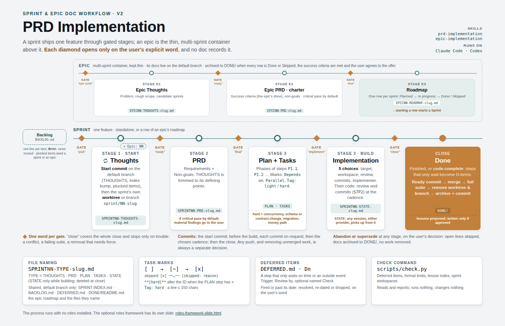
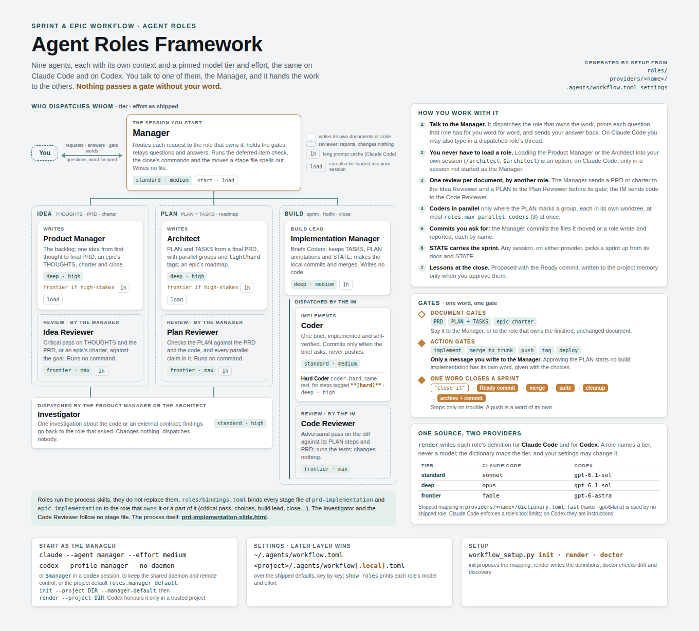

# AI Skills

Skills, roles, a rule and a setup tool for AI coding agents, written once and installed
for both [Claude Code](https://code.claude.com/docs/en/skills) and
[Codex](https://developers.openai.com/codex/skills). One clone is the source; every
provider home links to it.

This is version 2. Version 1, two rule files and an agent file beside the skills, is at
the tag `v1.0`; [Moving from v1](#moving-from-v1) says how to get from there to here.

## Layout

| Path | Holds |
|------|-------|
| `prd-implementation/`, `epic-implementation/` | The sprint and epic process as two skills: a short entry file and, in `references/`, the files it points to: one or two for each stage, the conventions and completion; for the sprint also the state file, deferred items, backlog and deferred conversion, abandoning a sprint, and one file for each provider. |
| `project-memory/` | The lessons a project keeps, as a skill: the entry file and, in `references/`, the format of the index and of a lesson file, a lesson's lifecycle, and how a project gets both providers to load its `AGENTS.md`. |
| `csv-tools/`, `json-tools/`, `self-reflection/`, `usage-cost/` | Skills. A skill is a directory at the root that holds `SKILL.md`. |
| `multiagent-collab/` | A skill with its own setup, protocol file, hooks and tests. |
| `roles/` | The sources of the nine roles: `<role>/ROLE.md` and `<role>/role.toml`, the sections roles share in `_shared/`, and `bindings.toml`, which says which role follows which stage of the process. Format: [`roles/README.md`](roles/README.md). A project's own specialist: [`roles/SPECIALISTS.md`](roles/SPECIALISTS.md). |
| `rules/` | `avoid-bash-injection-heuristics/`, a rule for Claude Code: how to shape a Bash command so that the permission checks that ignore the allowlist do not fire. Codex has no place for a rule. |
| `providers/` | What differs between providers, in `claude-code/` and `codex/`: `dictionary.toml` (what the tiers and effort names mean there, and the version it was checked on) and `actions.md` (how a role's actions are done there). |
| `tools/` | `setup/`: the setup tool, `workflow_setup.py`, with its package `wfsetup/`, its shipped defaults (`defaults.toml`) and tests; `manifest-keys.json`, the keys setup may change in a settings file; `v1-known-hashes.json`, the hashes of the committed v1 files, and `build_v1_hashes.py`, which builds it. `session-profile/`: prints the role, model and effort a provider recorded for each agent of a session. |
| `docs/` | [`agent-roles-framework.md`](docs/agent-roles-framework.md): the design of the roles and what was checked on each provider. [`v1-to-v2.md`](docs/v1-to-v2.md). Two one-page slides, each with a `-preview.png` beside it: [`prd-implementation-slide.html`](docs/prd-implementation-slide.html), the process, and [`roles-framework-slide.html`](docs/roles-framework-slide.html), the roles; see [The slides](#the-slides). `memory/`: this repository's own lessons, indexed in `AGENTS.md`. |
| [`AGENTS.md`](AGENTS.md) | The repository's conventions. Both providers read it; there is no `CLAUDE.md`. |

### What each skill is for

| Skill | For | Providers |
|-------|-----|-----------|
| [`prd-implementation`](prd-implementation/SKILL.md) | A sprint in stages with explicit gates: backlog, THOUGHTS, PRD, PLAN and TASKS, implementation, archiving. | Claude Code, Codex |
| [`epic-implementation`](epic-implementation/SKILL.md) | An effort of several sprints: EPIC THOUGHTS, the charter, the roadmap, its sprints, archiving. | Claude Code, Codex |
| [`project-memory`](project-memory/SKILL.md) | Lessons kept in the project: an index of one line per lesson in the project's `AGENTS.md`, one file per lesson, a git-ignored local folder; proposed, and written only on the user's approval. | Claude Code, Codex |
| [`json-tools`](json-tools/SKILL.md) | Inspect, query and transform JSON files with local scripts (Python or Node, no dependencies). | Claude Code, Codex |
| [`csv-tools`](csv-tools/SKILL.md) | The same for CSV files. | Claude Code, Codex |
| [`self-reflection`](self-reflection/SKILL.md) | A review of the finished conversation that reports only what would change future work. Runs only when asked for. | Claude Code, Codex |
| [`usage-cost`](usage-cost/SKILL.md) | Claude Code usage and list-price cost over a window, from Claude Code's own session logs. | Claude Code |
| [`multiagent-collab`](multiagent-collab/SKILL.md) | An owner and an adversarial reviewer across Codex and Claude, through a shared filesystem baton. | Claude Code, Codex |

## Installation

There are two installers. The collaboration skill, `multiagent-collab`, has its own,
described after the quick start; the setup tool leaves that skill alone, whatever is at its path.
Everything else (the other seven skills, the rule and the roles) is installed by the setup
tool: [Quick start](#quick-start) gives the steps for each kind of machine, and
[Skills](#skills) below says what each command does. The two may use one clone or two:
`doctor` reports a collaboration skill linked from another clone as information, not as a
fault.

### Quick start

You need git, Python 3.11 or later, and at least one provider: Claude Code, the Codex CLI
or both. Setup installs for each provider it finds installed (its program is on `PATH`, or
its home exists). It uses the Python standard library alone, so there is nothing to
`pip install`. A dry run writes nothing, a second run with nothing to change plans nothing,
and `uninstall` takes an install back. `multiagent-collab` is optional and has its own
installer, in the next section.

| Your machine | Steps |
|--------------|-------|
| Linux, macOS, or WSL used on its own (nothing on the Windows side uses these skills) | [Linux, macOS, or WSL alone](#linux-macos-or-wsl-alone) |
| Windows, with the providers installed in Windows and no WSL in use | [Windows](#windows) |
| Windows and WSL on one machine, the providers used from both | [Windows and WSL together](#windows-and-wsl-together) |

Then, on any machine: install [the process alone, without roles](#the-process-alone-without-roles),
or the roles as well, now or [later](#adding-roles-later). The steps below install the
roles.

#### Linux, macOS, or WSL alone

On WSL with the clone inside WSL's own file system, allow that clone once, before
`render`: see "WSL used alone" below the commands.

```bash
git clone https://github.com/yzaremba/ai-skills.git ~/workspace/ai-skills
cd ~/workspace/ai-skills
python3 --version                                     # 3.11 or later
python3 tools/setup/workflow_setup.py homes           # reads only: the homes it would handle
python3 tools/setup/workflow_setup.py render --dry-run
python3 tools/setup/workflow_setup.py render
python3 tools/setup/workflow_setup.py doctor
```

- **Where to clone.** `~/workspace/ai-skills` is the recommended place, and the one the
  `multiagent-collab` section uses, so that one clone serves both installers. Any other
  directory that stays works too. Every link setup makes leads into the clone, so moving
  or deleting the clone breaks the install
  (`uninstall --help` says how to take back an install whose clone moved, with
  `--clone-was`).
- **What `render` does.** It links each skill into `~/.claude/skills` and, for Codex,
  `~/.agents/skills`; links the rule into `~/.claude/rules`; and generates the role
  definitions and the entry points of a session, which its output lists under "entry
  points". `doctor` checks all of it and writes nothing; exit code 1 means an error. It
  starts the providers' programs (`--version`, Codex's model list), which may write state
  of their own into their homes.
- **WSL used alone.** Setup sees WSL as one side of a Windows machine and, by default,
  refuses a clone that the Windows side cannot read, which is any clone inside WSL's own
  file system. Where nothing on the Windows side uses these skills, allow it once: `init`
  asks, on such a clone, and `--allow-unshared-clone` answers. It writes
  `setup.allow_unshared_clone = true` in `~/.agents/workflow.toml` (the line can also be
  written by hand, under `[setup]`), and `render` and `doctor` then accept the clone on
  every run; `render` says which setting allowed it, and `doctor` reports the clone as
  information, not as an error:

  ```bash
  python3 tools/setup/workflow_setup.py init --allow-unshared-clone --dry-run
  python3 tools/setup/workflow_setup.py init --allow-unshared-clone
  python3 tools/setup/workflow_setup.py render --dry-run
  python3 tools/setup/workflow_setup.py render
  python3 tools/setup/workflow_setup.py doctor
  ```

  `init` asks its other questions as well; away from a terminal add `--yes`, which accepts
  what it proposes for them. For a single run instead, give `--allow-unshared-clone` to
  `render` or `doctor` (`doctor` then reports a warning). A clone on a Windows drive
  (`/mnt/c/...`) needs neither: that is
  [Windows and WSL together](#windows-and-wsl-together).
- **macOS is not tested.** The setup tool has no code of its own for macOS: it takes it
  as any POSIX system, with symbolic links and the homes `~/.claude`, `~/.codex` and
  `~/.agents`. No test run or gate recorded here was made on a Mac. Read the dry run and
  the `doctor` output before relying on it.
- **Settings, optional.** Without a settings file, the model each role runs on and the
  process settings are the shipped ones, and the model of each tier follows the shipped
  provider dictionaries: a `git pull` followed by `render` can change it. `init` writes
  `~/.agents/workflow.toml`: it asks which model each tier means for each installed
  provider, and the process, roles and memory settings, shows what it will write, and
  keeps the models you confirmed until you run it again. Run `render` after it:

  ```bash
  python3 tools/setup/workflow_setup.py init --dry-run
  python3 tools/setup/workflow_setup.py init
  python3 tools/setup/workflow_setup.py render
  ```

  It asks on a terminal only. Elsewhere (an agent session, a pipe) give `--yes`, which
  accepts what is proposed, or the answer flags `init --help` lists.
- **On Codex: `render --apply-codex-settings`.** Codex's default sandbox keeps `.git`
  read-only, so a commit or a worktree needs approval command by command; and with no
  limit set Codex was seen to allow four agents, the main session counted, which is fewer
  than the Manager, the Implementation Manager and three parallel Coders; and an agent that
  waits with a short timeout wakes again and again, each time reading its whole context.
  With this option `render` writes, in marked blocks of your Codex `config.toml`,
  `agents.max_concurrent_threads_per_session = 8`; a wait floor,
  `[features.multi_agent_v2]` with `min_wait_timeout_ms = 300000` and
  `default_wait_timeout_ms = 3600000`, so that Codex raises a shorter wait to five minutes;
  and a permission profile, `workflow`
  (permission profiles are beta in Codex), that makes `.git` writable. `--worktree-root DIR`
  also makes the directory your worktrees are made under writable, and
  `--default-codex-permissions` writes the profile and selects it. Codex 0.163.0 refuses to
  load a config that defines a profile and sets no `default_permissions`, so without the
  option the profile is written, unselected, only where your file sets
  `default_permissions` itself, and is otherwise printed as text. While the file sets
  `sandbox_mode` no profile is written, and a file that defines `features.multi_agent_v2`
  itself gets no floor: its values are reported and the lines to add are printed. It helps
  the process alone too: its sprint worktree and commits meet
  the same sandbox ("The sprint worktree" in `prd-implementation/references/codex.md`).
  `doctor --only codex-settings` says what the option would do, and
  `render --remove-codex-settings` takes it out; more under "Git on Codex" in
  [Limits known so far](#limits-known-so-far).
- **A project.** Nothing is written into a project unless it is named.
  `render --project DIR` writes there what the project's settings ask for, such as the
  Manager as the default of every session: "A project" under [Using it](#using-it).

#### Windows

In PowerShell:

```powershell
git clone https://github.com/yzaremba/ai-skills.git $HOME\workspace\ai-skills
cd $HOME\workspace\ai-skills
py -3 --version                                       # 3.11 or later
py -3 tools/setup/workflow_setup.py homes
py -3 tools/setup/workflow_setup.py render --dry-run
py -3 tools/setup/workflow_setup.py render
py -3 tools/setup/workflow_setup.py doctor
```

- **The interpreter.** `py -3` is the Python launcher; `python` does as well where it runs
  Python 3.11 or later.
- **Links are directory junctions.** On Windows setup links each skill and the rule as a
  directory junction, which needs neither Developer Mode nor an administrator; a symbolic
  link would need one of the two.
- **The clone is on a local drive.** A junction leads only to a directory on a local
  drive, so `render` refuses a clone on a network drive or under a UNC path. Your user
  profile, as in the example, is on a local drive.
- **The homes** are `.claude`, `.codex` and `.agents` in your user profile, or where
  `CLAUDE_CONFIG_DIR` and `CODEX_HOME` point.
- **What was checked.** The setup tool's tests pass under a Windows Python. Run natively
  on Windows, `doctor --prove-discovery` showed Claude Code and Codex reading every skill
  through the junctions: "Native Windows" under [Limits known so far](#limits-known-so-far).
- Settings, a project and, on Codex, `render --apply-codex-settings` work as in the Linux
  steps, with `py -3` for `python3`.

#### Windows and WSL together

Where Claude Code or Codex is used both from Windows and from inside WSL, each side has its
own homes (`.claude` in your Windows user profile, `~/.claude` in WSL, and so on), and each
side's homes are installed from that side. By default both link to one clone on a Windows
drive, so that one `git pull` reaches both: the clone of the Windows steps,
`$HOME\workspace\ai-skills`, which WSL reads through its mount as
`/mnt/c/Users/<you>/workspace/ai-skills`. A Windows install made by those steps therefore
needs no new clone when WSL is added. Clone, and install the Windows side, in PowerShell:

```powershell
git clone https://github.com/yzaremba/ai-skills.git $HOME\workspace\ai-skills
cd $HOME\workspace\ai-skills
py -3 tools/setup/workflow_setup.py render --dry-run
py -3 tools/setup/workflow_setup.py render
py -3 tools/setup/workflow_setup.py doctor
```

Then the WSL side, from the same clone, in a WSL shell:

```bash
cd /mnt/c/Users/<you>/workspace/ai-skills
python3 tools/setup/workflow_setup.py render --dry-run
python3 tools/setup/workflow_setup.py render
python3 tools/setup/workflow_setup.py doctor
```

- **Each side writes its own places.** `homes`, on either side, prints which places that
  side writes. A place whose real path is on the other side (a WSL home that links its
  `CLAUDE.md` into the Windows home, for example) is skipped there and written by the run
  on the other side. So `render` runs on both sides, the first time and after a pull.
- **Order.** Either side first, unless a v1 install is present: then Windows first and WSL
  straight after, as [Moving from v1](#moving-from-v1) says.
- **Settings.** Each side has its own `~/.agents/workflow.toml`: run `init` on each side
  where you want one.
- **Pull that clone with Windows git.** Git run from WSL on a clone under `/mnt/c` can
  show every file as modified.
- **Any other location** on a local Windows drive works the same way, read from WSL under
  `/mnt/<drive>/`.
- **Two clones instead.** `--allow-unshared-clone` installs a side from a clone that only
  that side can read, such as a clone inside WSL's file system. Without it, as
  `render --help` puts it, "every home links to one shared clone". With two clones each
  side links to its own: a pull in one does not reach the other, keeping both at the same
  commit is yours to do, and the side whose clone the other cannot read allows it once,
  with `init --allow-unshared-clone` on that side (or the option on each run), as in
  "WSL used alone" above.

#### The process alone, without roles

`prd-implementation` needs no role, nor do `epic-implementation` and `project-memory`. To
install the skills and the rule and no role, say so once, then render (with `py -3` on
Windows, and with the clone allowed where your case above needs it):

```bash
python3 tools/setup/workflow_setup.py init --no-roles --dry-run
python3 tools/setup/workflow_setup.py init --no-roles
python3 tools/setup/workflow_setup.py render --dry-run
python3 tools/setup/workflow_setup.py render
python3 tools/setup/workflow_setup.py doctor
```

- **What you get.** Every skill linked for each provider it names (`usage-cost` is for
  Claude Code only), and the rule on Claude Code, as above. `init --no-roles` writes
  `roles.enabled = false` in `~/.agents/workflow.toml` (or write that line yourself, under
  `[roles]`), and every later `render` installs the process alone: no role definition and
  no entry point, in a home or a project. Its output says the roles are off and which file
  turned them off. A run removes the roles an earlier run generated, and keeps one that
  was edited by hand. `init` asks its other questions as well; away from a terminal add
  `--yes`.
- **A project rendered with roles before.** A `render` without `--project` writes nothing
  in a project, and setup keeps no list of the projects it rendered. Such a project keeps
  its starting role (`"agent"` in `.claude/settings.json` and setup's block in
  `.codex/config.toml`), which names a definition the home no longer has: run
  `render --project DIR` for each one to take it out. `render` and `doctor` say so while
  the roles are off.
- **For a single run.** `render --no-roles` does the same for that run alone, whatever
  the setting says; the next `render` without it follows the setting again.
- **How you use it.** In any session in the project, the skill loads when a request
  matches its description ("start a sprint", "write the PRD", "implement P1.2") or a sprint
  doc is read or edited, or when it is named: `/prd-implementation` on Claude Code,
  `$prd-implementation` on Codex. One session runs every stage and stops at every gate for
  your word. In implementation it is the build lead: by default it hands each step to a
  separate agent it starts (or implements inline, if you say so or none can be
  started) and has the code reviewed by an agent that did not write it, at the cadence you
  choose; `prd-implementation/references/claude-code.md` and `codex.md` say how on each
  provider.
  The settings still apply: `process.docs_dir` (where the sprint docs live, `docs` by
  default), `process.questions`, `process.recommend` and `memory.dir`, written by `init`,
  or by `init --project DIR` for one project.
- **What you give up.** What the roles add: a model and effort pinned to each kind of work
  (the shipped profiles put the reviewers on the frontier tier, a Coder on the standard
  one); a reviewer other than the author for the PRD and the PLAN (alone, the session that
  writes the PRD makes its critical pass itself, while the code is reviewed by a fresh
  agent either way); the limits a definition enforces on Claude Code, such as a reviewer
  or a Manager with no editing tool (the Manager keeps a shell, so writing no file through
  it is an instruction); a Manager that routes each request and holds the gates; and a
  fresh context for each document. With one session, its model and its context serve
  every stage.
- **Without the setup tool.** The process skills work without it: a skill reaches no path
  outside its own directory except the setup tool beside it, and works where that is
  missing. A skill directory can be linked by hand into each provider's skills directory:

  ```bash
  mkdir -p ~/.claude/skills ~/.agents/skills
  ln -s ~/workspace/ai-skills/prd-implementation ~/.claude/skills/prd-implementation   # Claude Code
  ln -s ~/workspace/ai-skills/prd-implementation ~/.agents/skills/prd-implementation   # Codex
  ```

  On Windows the link is a junction:
  `New-Item -ItemType Junction -Path $HOME\.claude\skills\prd-implementation -Target $HOME\workspace\ai-skills\prd-implementation`,
  and the same for `$HOME\.agents\skills`; `epic-implementation` and `project-memory` are
  linked the same way. A linked skill finds the clone through its link
  and reads the settings files as with setup. A copy has no setup tool beside it: its
  scripts use the built-in defaults and read no settings file. Setup did not make such a
  link, so `render` stops on it as a conflict, and names it: remove the links you made
  before the first `render`.

#### Adding roles later

Turn the roles on with `init --roles`, which takes `roles.enabled = false` out of
`~/.agents/workflow.toml` (or set it to `true` there yourself), then run `render`. It
generates the role definitions and the entry points beside the skills already linked.
The same `init` run sets which model each tier means. There is no `render` option that
turns the roles on against the setting: what one run generated, the next would remove.
Then a session starts as the Manager:

| | Claude Code | Codex |
|-|-------------|-------|
| A session started as the Manager | `claude --agent manager --effort medium`; `render` prints the command with the effort your settings give, under "entry points" | `codex --profile manager --no-daemon` |
| The Manager loaded into a session | `/manager` | `$manager` |
| Every session in a project starts as the Manager | `init --project DIR --manager-default`, then `render --project DIR` | The same; Codex reads the project's `.codex/config.toml` only in a trusted project |

On Codex `--profile` always runs the session embedded, without the shared app-server
daemon; `--no-daemon` only states that and silences Codex's warning ("--profile requires
embedded mode"). The flag was checked on Codex CLI 0.160.0 and 0.163.0. Which to use: the
profile pins the Manager's model and effort, but its session is not on the daemon that
`codex remote-control` manages, so `codex agents` does not list it and it has no remote
control. To keep the daemon and remote control, start `codex` in the project and type
`$manager`: the loaded Manager names its pinned model and effort, and `/model` switches
to them.

The Manager routes each request to the role that owns it: [Using it](#using-it) lists the
nine roles and what each does. `init --no-roles` goes back to the process alone, and
`render --no-roles` for one run; then run `render --project DIR` for each project
rendered with roles, to take out its starting role. A project can turn its own roles off with
`init --project DIR --no-roles`; it gets roles only where the home has them. On
Codex, see `render --apply-codex-settings` in the Linux steps: with roles, a parallel group
needs more agents than Codex allows with no limit set.

### `multiagent-collab` for Codex and Claude

This skill needs its setup utility; cloning it directly into one agent's discovery
directory is not enough. Prerequisites are Python 3, Codex CLI, and Claude Code.
The workflow below is locally verified with `codex-cli 0.154.0`. Current OpenAI
documentation identifies `$HOME/.agents/skills` as Codex's user skill location and
supports symlinked skill folders; behavior of other Codex versions should be
verified with the included doctor command. See the official
[Codex skills](https://developers.openai.com/codex/skills) and
[hooks](https://developers.openai.com/codex/hooks) documentation.

Keep one persistent clone, inspect the planned changes, then install for both
agents:

```bash
git clone https://github.com/yzaremba/ai-skills.git ~/workspace/ai-skills
cd ~/workspace/ai-skills
python3 multiagent-collab/scripts/multiagent_collab.py setup --agent both --dry-run
python3 multiagent-collab/scripts/multiagent_collab.py setup --agent both
```

The defaults are home `~` and chat root `~/workspace/chat`. To change them, pass
`--home PATH` and `--chat-root PATH` to both setup invocations. Setup preserves
unrelated configuration, records backups below `<chat-root>/_backups/`, and never
claims or removes the shared `~/.agents` or `~/.agents/skills` directories.

Setup installs session hooks but does not start agents or opt sessions in. Restart
Codex and Claude. In Codex, open `/hooks`, review the exact user hook, and trust its
current hash. Then give each agent this instruction in its own session:

```text
Use $multiagent-collab. Bind this session to ~/workspace/chat and verify wake delivery.
```

Claude will ask you to keep its printed `tail -n 0 -F .../monitor.inbox` Monitor
running. Each agent sends a nonce through its real wake transport and verifies the
nonce returned to the session. When both are ready, check the installation:

```bash
cd ~/workspace/ai-skills
python3 multiagent-collab/scripts/multiagent_collab.py doctor --agent both --require-binding
```

Start work from either bound agent; the initiating agent becomes owner and the other
becomes reviewer:

```text
Use $multiagent-collab. Start a task for: <describe the work and completion condition>.
```

For upgrades, first ask both live agents to `release` their bindings. A live
same-session `rebind` is intentionally a no-op and does not reload upgraded watcher
code. Update the persistent clone, review the protocol hash if it changed, and rerun
setup:

```bash
cd ~/workspace/ai-skills
git pull --ff-only
sha256sum ~/workspace/chat/PROTOCOL.md multiagent-collab/assets/PROTOCOL.md
python3 multiagent-collab/scripts/multiagent_collab.py setup --agent both --dry-run --upgrade-protocol-from APPROVED_CURRENT_SHA256
python3 multiagent-collab/scripts/multiagent_collab.py setup --agent both --upgrade-protocol-from APPROVED_CURRENT_SHA256
```

Restart both agents, then use `bind` again, repeat the nonce proofs, and rerun doctor.
Never use `--upgrade-protocol-from` until the displayed current hash and replacement
were reviewed and approved. Setup verifies real Codex discovery with the offline
`codex debug prompt-input` command; if that probe is unavailable, it warns and does
not remove a working legacy discovery link.

To remove the managed integration while preserving protocols, tasks, backups, and
archives:

```bash
cd ~/workspace/ai-skills
python3 multiagent-collab/scripts/multiagent_collab.py uninstall --agent both --dry-run
python3 multiagent-collab/scripts/multiagent_collab.py uninstall --agent both
```

### Skills

The setup tool, `tools/setup/workflow_setup.py`, installs the skills, the rule and the
roles. [Quick start](#quick-start) gives the steps for each kind of machine; this section
says what each command does. It needs Python 3.11 or later and nothing outside the
standard library. Below, `python` stands for your interpreter: `python3` on Linux, macOS
and WSL, `py -3` on Windows. Where `python` is a project's virtual environment, use a
system interpreter.

The provider dictionaries were checked on 2026-10-11 against these versions; `doctor`
warns of a version newer than the one checked or older than the oldest supported:

| Provider | Checked on | Oldest supported |
|----------|------------|------------------|
| Claude Code | 2.1.296 | 2.1.281 |
| Codex CLI | 0.162.1 | 0.160.0 |

On Claude Code the fast tier is the `haiku` alias, which is Haiku 5.5 with effort levels
from 2.1.293 on; an older client runs a fast-tier role on Haiku 4.5, which has none.

Setup installs for each provider that is installed (its program is on `PATH`, or its
home exists). It writes only inside the provider homes (`~/.claude`, `~/.codex`, or
where `CLAUDE_CONFIG_DIR` and `CODEX_HOME` point), `~/.agents`, and a project named with
`--project`; never inside the clone, and never at a credentials file. It backs up every
file it replaces or removes, under `~/.agents/workflow-setup/backups/`, and `uninstall`
puts back what was there. A project has its own backups, install record and lock, under
`DIR/.agents/workflow-setup/`.

**The clone.** Every home links into the clone, so the clone stays where it is. On a
machine with a Windows side and a WSL side, `render` refuses a clone that both sides
cannot read, unless the setting `setup.allow_unshared_clone = true` in
`~/.agents/workflow.toml` allows it on every run (`init --allow-unshared-clone` writes
it), or `--allow-unshared-clone` for one run. `doctor` reports such a clone as an error,
as information where the setting allows it, and as a warning with the option. On a Linux
with no Windows side the question is not asked. Native Windows takes a clone on a local drive, where a junction can
lead. [Windows and WSL together](#windows-and-wsl-together) has the shared clone, and
[Linux, macOS, or WSL alone](#linux-macos-or-wsl-alone) the option for WSL used alone.

**The commands**, in the order of a first install, from the root of the clone; where
Windows and WSL both use the providers, once on each side. Where a v1 install is present,
read [Moving from v1](#moving-from-v1) first.

```bash
python tools/setup/workflow_setup.py homes
python tools/setup/workflow_setup.py init --dry-run
python tools/setup/workflow_setup.py init
python tools/setup/workflow_setup.py render --dry-run
python tools/setup/workflow_setup.py render
python tools/setup/workflow_setup.py doctor
```

- `homes` only reads: it prints the homes this side would handle and whose each place
  is. A place whose real path is on the other side is skipped here and written by the
  run on that side.
- `init` writes `~/.agents/workflow.toml`: which model each tier means and which value
  each effort name means, for each installed provider, and the process, roles and memory
  settings. It is optional: without the file the shipped defaults and the provider
  dictionaries apply. It asks, proposes the value in effect, and shows the mapping before
  it writes. It asks on a terminal only. Where standard input is not one (an agent session,
  a pipe) a question without an answer stops the run and names its flag: give `--yes`,
  which accepts what is proposed, or the answer flags (`--tier`, `--effort` and the
  others `init --help` lists). This holds for `--dry-run` and for `init --project DIR`
  too. `--yes` does not rewrite a settings file written or edited by hand; that takes
  `--rewrite-settings` as well. For Codex it checks the mapping against
  `codex debug models`, also with `--dry-run`: a program of the provider's, which may
  write state of its own into the provider's home. Two of its questions are choices
  `render` would otherwise need an option for on every run: whether the roles are
  installed (`--roles`, `--no-roles`), and, asked only where this side's clone is one the
  other side cannot read, whether to accept it (`--allow-unshared-clone`; proposed: no).
- `render` links each skill into the skills directory of each provider it names
  (`~/.claude/skills`, and `~/.agents/skills` for Codex), links the rule into
  `~/.claude/rules`, and generates the role definitions and the entry points of a
  session. One conflict (a file, a directory or a foreign link where a link would go)
  stops the run before anything is written. Exit code 3 means the rest was done and
  something was skipped or kept that an option would change; the output names each.
  With `roles.enabled = false` (`init --no-roles`) every `render` installs the skills and
  the rule without any role; `render --no-roles` does so for one run. A project rendered
  with roles before keeps its starting role until `render --project DIR` takes it out.
- `doctor` checks the sources, what setup wrote and the providers, and writes nothing.
  Exit code 1 means an error. It starts provider programs (`--version`, the model list,
  offline discovery commands) and the collaboration skill's own doctor; a provider's
  program may write state of its own into its home. Only `doctor --prove-discovery`
  starts a session with a model, one for each provider, and that spends quota. Codex's
  role definitions stay unproven after it, and are then a warning: see
  [Limits known so far](#limits-known-so-far).

Read each dry run before the real run, and run one command at a time; every command's
`--help` states exactly what it does. `uninstall --dry-run` and `uninstall` take an
install back. A home that holds a v1 install is migrated in the same `render`: see
[Moving from v1](#moving-from-v1). Without the option named there, `render` stops on a
v1 copy that is in the way of a link. With it the run still stops on a copy in the way
that setup keeps: one edited by hand until `--remove-stale` names it, and a clone or a
copy it cannot read until it is moved away.

## What a `git pull` in the clone does

- **Skills and the rule change at once**, in every home that links to the clone: each is a
  link into the clone, and no home holds a copy.
- **Generated files change at the next `render`**: the role definitions, the loaded-role
  skills, the Codex profile file, and what a project got. They are made from the role
  sources and the settings. Until then the `drift` check of `doctor` reports each one as
  a warning. Run `render` after a pull, on each side where Windows and WSL share the
  clone; with nothing to change it plans nothing and says so. The process alone and a
  clone only one side reads are settings (`roles.enabled`, `setup.allow_unshared_clone`)
  that every run reads, so no option needs repeating.
- **The models stay as confirmed.** The tier and effort mapping in
  `~/.agents/workflow.toml` does not follow a new dictionary; it changes when `init` is
  run again. Without that file the mapping is the shipped dictionaries', and a new
  dictionary takes effect at the next `render`.

## Moving from v1

A v1 install left two import lines in the user-level `CLAUDE.md`, rule copies, loose
skill copies and the `sprint-coder` agent in the homes. `doctor` reports each as an
error until it is gone. `render` removes them with `--migrate-v1`, always with a dry run
first:

```bash
python tools/setup/workflow_setup.py render --migrate-v1 --dry-run
python tools/setup/workflow_setup.py render --migrate-v1
python tools/setup/workflow_setup.py doctor --only v1
```

What it removes, each after a backup:

- The lines `@rules/prd-implementation.md` and `@rules/epic-implementation.md` in the
  Claude Code `CLAUDE.md`, as whole lines. A marked block that points to the two skills
  is added at the end, and the Codex `AGENTS.md` gets the same block.
- The v1 rule files in the Claude Code rules directory, `agents/sprint-coder.md`, and
  the loose copies of the v1 skills in the skills directories, Codex's deprecated
  `<codex home>/skills` among them. A file goes only when its content is a committed
  version of the v1 file; a link only when it leads to such a copy or into this clone.

What it keeps and reports:

- A copy edited by hand, or a link it does not recognise. The exit code is then 3. The
  dry run prints `--remove-stale PATH` for each; add that option to remove the one
  named. The option works only with `--migrate-v1` and may be given more than once; a
  path the dry run did not name stops the run.
- A git clone inside a skills directory, which is never removed, with any option. Move
  it away yourself.
- A copy setup cannot read: on Windows, for example, a directory that holds a link made
  in WSL. `--remove-stale` does not apply to it: naming it there stops the run. Move it
  away by hand.

A clone or an unreadable copy does not by itself make the exit code 3. Any kept item
that is in the way of a link is a conflict: the run stops before anything is written,
with exit code 2, and `--migrate-v1` alone does not clear that. `doctor` reports every
kept item as an error until it is gone.

Projects are not migrated: a project whose `.claude/rules/` links to a removed rule copy
is left with a dangling link, and the run warns of it. On a machine where Windows and WSL
both use the providers, run Windows first, then WSL: with a v1 install that order is
required. Each run skips the
places the other side owns, so both are needed; where the WSL home links its `CLAUDE.md`
and rules into the Windows home, the Windows run is the one that changes them. Between
the two runs such a WSL home has no process rule and no v2 skill links yet: run the WSL
side straight after, and start no work there in between. `uninstall` puts back what the
migration removed. [`docs/v1-to-v2.md`](docs/v1-to-v2.md) says, section by section, where each
v1 rule went.

## Using it

**The process.** Both providers load a skill when a request matches its description:
"start a sprint", "write the PRD", "plan an epic". A skill can also be named:
`/prd-implementation` on Claude Code, `$prd-implementation` on Codex. `self-reflection`
runs only when named. The process names no role and needs none: with
`roles.enabled = false` `render` installs it alone, as
[The process alone, without roles](#the-process-alone-without-roles) says.

**Roles.** A role is an agent with its own instructions, a pinned model tier and effort,
and limits. Nine are shipped. A specialist (operations, data research, a release) is a
project's own agent and none is shipped: [`roles/SPECIALISTS.md`](roles/SPECIALISTS.md)
says how a project defines one.

| Role | What it does | Claude Code | Codex |
|------|--------------|-------------|-------|
| Manager | The session the user starts: routes requests, holds the gates, runs the commands of a sprint's close and, on the user's word, a move, rename or deletion of a whole file that a stage file gives as a command, writes no file. | `claude --agent manager --effort medium`, or `/manager` in a session | `codex --profile manager --no-daemon`, or `$manager` in a session |
| Product Manager | Keeps the backlog and develops one idea with the user into THOUGHTS and a PRD, or an epic's charter. | Dispatched by the Manager, which relays its questions; the user may also type in its thread. Or loaded: `/product-manager` | Dispatched by the Manager, which relays its questions. Or loaded: `$product-manager` |
| Idea Reviewer | The critical pass on THOUGHTS and a PRD or a charter. Reads, and changes nothing. | Dispatched by the Manager | Dispatched by the Manager |
| Architect | Turns a final PRD into PLAN and TASKS, and a final charter into the epic's roadmap. | Dispatched by the Manager, which relays its questions; the user may also type in its thread. Or loaded: `/architect` | Dispatched by the Manager, which relays its questions. Or loaded: `$architect` |
| Plan Reviewer | Checks a PLAN against its PRD and the code. Reads, and changes nothing. | Dispatched by the Manager | Dispatched by the Manager |
| Implementation Manager | The build lead of a sprint or a hotfix: briefs Coders, keeps TASKS, the PLAN's annotations and STATE, makes the local commits and merges. Writes no code. | Dispatched by the Manager | Dispatched by the Manager |
| Coder | Implements one brief and verifies it. A second definition, `coder-hard`, has a higher profile. | Dispatched by the Implementation Manager | Dispatched by the Implementation Manager |
| Code Reviewer | The adversarial pass on a code change. Runs the tests, and changes nothing. | Dispatched by the Implementation Manager | Dispatched by the Implementation Manager |
| Investigator | One investigation another role needs, with its findings returned to that role. Changes nothing. | Dispatched by the Product Manager or the Architect | Dispatched by the Product Manager or the Architect |

Loading a role suspends any other, and does not switch the session's model: the role
says which model and effort it is meant for, and the user switches with `/model` and
`/effort` on Claude Code, `/model` on Codex. On Codex, start the session at the project
root. On Claude Code a session started as the Manager (`--agent manager`, or the project
default) has no tool that changes a file, whatever is loaded into it: there a role that
writes is dispatched, and loading one is for a session not started as a role.

On Claude Code a role's pinned effort applies when the role is dispatched as a subagent.
By Claude Code's documentation, a session started as the Manager takes the definition's
prompt, tools and model, and runs at the session's own effort: `--effort`, `/effort` or
the `effortLevel` setting, and failing those the model's default. So the Manager's effort
is given beside the role: at launch with `--effort` (`render` prints the command with the
level the settings resolve, under "entry points"), and as a project default with
`effortLevel`, below. A session record on Claude Code 2.1.296 showed a Manager started
plainly in a project with `effortLevel` set to `medium` run at medium on every turn; that
`--effort` at launch does the same is read from the documentation and not yet shown.

**Roles and your own workflow.** The roles are built on the two process skills, and do
not adapt to another process by themselves. `roles/bindings.toml` gives every stage file
of `prd-implementation` and `epic-implementation` to a role, and `validate` fails a stage
file that has no row. A role's definition carries its rows and tells it to take no part in
a stage with no row. The role texts speak of this process's documents: THOUGHTS, the PRD,
PLAN and TASKS, STATE, the close. The Product Manager, the Architect, the Implementation
Manager and the Coder follow the installed process skills, and say so when one is missing.
What works in a project that keeps no sprint docs:

- A light question, which the Manager answers itself when no file is written and a few
  lookups suffice.
- A hotfix. The Manager routes it to the Implementation Manager with your request as its
  spec, and there "the sprint process does not apply: no sprint document, no STATE". A
  Coder implements it from its brief, and the Code Reviewer reviews it against the brief's
  text.
- A project's own specialist ([`roles/SPECIALISTS.md`](roles/SPECIALISTS.md)), which
  follows no stage file.

What does not: everything before the code. An idea or a feature goes to the Product
Manager, which writes THOUGHTS and a PRD; a plan is the Architect's PLAN and TASKS, once
the PRD has passed its gate; the reviewers review those documents. The Manager writes no
file, and does not do work whose role is not installed. The settings change how the
process runs, not what it is: where its docs live (`process.docs_dir`), how questions are
put (`process.questions`, `process.recommend`), each role's tier and effort
(`[roles.<id>]`, `roles.high_stakes`), how many Coders work at once
(`roles.max_parallel_coders`), whether a project's sessions start as the Manager, and where
lessons go (`memory.dir`). Fitting the roles to another workflow is a fork: a process skill
of your own (one `references/stage-*.md` makes a skill a process skill, and then every
`.md` file directly in its `references/` but `conventions.md`, `claude-code.md` and
`codex.md` is a stage file that `validate` requires a row for); rows in
`roles/bindings.toml` that give each stage file to a role; and the role texts, the Manager's routing table among them, rewritten where they
name this process's documents and skills. Then `validate` and `render`.

**Project memory.** The `project-memory` skill keeps a project's lessons: one line each
in a marked block of the project's `AGENTS.md`, one file each under `memory.dir`
(`docs/memory` by default). A lesson is proposed, at a sprint's close or when it is
learned, and written only on the user's approval. The index reaches a session only where
the provider loads that `AGENTS.md`; `doctor --project DIR` checks it, see
"Checking a project" below.

**A project.** Nothing is written in a project unless it is named. To make every session
in a project start as the Manager:

```bash
python tools/setup/workflow_setup.py init --project DIR --manager-default
python tools/setup/workflow_setup.py render --project DIR --dry-run
python tools/setup/workflow_setup.py render --project DIR
```

`init --project DIR` writes `DIR/.agents/workflow.toml` and puts
`.agents/workflow.local.toml` into the project's ignore block in `DIR/.gitignore`. Away
from a terminal it needs `--yes` or the answer flags, like any `init`. What makes the
Manager the project default is the setting `roles.manager_default = true`; the flag
`--manager-default` sets it. `render --project DIR` refreshes the homes as without the
option, and in the project, with that setting, sets `"agent"` and `"effortLevel"` in
`DIR/.claude/settings.json` and writes a marked block at the head of
`DIR/.codex/config.toml`. `effortLevel` is the Manager's effort as the project's
settings resolve it. Both keys go by the same rules: no other key is touched, a value
setup did not set is kept and reported with exit code 3 until `--overwrite-edited`
replaces it after a backup, and turning the setting off, or `uninstall --project DIR`,
takes out what setup set and puts back what was there. The setting takes `low`,
`medium`, `high` and `xhigh`: for a Manager set to `max`, or on a model that takes no
effort, `effortLevel` is not written and the output says why. While `"agent"` has a
value that is not setup's and is kept, the project's sessions do not start as the
Manager, and setup leaves `effortLevel` alone: it sets none, and one it set earlier
stays as it is. A project's `effortLevel` applies to every Claude Code session in the
project, whatever it starts as. It also
writes a role definition for each role the project's
settings change, and lists what it generated in `DIR/.gitignore`. Setup's backups,
install record and lock for the project are in `DIR/.agents/workflow-setup/`, a
directory it creates in DIR and lists in the same ignore block.

**Checking a project.** `doctor --project DIR` runs every check of `doctor` with the
project's settings and what `render --project DIR` wrote there, and one check that needs
a project, `instruction-files`: whether both providers load `DIR/AGENTS.md`, the file
that holds the project's lesson index. It writes nothing.

```bash
python tools/setup/workflow_setup.py doctor --project DIR
python tools/setup/workflow_setup.py doctor --project DIR --only instruction-files
```

| Finding | When |
|---------|------|
| Error | A `CLAUDE.md`, `.claude/CLAUDE.md` or `CLAUDE.local.md` is in DIR or in a directory above it, and neither remedy is in place. Claude Code (2.1.277 or later; every kind of session from 2.1.281) reads `AGENTS.md` directly only while none of the three is there. The user's own `CLAUDE.md`, the one that lies in the Claude Code home, does not count; a file elsewhere that is a link to it does. |
| Error | `DIR/AGENTS.md` is over the 4 MiB above which Claude Code skips an instruction file: it is not loaded, whatever imports it. |
| Warning | A `CLAUDE.md` of the three, or the user's own, is over 4 MiB: Claude Code skips it, `doctor` does not open it, and an import in it is no remedy. |
| Warning | A file Claude Code loads here is over three quarters of those 4 MiB. |
| Warning | The setting is `"claude-md-and-agents-md"` under the id `cc-plugin-agents-md@builtin` alone. It is counted as the remedy, and Claude Code before 2.1.285 ignores that id. |
| Warning | The setting has different values under its two ids. It is not counted as a remedy; the line names both values. |
| Warning | The setting is `"managed-only"`: Claude Code loads the organization's instructions alone, and `AGENTS.md` is not loaded, import or not. |
| Warning | The setting is `"claude-md"` and none of the three files imports `AGENTS.md`: Claude Code reads `CLAUDE.md` files only. |
| Warning | The user's `settings.json` cannot be read, or is not a JSON object. The setting is taken as unset. |
| Warning | DIR holds an `AGENTS.override.md` that is not empty. Codex takes one instruction file from a directory, the first that is not empty, and that one replaces the `AGENTS.md` beside it. |
| Info | DIR holds an empty `AGENTS.override.md`: it replaces nothing until it holds something. |
| Warning | The instruction files Codex loads, the one in its home and DIR's, are together over three quarters of its limit: 32 KiB, or `project_doc_max_bytes` in `~/.codex/config.toml` when that is set. |
| Warning | The same files are together at or over the limit. Codex stops adding files there, so the end of them is not loaded. |
| Warning | `project_doc_max_bytes` is 0: no instruction file is loaded on Codex. |
| Warning | `project_doc_max_bytes` is not a number of bytes. The sizes are measured against the default. |
| Info | DIR has no `AGENTS.md`, or a provider is not installed: nothing to check. |

The two remedies for the error: a line `@AGENTS.md` in one of the three files, its path
relative to the file that holds it (`@../AGENTS.md` in `.claude/CLAUDE.md`); or, in the
user's own `~/.claude/settings.json`,
`pluginConfigs."agents-md@builtin".options.instructionFiles` set to
`"claude-md-and-agents-md"`. Claude Code ignores that setting in a project's settings
files, and the error says so when it finds it there. `doctor` reads that one key of the
settings file and `project_doc_max_bytes` of the Codex config, and prints no other value
of either. It sees an import written in one of the three files, not one reached through
a second imported file, and not one in a code block, a code span or an HTML comment;
where it cannot tell whether a line is code, it finds no import. It takes DIR by its real
path. More in
[`project-memory/references/loading.md`](project-memory/references/loading.md).

**Settings.** Four layers, later wins: the shipped defaults, `~/.agents/workflow.toml`,
`DIR/.agents/workflow.toml` and `DIR/.agents/workflow.local.toml`.

```bash
python tools/setup/workflow_setup.py show
python tools/setup/workflow_setup.py show roles
python tools/setup/workflow_setup.py show roles --project DIR
```

`show` prints each effective setting and the layer it came from; `show roles` adds the
model and effort each role definition runs with on each provider.

Two settings are read by setup itself, and each stands for an option `render` would
otherwise need on every run; the option still works for a single run:

| Setting | Default | Read from | What it does |
|---------|---------|-----------|--------------|
| `roles.enabled` | `true` | The user's file for the homes; a project's files, over the user's, for that project | `false` installs the process alone, as `render --no-roles` does for one run. A project gets roles only where the home has them; one rendered with roles before keeps its starting role until `render --project DIR`. `init --roles` / `--no-roles` sets it. |
| `setup.allow_unshared_clone` | `false` | The user's file alone: a project's file that holds `[setup]` is an error | `true` lets `render` and `doctor` accept a clone that only this side of a Windows and WSL machine reads, as `--allow-unshared-clone` does for one run: only where the other side does not install from this clone (WSL used alone, or a clone for each side). `init --allow-unshared-clone` sets it. |

Both are newer than the first version 2 tools: an older clone's setup tool, and the
`check.py` of an older `prd-implementation`, refuse a user file that holds `roles.enabled`
or `[setup]` as an unknown key, so update every clone that reads `~/.agents/workflow.toml`
before writing either.

On Claude Code the definitions of the Product Manager, the Architect, the
Implementation Manager and the Idea and Plan Reviewers also name the one-hour prompt
cache (`cache = "long"` in their `role.toml`, written as `experimental.cacheTtl: 1h`):
the first three wait between turns, on the user or on Coders, the reviewers can think
longer than five minutes between two requests, and a dispatched role is otherwise on
the five-minute cache. A
one-hour cache write is billed at a higher rate, and Claude Code's own
`subagentPromptCacheTtl` setting or `CLAUDE_CODE_SUBAGENT_PROMPT_CACHE_TTL` variable
overrides the definition. `render` shows the cache beside the model and effort.

More: [`roles/README.md`](roles/README.md) for the format of a role,
[`docs/agent-roles-framework.md`](docs/agent-roles-framework.md) for the design and the
gate results, `providers/<name>/actions.md` for how each action is done on a provider,
and each skill's `SKILL.md`.

## Limits known so far

- **On Codex a role's limits are instructions, not enforced.** A definition's read-only
  sandbox is ignored in an interactive session (gate G10, Codex CLI 0.160.0): a
  dispatched agent runs under its parent's sandbox and keeps the agent tools. Claude
  Code denies the tools in the definition.
- **The linked rule in a Cowork session.** In the words of `render --help`: A Cowork
  session on the desktop does not load a linked user-level rule: there Claude Code skips
  "a symlinked ~/.claude/rules/ directory or rule file that points outside the working
  directory" (code.claude.com/docs/en/memory, read 2026-10-05). The page names the rules
  directory and a rule file; a linked directory inside rules/, which is what this
  command makes, is taken to be skipped the same way. Every other Claude Code session
  loads the rule through the link.
- **A loaded role in a long Claude Code session.** After a compaction Claude Code keeps
  the first 5,000 tokens of an invoked skill, a figure its dictionary states
  (`skills.compaction_tokens`). The three roles that can be loaded (Manager, Product
  Manager, Architect) are kept within that on Claude Code, by an estimate of one token
  per three bytes, which errs high: `validate` refuses a role whose loaded skill is over
  5,000 tokens there, measured with the shipped settings, and `validate --json` gives
  each size on each provider. `doctor` (the check `loaded-skill-size`) measures with
  your settings, which can make a skill longer, as a long model name does, and warns;
  `render` then marks the role LONG. What would be cut is the end, the role's binding
  rows and the provider's action notes. Codex documents no such cut: there the size is
  reported, by `validate --json`, `render` and `doctor`, and not limited. A clean
  install with the shipped settings ends with no such warning.
- **Git on Codex.** The default sandbox keeps `.git` read-only, so a commit or a
  worktree needs approval command by command, or a permission profile (beta in Codex).
  `render --apply-codex-settings --default-codex-permissions` defines one, `workflow`,
  and selects it. Without the option the profile is written only beside a
  `default_permissions` of your own: Codex CLI 0.163.0 will not start with a config that
  defines a profile and sets no `default_permissions`. A block an earlier setup wrote that
  way is an error of `doctor --only codex-settings`; `render --apply-codex-settings`
  takes the profile out of it, and `render --remove-codex-settings` takes the blocks out.
  While the user's `config.toml` sets `sandbox_mode` no profile is written, because Codex
  then ignores `default_permissions`; setup never changes `sandbox_mode`.
- **Four agents on Codex with no limit set**, counting the main session, as seen on
  Codex CLI 0.160.0; Codex's documentation leaves that default to the client and does
  not count the main session in the limit it sets.
  `render --apply-codex-settings` sets `agents.max_concurrent_threads_per_session = 8`
  where the file sets no limit.
- **Short waits on Codex.** Agents were seen to call `wait_agent` with timeouts of 60 and
  300 seconds although the action notes say 3600000 ms, and every wake-up of a long-lived
  Manager reads its whole context again. `render --apply-codex-settings` sets the floor
  `features.multi_agent_v2.min_wait_timeout_ms = 300000`, with
  `default_wait_timeout_ms = 3600000`, where the file defines nothing at
  `features.multi_agent_v2`; Codex CLI 0.163.0 raises a shorter request to the floor.
- **Codex reads a project's `.codex/config.toml` only in a trusted project.** In an
  untrusted one the Manager default does nothing on Codex.
- **Codex writes into the profile file.** Started with
  `codex --profile manager --no-daemon`, Codex adds to `~/.codex/manager.config.toml`
  what you do in it: the answer to "trust this project?" as a `[projects."<path>"]`
  table, flags of its interface. What follows setup's part is yours: `render` carries
  it over each time it writes the profile, `doctor` does not count it as a hand edit
  unless it sets one of setup's keys, and
  `uninstall` takes setup's part out and leaves the file holding the rest. Keys Codex
  writes itself (`projects`, `notice`) pass without a word; any other key there is
  named, and `doctor` warns of one that changes what the role may do, such as
  `sandbox_mode` or `approval_policy`.
- **Discovery cannot be shown for everything.** No provider output that was found lists
  Codex's role definitions, and Claude Code lists nothing without a session: `doctor`
  reports those items as unproven. `doctor --prove-discovery` starts one session for
  each provider; Codex's role definitions stay unproven after it, and each is then a
  warning. The proof for those is the session record of a real spawn, which
  `tools/session-profile` reads.
- **The Manager's effort on Claude Code is the session's, not the definition's, as
  documented.** Its definition pins medium, and the session record showed the main
  thread at high. Setup therefore names `--effort` in the launch command and sets
  `effortLevel` in a project (see "A project"). A session record on 2.1.296 confirmed
  `effortLevel`; `--effort` at launch follows the documentation and is not yet shown by a
  record. `effortLevel` cannot hold `max`.
- **Not exercised yet:** the rules of the change of 2026-10-15, which came after the
  second sample sprint: a document gate passed in a loaded role and taken as passed by
  the role loaded next, the one-word close with the archive as a follow-up, and a commit
  the Manager makes of files a role wrote. A loaded role on Codex in a long dialogue or
  across a compaction. An approval said to the role that owns a document did pass its
  gate on both providers (Claude Code 2.1.296, Codex CLI 0.162.1).
- **Other programs.** The guards on where setup writes and removes hold against the disk
  as a run finds it, not against another program that changes the same directories
  while the run is under way.
- **Native Windows.** The setup tool's tests pass under a Windows Python, where a link
  is a directory junction. Run natively on Windows, `doctor --prove-discovery` showed
  Claude Code 2.1.296 and Codex CLI 0.160.0 reading every skill through the junctions,
  and the generated roles and entry points that `doctor` can prove (gate G7,
  2026-10-11). Codex's role definitions stay unproven there, as under "Discovery cannot
  be shown for everything" above.

## FAQ

- **Why is a role's text limited to 5,000 tokens, and what do I do when a role is over?**
  After a compaction Claude Code keeps the first 5,000 tokens of an invoked skill (see
  "A loaded role in a long Claude Code session" above). It binds the three roles that can
  be loaded into a running session: Manager, Product Manager, Architect. A dispatched or
  started role is not limited. The size shows in `doctor` (the check `loaded-skill-size`)
  and in `validate --json`. When a role is over, cut wording in its `ROLE.md`, in the
  `roles/_shared` sections it includes, or in its binding notes in `roles/bindings.toml`:
  what would be lost is the end, the binding rows and action notes. Or set `load = false`
  in the role's `[entry]`: that drops its skill and the limit with it, at the price of the
  mid-session switch (`/manager` on Claude Code, `$manager` on Codex); you then start a
  Manager session instead. The Manager is at the limit today (2026-10-20): a sentence
  added costs a sentence cut.

- **Does the one-hour rule hold on an API key or on usage credits?** Not by default. The
  Manager follows up with a waiting Implementation Manager in under an hour because the
  long cache lives an hour. Claude Code's prompt-caching page (code.claude.com/docs/en/prompt-caching,
  read 2026-10-20, Claude Code 2.1.304) gives the main conversation one hour on a
  subscription within plan usage, and five minutes on an API key, a cloud provider, or a
  subscription that has gone over plan usage and draws on usage credits. The setting
  `promptCacheTtl` (or the variable `CLAUDE_CODE_PROMPT_CACHE_TTL`, `5m` or `1h`, Claude
  Code 2.1.242 or later) overrides it: the page names `1h` there for an API key and as the
  way "to keep the one-hour TTL" on usage credits. Where the main session has
  only five minutes, a waiting dispatched role goes cold during the wait and the Manager's
  follow-up re-writes its context: set `promptCacheTtl` to `1h`, or expect the re-write.
  The dispatched agents' side is under "Prompt cache" in `providers/claude-code/actions.md`.

- **When does a review run on the frontier tier (Fable)?** Only when you choose it:
  `[roles.<id>] tier = "frontier"` in `~/.agents/workflow.toml` or the project's
  `.agents/workflow.toml`, then `render`. No brief names a model. Not the default because
  the frontier quota runs out before the normal limits (the user's experience, 2026-10-20),
  and the reviewers' default has been deep at high effort since sprint 02.

- **The Manager now writes files. What can it still not do?** It does what needs no
  separate judgement: deferred items, a backlog line, the sprint index, the archive
  change, commits of named files on the user's word, a rebase. It cannot author a gated
  document, write code or tests, dispatch a Coder, review what it briefed, or change state
  outside the repository; a push, tag, merge to trunk, deploy or history rewrite needs the
  user's word. The list and the reasons are in
  [`docs/agent-roles-framework.md`](docs/agent-roles-framework.md).

- **`doctor` warns that the dictionary was checked on an older version. What do I do?**
  Nothing, unless something misbehaves. The dictionary records the provider version its
  facts were read on, and a newer provider usually changes nothing it names. When a fact
  changes, the dictionary's comment is updated with the new read date. `doctor` stops
  warning once `checked_on_version` in `providers/<name>/dictionary.toml` is raised
  after a check.

- **Which clone do I run `render` from, and on which side?** The homes link to the clone
  `render` was run from (the symlinks under `~/.claude/skills` show it). A render from
  another clone or from a sprint worktree re-points them, and a worktree is removed at the
  close. So render from the clone the homes link to, after it has pulled. On a machine with
  Windows and WSL each side renders its own homes; see
  [Windows and WSL together](#windows-and-wsl-together).

- **A project answered questions one at a time; now it gets them all together. Why?** The
  shipped default of `process.questions` changed to `all-together` in sprint 02
  (2026-10-20). A project that wants the other sets `questions = "one-at-a-time"` in its
  `.agents/workflow.toml`; `show` prints the effective value.

## The slides

Two one-page overviews, each a single HTML file in `docs/` with a preview image beside it.
The rendered pages, at `https://yzaremba.github.io/ai-skills/<file>.html`, are served from
the main branch: they show a change to a slide once it is merged there.

**The process (v2).** [`docs/prd-implementation-slide.html`](docs/prd-implementation-slide.html):
the sprint process as it is in v2
([rendered](https://yzaremba.github.io/ai-skills/prd-implementation-slide.html)).

[](docs/prd-implementation-slide.html)

**The roles.** [`docs/roles-framework-slide.html`](docs/roles-framework-slide.html): the
roles and how they work together
([rendered](https://yzaremba.github.io/ai-skills/roles-framework-slide.html)).

[](docs/roles-framework-slide.html)

## License

Apache-2.0 — see [LICENSE.txt](LICENSE.txt).
