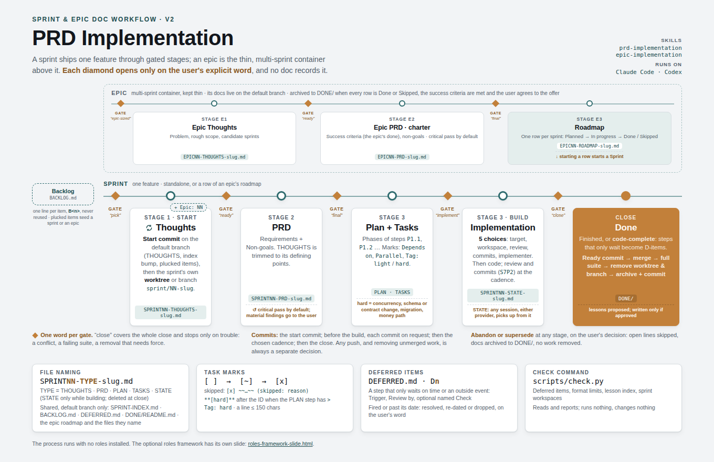
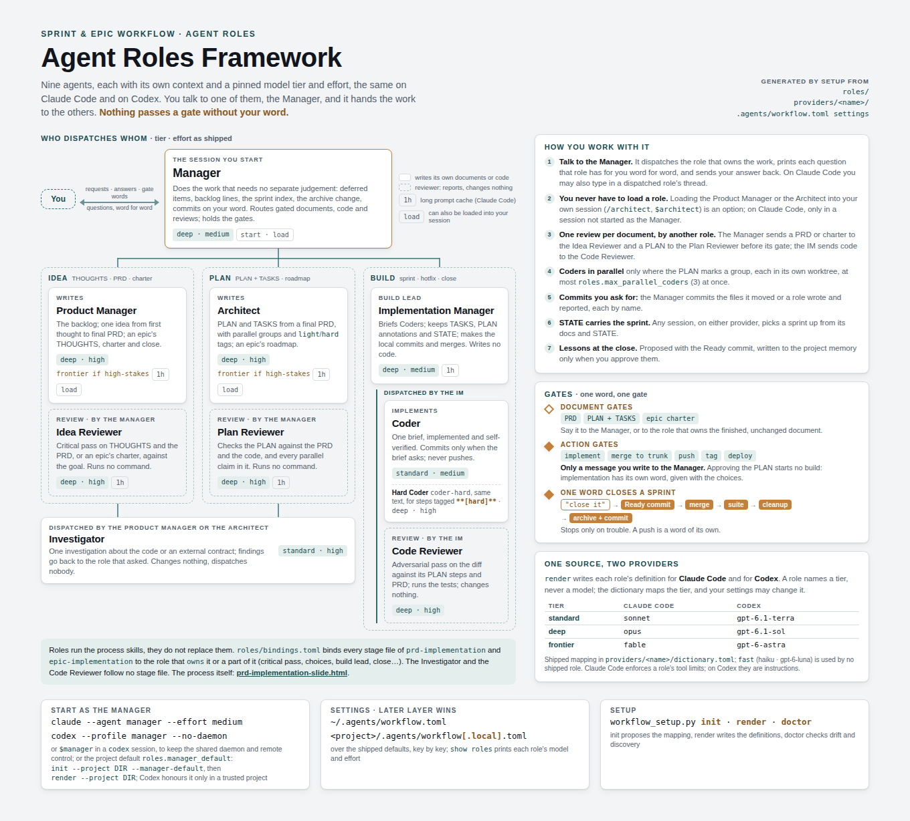

# AI Skills

Skills, roles, a rule and a setup tool for AI coding agents, written once and installed
for both [Claude Code](https://code.claude.com/docs/en/skills) and
[Codex](https://developers.openai.com/codex/skills). One clone is the source; every
provider home links to it.

This is version 2. Version 1, two rule files and an agent file beside the skills, is at
the tag `v1.0`.

## Layout

| Path | Holds |
|------|-------|
| `prd-implementation/`, `epic-implementation/` | The sprint and epic process as two skills: a short entry file and, in `references/`, the files it points to: one or two for each stage, the conventions and completion; for the sprint also the state file, deferred items, backlog and deferred conversion, abandoning a sprint, and one file for each provider. |
| `project-memory/` | The lessons a project keeps, as a skill: the entry file and, in `references/`, the format of the index and of a lesson file, a lesson's lifecycle, and how a project gets both providers to load its `AGENTS.md`. |
| `csv-tools/`, `json-tools/`, `self-reflection/`, `usage-cost/` | Skills. A skill is a directory at the root that holds `SKILL.md`. |
| `multiagent-collab/` | A skill with its own setup, protocol file, hooks and tests. |
| `roles/` | The sources of the nine roles: `<role>/ROLE.md` and `<role>/role.toml`, the sections roles share in `_shared/`, `bindings.toml`, which says which role follows which stage of the process, and `dependencies.toml`, which says which skills a skill needs. Format: [`roles/README.md`](roles/README.md). A project's own specialist: [`roles/SPECIALISTS.md`](roles/SPECIALISTS.md). |
| `rules/` | `avoid-bash-injection-heuristics/`, a rule for Claude Code: how to shape a Bash command so that the permission checks that ignore the allowlist do not fire. Codex has no place for a rule. |
| `providers/` | What differs between providers, in `claude-code/` and `codex/`: `dictionary.toml` (what the tiers and effort names mean there, and the version it was checked on) and `actions.md` (how a role's actions are done there). |
| `tools/` | `setup/`: `setup.py`, the program that installs, checks (`--check`) and takes back (`--uninstall`), and `validate.py`, the check of the clone's sources; its package `wfsetup/`, its shipped defaults (`defaults.toml`), its tests, and `manifest-keys.json`, the keys setup may change in a project's `.claude/settings.json` (`agent`, `effortLevel`). `session-profile/`: prints the role, model and effort a provider recorded for each agent of a session. |
| `docs/` | [`agent-roles-framework.md`](docs/agent-roles-framework.md): the design of the roles and what was checked on each provider. [`v1-to-v2.md`](docs/v1-to-v2.md). Two one-page slides, each with a `-preview.png` beside it: [`prd-implementation-slide.html`](docs/prd-implementation-slide.html), the process, and [`roles-framework-slide.html`](docs/roles-framework-slide.html), the roles; see [The slides](#the-slides). `memory/`: this repository's own lessons, indexed in `AGENTS.md`. |
| [`AGENTS.md`](AGENTS.md) | The repository's conventions. Both providers read it; there is no `CLAUDE.md`. |

### What each skill is for

| Skill | For | Providers |
|-------|-----|-----------|
| [`prd-implementation`](prd-implementation/SKILL.md) | A sprint in stages with explicit gates: backlog, THOUGHTS, PRD, PLAN and TASKS, implementation, archiving. | Claude Code, Codex |
| [`epic-implementation`](epic-implementation/SKILL.md) | An effort of several sprints: EPIC THOUGHTS, the charter, the roadmap, its sprints, archiving. | Claude Code, Codex |
| [`project-memory`](project-memory/SKILL.md) | Lessons kept in the project: an index of one line per lesson in the project's `AGENTS.md`, one file per lesson, a git-ignored local folder; proposed, and written only on the user's approval. | Claude Code, Codex |
| [`json-tools`](json-tools/SKILL.md) | Inspect, query and transform JSON files with local scripts (Python or Node, no dependencies). | Claude Code, Codex |
| [`csv-tools`](csv-tools/SKILL.md) | The same for CSV files. | Claude Code, Codex |
| [`self-reflection`](self-reflection/SKILL.md) | A review of the finished conversation that reports only what would change future work. Runs only when asked for. | Claude Code, Codex |
| [`usage-cost`](usage-cost/SKILL.md) | Claude Code usage and list-price cost over a window, from Claude Code's own session logs. | Claude Code |
| [`multiagent-collab`](multiagent-collab/SKILL.md) | An owner and an adversarial reviewer across Codex and Claude, through a shared filesystem baton. | Claude Code, Codex |

## Installation

One program installs the skills, the rule and the roles: `tools/setup/setup.py`. Run alone
it shows every option with its value now; Enter accepts them all and shows the plan, and
"Apply? [Y/n]" applies it. `--yes` applies what the screen would show with no question,
`--dry-run` shows the plan and writes nothing, `--check` checks an install and writes
nothing, `--uninstall` takes it back, and `setup.py --help` lists the rest. A second run
with nothing to change plans nothing. `multiagent-collab` has its own installer, in the
next section; setup leaves that skill alone.

### Quick start

You need git, Python 3.11 or later, and at least one provider: Claude Code, the Codex CLI
or both. Setup installs for each provider it finds (its program is on `PATH`, or its home
exists). It uses the Python standard library alone, so there is nothing to `pip install`.

| Your machine | Steps |
|--------------|-------|
| Linux, macOS, or WSL used on its own | [Linux, macOS, or WSL alone](#linux-macos-or-wsl-alone) |
| Windows, with no WSL in use | [Windows](#windows) |
| Windows and WSL, the providers used from both | [Windows and WSL together](#windows-and-wsl-together) |

#### Linux, macOS, or WSL alone

```bash
git clone https://github.com/yzaremba/ai-skills.git ~/workspace/ai-skills
python3 ~/workspace/ai-skills/tools/setup/setup.py
```

Every link setup makes leads into the clone, so keep it where it is. macOS is not tested:
setup takes it as any POSIX system.

#### Windows

In PowerShell:

```powershell
git clone https://github.com/yzaremba/ai-skills.git $HOME\workspace\ai-skills
py -3 $HOME\workspace\ai-skills\tools\setup\setup.py
```

Setup links each skill as a directory junction, which needs neither Developer Mode nor an
administrator. The clone must be on a local drive.

#### Windows and WSL together

Each side has its own homes and is installed from that side, from one clone on a Windows
drive, so that one `git pull` reaches both. Clone and install in PowerShell as above, then
run in a WSL shell the command setup prints at the end of its run:

```bash
python3 /mnt/c/Users/<you>/workspace/ai-skills/tools/setup/setup.py
```

Pull that clone with Windows git: git run from WSL on a clone under `/mnt/c` can show every
file as modified.

#### A project

```bash
python3 ~/workspace/ai-skills/tools/setup/setup.py /path/to/project
```

The screen then also offers the project's own list of items, and whether every Claude Code
session in it starts as the Manager. Setup writes in the project `.agents/workflow.toml` and
`.claude/settings.json` at most, as files to commit (it commits nothing, and prints the
`git add` and `git commit` lines), and lists everything else it makes there in the
repository's exclude file. Add `--manager-default` for the Manager as the default.
Where your home does not install `roles` and the project's list does, the project gets its
own roles: see "A project's own roles" under [Using it](#using-it).

#### After a `git pull`

Run the same command again: Enter twice on the screen, or `--yes`. What is generated is
generated again from the clone. A project's rule copy and role definitions refresh the same
way, with `setup.py --yes DIR`.

```bash
python3 ~/workspace/ai-skills/tools/setup/setup.py --yes
```

#### The process alone, without roles

`prd-implementation`, `epic-implementation` and `project-memory` need no role. On the screen
open the items line and untick `roles`; or give the list without it:

```bash
python3 ~/workspace/ai-skills/tools/setup/setup.py --yes --install prd-implementation epic-implementation project-memory self-reflection
```

One session then runs every stage and stops at every gate for your word. Without roles you
give up what they add: a model and effort pinned to each kind of work, a reviewer other than
the author for the PRD and the PLAN, and a Manager that routes each request. Tick `roles`
again (or add it to `--install`) to get them back; [Using it](#using-it) lists them.

#### A project with a private planning repository

For a project whose sprint docs and private lessons live in a sibling private repository,
checked out next to it (`<planning repo>`, holding `docs/` and `memory/`). This is for local
use on both providers; the cloud is below.

1. In the project's `.agents/workflow.local.toml` (setup has no flag for this file):

   ```toml
   [process]
   docs_dir = "../<planning repo>/docs"
   ```

2. Link the private lessons, and commit a `.gitignore` line for the link. Write it without
   a trailing slash: git does not take a symlink for a directory, so `docs/memory/local/`
   would not ignore it. If `docs/memory/local/` is already a folder, move its files into
   `<planning repo>/memory` and remove it first; otherwise `ln -s` makes the link inside it.

   ```bash
   mkdir -p docs/memory
   ln -s ../../../<planning repo>/memory docs/memory/local
   echo /docs/memory/local >> .gitignore
   ```

3. Let the agent read the sibling.
   - Claude Code: in the project's `.claude/settings.local.json`:

     ```json
     {"permissions": {"additionalDirectories": ["/path/to/<planning repo>"]}}
     ```

     Setup does not ignore this file. Claude Code adds it to your global git ignore only
     when Claude Code itself creates the file; step 4 checks.
   - Codex: start it with the sibling added, for example `codex --add-dir ../<planning repo>`.
     Codex is documented here for local use only.

4. Check that git ignores both local files, and add any it does not to `.gitignore` or
   `.git/info/exclude` (setup lists `.agents/workflow.local.toml` in the exclude file only
   when its run on the project writes something):

   ```bash
   git check-ignore .agents/workflow.local.toml .claude/settings.local.json
   ```

#### Claude Code in the cloud

In a Claude Code cloud environment, the setup script clones this repository and runs setup
for the Claude Code home, then for the project:

```bash
#!/bin/bash
set -e
[ -d ~/.local/share/ai-skills ] || git clone https://github.com/yzaremba/ai-skills.git ~/.local/share/ai-skills
python3 ~/.local/share/ai-skills/tools/setup/setup.py --yes --provider claude-code
python3 ~/.local/share/ai-skills/tools/setup/setup.py --yes /home/user/<repo name>
```

The clone is not at `~/ai-skills` because a cloud session keeps its repository at
`/home/user/<repo name>`: in a session of ai-skills itself, `~/ai-skills` is that checkout,
and the clone would fail. The second run is the project's, and without that line an item the
project's `install` adds to the home's is missing. A project committed with `"agent"` in
`.claude/settings.json` starts a fresh session as the Manager.

A project whose sprint docs live in a private sibling repository (see above) runs its
sprints in the cloud too, when the session's own credentials can also read the sibling.
The script does not authenticate. Add this to the script, after the lines above:

```bash
[ -d /home/user/<planning repo> ] || git clone https://github.com/<owner>/<planning repo>.git /home/user/<planning repo>
cd /home/user/<repo name>
mkdir -p .agents .claude docs/memory .git/info
printf '[process]\ndocs_dir = "../<planning repo>/docs"\n' > .agents/workflow.local.toml
printf '{"permissions": {"additionalDirectories": ["/home/user/<planning repo>"]}}\n' > .claude/settings.local.json
ln -sfn ../../../<planning repo>/memory docs/memory/local
for p in /.agents/workflow.local.toml /.claude/settings.local.json /docs/memory/local; do
  grep -qxF "$p" .git/info/exclude 2>/dev/null || echo "$p" >> .git/info/exclude
done
```

The last lines keep the three out of `git status`; a cloud session may not ignore
them.

### `multiagent-collab` for Codex and Claude

This skill needs its setup utility; cloning it directly into one agent's discovery
directory is not enough. Prerequisites are Python 3, Codex CLI, and Claude Code.
The workflow below is locally verified with `codex-cli 0.154.0`. Current OpenAI
documentation identifies `$HOME/.agents/skills` as Codex's user skill location and
supports symlinked skill folders; behavior of other Codex versions should be
verified with the included doctor command. See the official
[Codex skills](https://developers.openai.com/codex/skills) and
[hooks](https://developers.openai.com/codex/hooks) documentation.

Keep one persistent clone, inspect the planned changes, then install for both
agents:

```bash
git clone https://github.com/yzaremba/ai-skills.git ~/workspace/ai-skills
cd ~/workspace/ai-skills
python3 multiagent-collab/scripts/multiagent_collab.py setup --agent both --dry-run
python3 multiagent-collab/scripts/multiagent_collab.py setup --agent both
```

The defaults are home `~` and chat root `~/workspace/chat`. To change them, pass
`--home PATH` and `--chat-root PATH` to both setup invocations. Setup preserves
unrelated configuration, records backups below `<chat-root>/_backups/`, and never
claims or removes the shared `~/.agents` or `~/.agents/skills` directories.

Setup installs session hooks but does not start agents or opt sessions in. Restart
Codex and Claude. In Codex, open `/hooks`, review the exact user hook, and trust its
current hash. Then give each agent this instruction in its own session:

```text
Use $multiagent-collab. Bind this session to ~/workspace/chat and verify wake delivery.
```

Claude will ask you to keep its printed `tail -n 0 -F .../monitor.inbox` Monitor
running. Each agent sends a nonce through its real wake transport and verifies the
nonce returned to the session. When both are ready, check the installation:

```bash
cd ~/workspace/ai-skills
python3 multiagent-collab/scripts/multiagent_collab.py doctor --agent both --require-binding
```

Start work from either bound agent; the initiating agent becomes owner and the other
becomes reviewer:

```text
Use $multiagent-collab. Start a task for: <describe the work and completion condition>.
```

For upgrades, first ask both live agents to `release` their bindings. A live
same-session `rebind` is intentionally a no-op and does not reload upgraded watcher
code. Update the persistent clone, review the protocol hash if it changed, and rerun
setup:

```bash
cd ~/workspace/ai-skills
git pull --ff-only
sha256sum ~/workspace/chat/PROTOCOL.md multiagent-collab/assets/PROTOCOL.md
python3 multiagent-collab/scripts/multiagent_collab.py setup --agent both --dry-run --upgrade-protocol-from APPROVED_CURRENT_SHA256
python3 multiagent-collab/scripts/multiagent_collab.py setup --agent both --upgrade-protocol-from APPROVED_CURRENT_SHA256
```

Restart both agents, then use `bind` again, repeat the nonce proofs, and rerun doctor.
Never use `--upgrade-protocol-from` until the displayed current hash and replacement
were reviewed and approved. Setup verifies real Codex discovery with the offline
`codex debug prompt-input` command; if that probe is unavailable, it warns and does
not remove a working legacy discovery link.

To remove the managed integration while preserving protocols, tasks, backups, and
archives:

```bash
cd ~/workspace/ai-skills
python3 multiagent-collab/scripts/multiagent_collab.py uninstall --agent both --dry-run
python3 multiagent-collab/scripts/multiagent_collab.py uninstall --agent both
```

### Skills

The setup program, `tools/setup/setup.py`, installs the skills, the rule and the roles.
[Quick start](#quick-start) gives the steps for each kind of machine; this section says
what it does. It needs Python 3.11 or later and nothing outside the standard library.
Below, `python` stands for your interpreter: `python3` on Linux, macOS and WSL, `py -3` on
Windows. Where `python` is a project's virtual environment, use a system interpreter.

The provider dictionaries were checked against these versions, Claude Code's on 2026-10-11
and Codex's on 2026-11-02; `setup.py --check` warns of a version newer than the one checked
or older than the oldest supported:

| Provider | Checked on | Oldest supported |
|----------|------------|------------------|
| Claude Code | 2.1.296 | 2.1.281 |
| Codex CLI | 0.166.0 | 0.160.0 |

On Claude Code the fast tier is the `haiku` alias, which is Haiku 5.5 with effort levels
from 2.1.293 on; an older client runs a fast-tier role on Haiku 4.5, which has none.

Setup installs for each provider that is installed (its program is on `PATH`, or its
home exists; `--provider NAME` names one that is not there yet). It writes only inside the
provider homes (`~/.claude`, `~/.codex`, or where `CLAUDE_CONFIG_DIR` and `CODEX_HOME`
point), `~/.agents`, and a project named on the command line; never inside the clone, and
never at a credentials file. It backs up every file it replaces or removes, under
`~/.agents/workflow-setup/backups/`, and `--uninstall` puts back what was there. A project
has its own backups, install record and lock, under `DIR/.agents/workflow-setup/`.

**The clone.** Every home links into the clone, so the clone stays where it is. On a
machine with a Windows side and a WSL side, setup prints one line when the Windows side
cannot read the clone; the run goes on and the exit code is not changed. Native Windows
takes a clone on a local drive, where a junction can lead, and stops on any other.
[Windows and WSL together](#windows-and-wsl-together) has the shared clone.

**The commands**, from the root of the clone; where Windows and WSL both use the
providers, once on each side:

```bash
python tools/setup/setup.py --dry-run
python tools/setup/setup.py
python tools/setup/setup.py --check
```

- `setup.py` alone opens the screen for this machine's homes, `setup.py DIR` the one for the
  project at DIR: every option numbered, with its value now and the layer and file the value
  comes from. Enter shows the plan, file by file, and asks "Apply? [Y/n]". Numbers (`3 5`)
  open those options and show the screen again; `r` and numbers (`r 3 5`) take those keys
  out of the file, so that the layer below gives them again. The screen is asked only on a
  terminal. Where standard input is not one (an agent session, a pipe), `--yes` applies what
  the screen would show and `--dry-run` prints the plan; without either the run stops and
  names `--yes`. Every value on the screen has a flag, and `setup.py --help` lists them.
- A value changed on the screen or given by flag is written to the settings file of the run,
  `~/.agents/workflow.toml`, or with DIR `DIR/.agents/workflow.toml`; a value accepted as
  shown is not. The home's file holds the tier and effort mappings of each installed
  provider in full, as the run confirmed them, so a new dictionary in the clone does not
  change them; `--tier`, `--effort` and `--role-model` do. For Codex the mapping is checked
  against `codex debug models`, also with `--dry-run`: a program of the provider's, which may
  write state of its own into the provider's home. A mapped model the list does not hold is
  refused; `--allow-unlisted` keeps it. `--install NAME...` is the whole list of what is
  installed (see "Which skills and rules are installed" below); `--reset KEY` takes a key
  out of the file, so that the layer below gives it again. A file written or edited by hand
  is rewritten from its values, after a backup, only when you answer yes on the screen or
  give `--yes --rewrite-settings`. Answer no on the screen and the file is kept, the values
  stay unwritten, the rest of the install goes on and the exit code is 3; `--yes` without
  `--rewrite-settings` stops with exit code 2 and writes nothing. One exception: where the file lacks only an installed provider's tier or effort
  mapping, setup adds the mapping at the file's end, its lines as they are, after a backup,
  without `--rewrite-settings`.
- A generated file, key or block that was edited by hand since setup wrote it is asked about
  on the screen ("replace, after a backup? [y/N]"). Without a terminal it is kept and
  reported, with exit code 3, unless `--overwrite-edited` is given.
- A run links each item of the list into the skills directory of each provider it names
  (`~/.claude/skills`, and `~/.agents/skills` for Codex), links the rule, when listed, into
  `~/.claude/rules`, and generates the role definitions and the entry points of a session.
  One conflict (a file, a directory or a foreign link where a link would go) stops the run
  before anything is written. A second run with nothing to change plans nothing and says so.
- `--check` checks the sources, what setup wrote and the providers, and writes nothing.
  Exit code 1 means an error. It starts provider programs (`--version`, the model list,
  offline discovery commands) and the collaboration skill's own doctor; a provider's
  program may write state of its own into its home. `--no-versions`, `--skip models`,
  `--skip discovery` and `--no-collab` leave those out, `--only NAME` and `--skip NAME`
  choose checks, and with DIR the project is checked as well. No check starts a session with
  a model, so Codex's role definitions stay unproven: see
  [Limits known so far](#limits-known-so-far).
- `--uninstall` takes back what setup installed in this machine's homes, or with DIR in that
  project. It touches only what the install record lists and only while it is as setup left
  it, and puts back what setup replaced. Run `--uninstall --dry-run` first.

Exit codes: 0; 1 when `--check` finds an error or you answer no at "Apply?"; 2 when the
run cannot do what was asked (a refused plan writes nothing; a failure part way keeps what
was done); 3 when the rest was done and an edited
file was kept.

**Codex's config.** Setup writes nothing into your Codex `config.toml` unless asked.
`--codex-settings on` writes blocks between setup's markers that hold what the roles need
on Codex (a concurrent-agents limit, a wait floor, the `workflow` permission profile,
unselected); the profile is written only where `config.toml` sets `default_permissions`,
and otherwise it is printed, not written. `profile` writes it and selects it; `off` takes
the blocks out. `--worktree-root
DIR` makes the directory your git worktrees are made under writable by the profile. A run
without the option keeps what the blocks hold. [Limits known so far](#limits-known-so-far)
says why each is there.

## What a `git pull` in the clone does

- **Skills and the rule change at once**, in every home that links to the clone: each is a
  link into the clone, and no home holds a copy.
- **Generated files change at the next run**: the role definitions, the loaded-role
  skills, the Codex profile file, and what a project got. They are made from the role
  sources and the settings. Until then the `drift` check of `setup.py --check` reports each
  one as a warning. Run `setup.py` after a pull (Enter twice on the screen, or `--yes`), on
  each side where Windows and WSL share the clone; with nothing to change it plans nothing
  and says so.
- **The models stay as confirmed.** The tier and effort mapping in
  `~/.agents/workflow.toml` does not follow a new dictionary; it changes when you change
  it with `--tier`, `--effort` or `--role-model`, or on the screen. Without that file the
  mapping is the shipped dictionaries', and a new dictionary takes effect at the next run.

## Using it

**The process.** Both providers load a skill when a request matches its description:
"start a sprint", "write the PRD", "plan an epic". A skill can also be named:
`/prd-implementation` on Claude Code, `$prd-implementation` on Codex. `self-reflection`
runs only when named. The process names no role and needs none: with
`roles` out of the `install` list setup installs it alone, as
[The process alone, without roles](#the-process-alone-without-roles) says.

**Roles.** A role is an agent with its own instructions, a pinned model tier and effort,
and limits. Nine are shipped. A specialist (operations, data research, a release) is a
project's own agent and none is shipped: [`roles/SPECIALISTS.md`](roles/SPECIALISTS.md)
says how a project defines one.

| Role | What it does | Claude Code | Codex |
|------|--------------|-------------|-------|
| Manager | The session the user starts: routes requests, holds the gates, runs the commands of a sprint's close and, on the user's word, a move, rename or deletion of a whole file that a stage file gives as a command, writes no file. | `claude --agent manager --effort medium`, or `/manager` in a session | `codex --profile manager --no-daemon`, or `$manager` in a session |
| Product Manager | Keeps the backlog and develops one idea with the user into THOUGHTS and a PRD, or an epic's charter. | Dispatched by the Manager, which relays its questions; the user may also type in its thread. Or loaded: `/product-manager` | Dispatched by the Manager, which relays its questions. Or loaded: `$product-manager` |
| Idea Reviewer | The critical pass on THOUGHTS and a PRD or a charter. Reads, and changes nothing. | Dispatched by the Manager | Dispatched by the Manager |
| Architect | Turns a final PRD into PLAN and TASKS, and a final charter into the epic's roadmap. | Dispatched by the Manager, which relays its questions; the user may also type in its thread. Or loaded: `/architect` | Dispatched by the Manager, which relays its questions. Or loaded: `$architect` |
| Plan Reviewer | Checks a PLAN against its PRD and the code. Reads, and changes nothing. | Dispatched by the Manager | Dispatched by the Manager |
| Implementation Manager | The build lead of a sprint or a hotfix: briefs Coders, keeps TASKS, the PLAN's annotations and STATE, makes the local commits and merges. Writes no code. | Dispatched by the Manager | Dispatched by the Manager |
| Coder | Implements one brief and verifies it. A second definition, `coder-hard`, has a higher profile. | Dispatched by the Implementation Manager | Dispatched by the Implementation Manager |
| Code Reviewer | The adversarial pass on a code change. Runs the tests, and changes nothing. | Dispatched by the Implementation Manager | Dispatched by the Implementation Manager |
| Investigator | One investigation another role needs, with its findings returned to that role. Changes nothing. | Dispatched by the Product Manager or the Architect | Dispatched by the Product Manager or the Architect |

Loading a role suspends any other, and does not switch the session's model: the role
says which model and effort it is meant for, and the user switches with `/model` and
`/effort` on Claude Code, `/model` on Codex. On Codex, start the session at the project
root. On Claude Code a session started as the Manager (`--agent manager`, or the project
default) has no tool that changes a file, whatever is loaded into it: there a role that
writes is dispatched, and loading one is for a session not started as a role.

On Claude Code a role's pinned effort applies when the role is dispatched as a subagent.
By Claude Code's documentation, a session started as the Manager takes the definition's
prompt, tools and model, and runs at the session's own effort: `--effort`, `/effort` or
the `effortLevel` setting, and failing those the model's default. So the Manager's effort
is given beside the role: at launch with `--effort` (setup prints the command with the
level the settings resolve, under "entry points"), and as a project default with
`effortLevel`, below. A session record on Claude Code 2.1.296 showed a Manager started
plainly in a project with `effortLevel` set to `medium` run at medium on every turn; that
`--effort` at launch does the same is read from the documentation and not yet shown.

**Roles and your own workflow.** The roles are built on the two process skills, and do
not adapt to another process by themselves. `roles/bindings.toml` gives every stage file
of `prd-implementation` and `epic-implementation` to a role, and `tools/setup/validate.py` fails a stage
file that has no row. A role's definition carries its rows and tells it to take no part in
a stage with no row. The role texts speak of this process's documents: THOUGHTS, the PRD,
PLAN and TASKS, STATE, the close. The Product Manager, the Architect, the Implementation
Manager and the Coder follow the installed process skills, and say so when one is missing.
What works in a project that keeps no sprint docs:

- A light question, which the Manager answers itself when no file is written and a few
  lookups suffice.
- A hotfix. The Manager routes it to the Implementation Manager with your request as its
  spec, and there "the sprint process does not apply: no sprint document". A hotfix that stops with
  work open keeps a `HOTFIX-STATE-*.md`, as "A hotfix's STATE" in
  `prd-implementation/references/state.md` says. A Coder implements it from its brief, and
  the Code Reviewer reviews it against the brief's text.
- A project's own specialist ([`roles/SPECIALISTS.md`](roles/SPECIALISTS.md)), which
  follows no stage file.

What does not: everything before the code. An idea or a feature goes to the Product
Manager, which writes THOUGHTS and a PRD; a plan is the Architect's PLAN and TASKS, once
the PRD has passed its gate; the reviewers review those documents. The Manager writes no
file, and does not do work whose role is not installed. The settings change how the
process runs, not what it is: where its docs live (`process.docs_dir`), how questions are
put (`process.questions`, `process.recommend` with its `"accept"` value,
`process.density`), each role's tier and effort (`[roles.<id>]`, `roles.high_stakes`), how
many Coders work at once (`roles.max_parallel_coders`), whether a project's sessions start
as the Manager, and where lessons go (`memory.dir`). Fitting the roles to another
workflow is a fork: a process skill of your own (one `references/stage-*.md` makes a
skill a process skill, and then every
`.md` file directly in its `references/` but `conventions.md`, `claude-code.md` and
`codex.md` is a stage file that `validate.py` requires a row for); rows in
`roles/bindings.toml` that give each stage file to a role; and the role texts, the Manager's routing table among them, rewritten where they
name this process's documents and skills. Then `validate.py` and `setup.py`.

**Project memory.** The `project-memory` skill keeps a project's lessons: one line each
in a marked block of the project's `AGENTS.md`, one file each under `memory.dir`
(`docs/memory` by default). A lesson is proposed, at a sprint's close or when it is
learned, and written only on the user's approval. The index reaches a session only where
the provider loads that `AGENTS.md`; `setup.py --check DIR` checks it, see
"Checking a project" below.

**A project.** Nothing is written in a project unless it is named. To make every session
in a project start as the Manager:

```bash
python tools/setup/setup.py DIR --manager-default --dry-run
python tools/setup/setup.py DIR --manager-default
```

Or open `setup.py DIR` and answer the Manager question on the screen. The settings file
`DIR/.agents/workflow.toml` is created when a value of it is chosen; commit it. What makes
the Manager the project default is the setting `roles.manager_default = true`; the flag
`--manager-default` sets it. A run with DIR refreshes the homes as without it, and in the
project, with that setting, sets `"agent"` and `"effortLevel"` in
`DIR/.claude/settings.json` and writes a marked block at the head of
`DIR/.codex/config.toml`, where git does not track that file. `effortLevel` is the
Manager's effort as the project's settings resolve it. Both keys go by the same rules: no
other key is touched, a value setup did not set is kept and reported with exit code 3 until
`--overwrite-edited` replaces it after a backup, and turning the setting off, or
`--uninstall DIR`, takes out what setup set and puts back what was there. A refresh with no
project choice changed leaves the two keys as they are. The setting takes `low`, `medium`,
`high` and `xhigh`: for a Manager set to `max`, or on a model that takes no effort,
`effortLevel` is not written and the output says why. While `"agent"` has a value that is
not setup's and is kept, the project's sessions do not start as the Manager, and setup
leaves `effortLevel` alone. A project's `effortLevel` applies to every Claude Code session
in the project, whatever it starts as. A role definition is written for each role the
project's settings change, where the home has the roles; where it has none, see the next
paragraph. Setup commits nothing: when it changed `DIR/.agents/workflow.toml`
or `DIR/.claude/settings.json` it prints the `git add` and `git commit` lines for them.
Everything else it makes in the project is listed in the repository's exclude file
(`info/exclude` in its git directory, which a repository's worktrees share), never in
`.gitignore`, together with `.agents/workflow.local.toml` and the state directory,
`DIR/.agents/workflow-setup/`, where its backups, install record and lock for the project
are. A project that is no git repository gets no list. An earlier version's block in a
tracked `.codex/config.toml` is named for you to remove.

**A project's own roles.**

```bash
python tools/setup/setup.py DIR --install roles --dry-run
python tools/setup/setup.py DIR --install roles
```

Where your home's `install` has no `roles` and the project's has
(`--install roles` gives the project's whole list as that one item), a run with DIR
installs the roles in the project for each provider this side has: every
role definition in `DIR/.claude/agents` and `DIR/.codex/agents`, built from the shipped
definitions and the settings down to the project's; a loaded-role skill for each role that
can be loaded, in `DIR/.claude/skills` and `DIR/.agents/skills`; and the process skills the
roles are bound to, linked as any project item is, unless the home has them. No profile is
written: Codex reads `--profile` only from its home. A role's binding rows name where a
session finds each skill: the home's directory for a skill the home has, and for one the
project has a path from the project root, which the role is told is the project's main
working tree. A session started inside a worktree of the project finds none of the
project's roles, because the generated files are kept out of git; a role dispatched from the
main working tree works in a worktree as usual. Where the home has the roles, `roles` in a
project's list adds nothing.

To start as the Manager, set `roles.manager_default` as above. On Claude Code the output
then gives `claude --agent manager --effort <level>` for the project; without the setting it
gives no start command, and a session loads a role with `/manager`. On Codex, with the
block written, a plain `codex` in the project starts as the Manager, and the output says so;
without it, a session loads the role with `$manager`. Setup prints one line when a Codex file
lands under `DIR/.codex`: Codex reads the role definitions and the Manager start only in a
project you trust. It does not work out whether the project is trusted, and never marks one
trusted; the loaded-role skills load in an untrusted project too, the roles they dispatch do
not.

The project's own roles are listed in the exclude file and taken out by `--uninstall DIR`.
When `roles` leaves the project's list, or the home gets it, the next run with DIR takes the
project's set out; a file edited by hand is kept and reported, with exit code 0, on every
later run. `--check DIR` covers them with its usual checks (drift, a file edited by hand,
and the size of a loaded-role skill; see the known limit "A loaded role in a long Claude
Code session").

**Skills in a project.** A project lists the skills (and the rule) it uses in `install`;
every skill and the rule live in the clone. To see them and then link them:

```bash
python tools/setup/setup.py DIR --install csv-tools json-tools --dry-run
python tools/setup/setup.py DIR --install csv-tools json-tools
```

`install` is a top-level key of a settings file, a list of the clone's skills, the rule and
`roles`, and `--install` gives the whole list, so the one flag adds and removes;
`--reset install` takes the key out of the file. A line `install` inside a table (below
`[memory]`, say) is an error that names the file and the table. The project's
`.agents/workflow.toml` is shared; `DIR/.agents/workflow.local.toml` (listed in the exclude
file) may hold an `install` of its own, written by hand, which replaces the shared one on
this machine. A place gets what its list names, plus the skills those need
(`roles/dependencies.toml`: `epic-implementation` needs `prd-implementation`; `roles` needs
the skills the roles are bound to), and the plan names each one added and what needs it. A
project's screen shows the home's items as well, marked "from this machine": those cannot
be unticked there, and an item this side's home has is not installed again in the project.
A project whose files hold no `install` gets none of its own. `roles` in a project's list
where the home has none gives the project its own roles (see above); where the home has
them it adds nothing.

A run with DIR links each skill of the list, for each provider that skill names and this
side has, as `DIR/.claude/skills/<name>` (Claude Code) and `DIR/.agents/skills/<name>`
(Codex), and lists the links in the exclude file. The rule is copied, not linked, into
`DIR/.claude/rules/<name>/`, and every run brings the copy in line with the clone. Run it
on each side of a Windows and WSL machine: a link one side made is kept by the other. The
link is a junction on Windows. From WSL, in a project on the Linux file system it is an
absolute symlink; in a project on a Windows drive, it is a relative symlink where the clone
is on the same drive, and absolute (Windows sessions do not see it) where the clone is in
the Linux file system; where the clone is on another Windows drive, WSL makes none and
names the skills left out: run setup from Windows. The next run removes the link of a skill
that left the list, and `--uninstall DIR` removes the links and the rule copy that setup
made, but not a link you made by hand that it took over. `setup.py --check DIR` reports a
skill of the list that is in neither the project nor the home, a link that leads elsewhere,
a changed copy of the rule, and a link or copy of a unit that left the list.

**Checking a project.** `setup.py --check DIR` runs every check with the project's settings
and what the run with DIR wrote there, and one check that needs a project,
`instruction-files`: whether both providers load `DIR/AGENTS.md`, the file that holds the
project's lesson index. It writes nothing.

```bash
python tools/setup/setup.py --check DIR
python tools/setup/setup.py --check DIR --only instruction-files
```

| Finding | When |
|---------|------|
| Error | A `CLAUDE.md`, `.claude/CLAUDE.md` or `CLAUDE.local.md` is in DIR or in a directory above it, and neither remedy is in place. Claude Code (2.1.277 or later; every kind of session from 2.1.281) reads `AGENTS.md` directly only while none of the three is there. The user's own `CLAUDE.md`, the one that lies in the Claude Code home, does not count; a file elsewhere that is a link to it does. |
| Error | `DIR/AGENTS.md` is over the 4 MiB above which Claude Code skips an instruction file: it is not loaded, whatever imports it. |
| Warning | A `CLAUDE.md` of the three, or the user's own, is over 4 MiB: Claude Code skips it, `--check` does not open it, and an import in it is no remedy. |
| Warning | A file Claude Code loads here is over three quarters of those 4 MiB. |
| Warning | The setting is `"claude-md-and-agents-md"` under the id `cc-plugin-agents-md@builtin` alone. It is counted as the remedy, and Claude Code before 2.1.285 ignores that id. |
| Warning | The setting has different values under its two ids. It is not counted as a remedy; the line names both values. |
| Warning | The setting is `"managed-only"`: Claude Code loads the organization's instructions alone, and `AGENTS.md` is not loaded, import or not. |
| Warning | The setting is `"claude-md"` and none of the three files imports `AGENTS.md`: Claude Code reads `CLAUDE.md` files only. |
| Warning | The user's `settings.json` cannot be read, or is not a JSON object. The setting is taken as unset. |
| Warning | DIR holds an `AGENTS.override.md` that is not empty. Codex takes one instruction file from a directory, the first that is not empty, and that one replaces the `AGENTS.md` beside it. |
| Info | DIR holds an empty `AGENTS.override.md`: it replaces nothing until it holds something. |
| Warning | The instruction files Codex loads, the one in its home and DIR's, are together over three quarters of its limit: 32 KiB, or `project_doc_max_bytes` in `~/.codex/config.toml` when that is set. |
| Warning | The same files are together at or over the limit. Codex stops adding files there, so the end of them is not loaded. |
| Warning | `project_doc_max_bytes` is 0: no instruction file is loaded on Codex. |
| Warning | `project_doc_max_bytes` is not a number of bytes. The sizes are measured against the default. |
| Info | DIR has no `AGENTS.md`, or a provider is not installed: nothing to check. |

The two remedies for the error: a line `@AGENTS.md` in one of the three files, its path
relative to the file that holds it (`@../AGENTS.md` in `.claude/CLAUDE.md`); or, in the
user's own `~/.claude/settings.json`,
`pluginConfigs."agents-md@builtin".options.instructionFiles` set to
`"claude-md-and-agents-md"`. Claude Code ignores that setting in a project's settings
files, and the error says so when it finds it there. `--check` reads that one key of the
settings file and `project_doc_max_bytes` of the Codex config, and prints no other value
of either. It sees an import written in one of the three files, not one reached through
a second imported file, and not one in a code block, a code span or an HTML comment;
where it cannot tell whether a line is code, it finds no import. It takes DIR by its real
path. More in
[`project-memory/references/loading.md`](project-memory/references/loading.md).

**Settings.** Four layers, later wins: the shipped defaults, `~/.agents/workflow.toml`,
`DIR/.agents/workflow.toml` and `DIR/.agents/workflow.local.toml`. Each later file wins key
by key.

```bash
python tools/setup/setup.py --dry-run --json
python tools/setup/setup.py DIR --dry-run --json
```

The screen shows each effective setting and the layer and file it came from; `--dry-run
--json` prints the same in its `settings` object, with the model and effort each role
definition runs with in its `install` object.

`install` is read by setup alone, not by the process skills (setup also reads the `roles` and `providers` keys):

| Setting | Default | Read from | What it does |
|---------|---------|-----------|--------------|
| `install` | `["roles", "prd-implementation", "epic-implementation", "project-memory", "self-reflection"]` | A top-level key of any of the files; a later file's list replaces the earlier one's whole | What is installed there: skills and rules of the clone by name, and `roles` for the role definitions and entry points. `multiagent-collab`, with its own setup, is not one. `--install NAME...` sets it, `--reset install` takes it out of the file. |

`install` is newer than the first version 2 tools: an older clone's setup tool refuses a
user file or a project file that holds it as an unknown key. A project's shared file is read
by the clone of each of the project's users, so update every clone that reads the file
(`~/.agents/workflow.toml`, or the project's) before writing one.

**Which skills and rules are installed** is `install`, a list of names:

```toml
install = ["roles", "prd-implementation", "epic-implementation", "project-memory",
           "self-reflection", "csv-tools"]
```

The shipped list is the one in the table: the process skills, `self-reflection` and the
roles. `csv-tools`, `json-tools`, `usage-cost` and the rule are installed only when you
add them. A link an earlier run made to a skill that left the list is removed; a link
removed by hand comes back at the next run while the skill is listed. A name that is no
skill, rule or `roles` of the clone stops the run. Without `roles` in the home's list the
process alone is installed, with no role definition and no entry point; what an earlier run
generated is then removed. A skill the list needs comes with it (`roles/dependencies.toml`;
the roles need the skills `roles/bindings.toml` binds them to), and the plan names what added it. The
collaboration skill has a setup of its own and is not in the list. Each side of a Windows
and WSL machine reads its own `~/.agents/workflow.toml`, and the side that writes a place
decides for it: where the WSL home's rules directory is a link to the Windows one, the
rule is the Windows side's setting.

On Claude Code the definitions of the Product Manager, the Architect, the
Implementation Manager and the Idea and Plan Reviewers also name the one-hour prompt
cache (`cache = "long"` in their `role.toml`, written as `experimental.cacheTtl: 1h`):
the first three wait between turns, on the user or on Coders, the reviewers can think
longer than five minutes between two requests, and a dispatched role is otherwise on
the five-minute cache. A
one-hour cache write is billed at a higher rate, and Claude Code's own
`subagentPromptCacheTtl` setting or `CLAUDE_CODE_SUBAGENT_PROMPT_CACHE_TTL` variable
overrides the definition. Setup shows the cache beside the model and effort.

More: [`roles/README.md`](roles/README.md) for the format of a role,
[`docs/agent-roles-framework.md`](docs/agent-roles-framework.md) for the design and the
gate results, `providers/<name>/actions.md` for how each action is done on a provider,
and each skill's `SKILL.md`.

## Limits known so far

- **On Codex a role's limits are instructions, not enforced.** A definition's read-only
  sandbox is ignored in an interactive session (gate G10, Codex CLI 0.160.0): a
  dispatched agent runs under its parent's sandbox and keeps the agent tools. Claude
  Code denies the tools in the definition.
- **The linked rule in a Cowork session.** In the words of `setup.py --help`: A Cowork
  session on the desktop does not load a linked user-level rule: there Claude Code skips
  "a symlinked ~/.claude/rules/ directory or rule file that points outside the working
  directory" (code.claude.com/docs/en/memory, read 2026-10-05). The page names the rules
  directory and a rule file; a linked directory inside rules/, which is what setup
  makes, is taken to be skipped the same way. Every other Claude Code session
  loads the rule through the link.
- **A loaded role in a long Claude Code session.** After a compaction Claude Code keeps
  the first 5,000 tokens of an invoked skill, a figure its dictionary states
  (`skills.compaction_tokens`). The three roles that can be loaded (Manager, Product
  Manager, Architect) are kept within that on Claude Code, by an estimate of one token
  per three bytes, which errs high: `validate.py` refuses a role whose loaded skill is over
  5,000 tokens there, measured with the shipped settings, and `validate.py --json` gives
  each size on each provider. `setup.py --check` (the check `loaded-skill-size`) measures with
  your settings, which can make a skill longer, as a long model name does, and warns;
  `setup.py --check DIR` measures a project's own loaded skills the same way;
  Setup then marks the role LONG. What would be cut is the end, the role's binding
  rows and the provider's action notes. Codex documents no such cut: there the size is
  reported, by `validate.py --json`, setup and `--check`, and not limited. A clean
  install with the shipped settings ends with no such warning.
- **Git on Codex.** The default sandbox keeps `.git` read-only, so a commit or a
  worktree needs approval command by command, or a permission profile (beta in Codex).
  `setup.py --codex-settings profile` defines one, `workflow`, and selects it. Without `profile` (`--codex-settings on`, or no option) the profile is written only beside a
  `default_permissions` of your own, and otherwise printed: Codex CLI 0.163.0 will not start with a config that
  defines a profile and sets no `default_permissions`. A block an earlier setup wrote that
  way is an error of `setup.py --check --only codex-settings`; `--codex-settings on`
  takes the profile out of it, and `--codex-settings off` takes the blocks out.
  While the user's `config.toml` sets `sandbox_mode` no profile is written, because Codex
  then ignores `default_permissions`; setup never changes `sandbox_mode`.
- **Four agents on Codex with no limit set**, counting the main session, as seen on
  Codex CLI 0.160.0; Codex's documentation leaves that default to the client and does
  not count the main session in the limit it sets.
  `--codex-settings on` sets `agents.max_concurrent_threads_per_session = 8`
  where the file sets no limit.
- **Short waits on Codex.** Agents were seen to call `wait_agent` with timeouts of 60 and
  300 seconds although the action notes say 3600000 ms, and every wake-up of a long-lived
  Manager reads its whole context again. `--codex-settings on` sets the floor
  `features.multi_agent_v2.min_wait_timeout_ms = 300000`, with
  `default_wait_timeout_ms = 3600000`, where the file defines nothing at
  `features.multi_agent_v2`; Codex CLI 0.163.0 raises a shorter request to the floor.
- **Codex reads a project's `.codex/config.toml` only in a trusted project.** In an
  untrusted one the Manager default does nothing on Codex, and the project's role
  definitions in `.codex/agents` are not read either; setup prints a line about it.
- **Codex writes into the profile file.** Started with
  `codex --profile manager --no-daemon`, Codex adds to `~/.codex/manager.config.toml`
  what you do in it: the answer to "trust this project?" as a `[projects."<path>"]`
  table, flags of its interface. What follows setup's part is yours: setup carries
  it over each time it writes the profile, `--check` does not count it as a hand edit
  unless it sets one of setup's keys, and
  `--uninstall` takes setup's part out and leaves the file holding the rest. Keys Codex
  writes itself (`projects`, `notice`) pass without a word; any other key there is
  named, and `--check` warns of one that changes what the role may do, such as
  `sandbox_mode` or `approval_policy`.
- **A skill seen twice on Codex is listed twice.** When the same skill is found in the home
  and in a project, Codex lists both, as seen with codex-cli 0.167.0 on 2026-11-10. Claude
  Code takes the user-level one over a project's.
- **WSL following a junction to another drive is untested.** Whether WSL's clients follow a
  junction to another drive is not yet tested. It matters only where the clone is on
  another Windows drive than the project: run setup from Windows ([WSL makes no link there](#using-it)).
- **Discovery cannot be shown for everything.** No provider output that was found lists
  Codex's role definitions, and Claude Code lists nothing without a session: `setup.py --check`
  reports those items as unproven, and no check starts a session with a model. The proof
  for those is the session record of a real spawn, which `tools/session-profile` reads.
- **The Manager's effort on Claude Code is the session's, not the definition's, as
  documented.** Its definition pins medium, and the session record showed the main
  thread at high. Setup therefore names `--effort` in the launch command and sets
  `effortLevel` in a project (see "A project"). A session record on 2.1.296 confirmed
  `effortLevel`; `--effort` at launch follows the documentation and is not yet shown by a
  record. `effortLevel` cannot hold `max`.
- **Not exercised yet:** the rules of the change of 2026-10-15, which came after the
  second sample sprint: a document gate passed in a loaded role and taken as passed by
  the role loaded next, the one-word close with the archive as a follow-up, and a commit
  the Manager makes of files a role wrote. A loaded role on Codex in a long dialogue or
  across a compaction. An approval said to the role that owns a document did pass its
  gate on both providers (Claude Code 2.1.296, Codex CLI 0.162.1).
- **Other programs.** The guards on where setup writes and removes hold against the disk
  as a run finds it, not against another program that changes the same directories
  while the run is under way.
- **Native Windows.** The setup tool's tests pass under a Windows Python, where a link
  is a directory junction. Run natively on Windows with a discovery check that
  started model sessions (an earlier version of setup), Claude Code 2.1.296 and Codex CLI
  0.160.0 read every skill through the junctions, and the generated roles and entry
  points that could be proven (gate G7, 2026-10-11). Codex's role definitions stay unproven there, as under "Discovery cannot
  be shown for everything" above.

## FAQ

- **Why is a role's text limited to 5,000 tokens, and what do I do when a role is over?**
  After a compaction Claude Code keeps the first 5,000 tokens of an invoked skill (see
  "A loaded role in a long Claude Code session" above). It binds the three roles that can
  be loaded into a running session: Manager, Product Manager, Architect. A dispatched or
  started role is not limited. The size shows in `setup.py --check` (the check `loaded-skill-size`)
  and in `validate.py --json`. When a role is over, cut wording in its `ROLE.md`, in the
  `roles/_shared` sections it includes, or in its binding notes in `roles/bindings.toml`:
  what would be lost is the end, the binding rows and action notes. Or set `load = false`
  in the role's `[entry]`: that drops its skill and the limit with it, at the price of the
  mid-session switch (`/manager` on Claude Code, `$manager` on Codex); you then start a
  Manager session instead. The Manager is at the limit today (2026-10-20): a sentence
  added costs a sentence cut.

- **Does the one-hour rule hold on an API key or on usage credits?** Not by default. The
  Manager follows up with a waiting Implementation Manager in under an hour because the
  long cache lives an hour. Claude Code's prompt-caching page (code.claude.com/docs/en/prompt-caching,
  read 2026-10-20, Claude Code 2.1.304) gives the main conversation one hour on a
  subscription within plan usage, and five minutes on an API key, a cloud provider, or a
  subscription that has gone over plan usage and draws on usage credits. The setting
  `promptCacheTtl` (or the variable `CLAUDE_CODE_PROMPT_CACHE_TTL`, `5m` or `1h`, Claude
  Code 2.1.242 or later) overrides it: the page names `1h` there for an API key and as the
  way "to keep the one-hour TTL" on usage credits. Where the main session has
  only five minutes, a waiting dispatched role goes cold during the wait and the Manager's
  follow-up re-writes its context: set `promptCacheTtl` to `1h`, or expect the re-write.
  The dispatched agents' side is under "Prompt cache" in `providers/claude-code/actions.md`.

- **When does a review run on the frontier tier (Fable)?** Only when you choose it:
  `[roles.<id>] tier = "frontier"` in `~/.agents/workflow.toml` or the project's
  `.agents/workflow.toml`, then `setup.py`. No brief names a model. Not the default because
  the frontier quota runs out before the normal limits (the user's experience, 2026-10-20),
  and the reviewers' default has been deep at high effort since sprint 02.

- **The Manager now writes files. What can it still not do?** It does what needs no
  separate judgement: deferred items, a backlog line, the sprint index, the archive
  change, commits of named files on the user's word, a rebase. It cannot author a gated
  document, write code or tests, dispatch a Coder, review what it briefed, or change state
  outside the repository; a push, tag, merge to trunk, deploy or history rewrite needs the
  user's word. The list and the reasons are in
  [`docs/agent-roles-framework.md`](docs/agent-roles-framework.md).

- **`--check` warns that the dictionary was checked on an older version. What do I do?**
  Nothing, unless something misbehaves. The dictionary records the provider version its
  facts were read on, and a newer provider usually changes nothing it names. When a fact
  changes, the dictionary's comment is updated with the new read date. `--check` stops
  warning once `checked_on_version` in `providers/<name>/dictionary.toml` is raised
  after a check.

- **Which clone do I run setup from, and on which side?** The homes link to the clone
  `setup.py` was run from (the symlinks under `~/.claude/skills` show it). A run from
  another clone or from a sprint worktree stops with conflicts and writes nothing, because
  the links lead to the first clone; and a worktree is removed at the close. So run setup from the clone the homes link to, after it has pulled. On a machine
  with Windows and WSL each side installs its own homes; see
  [Windows and WSL together](#windows-and-wsl-together).

- **A project answered questions one at a time; now it gets them all together. Why?** The
  shipped default of `process.questions` changed to `all-together` in sprint 02
  (2026-10-20). A project that wants the other sets `questions = "one-at-a-time"` in its
  `.agents/workflow.toml`; the screen shows the effective value.

## The slides

Two one-page overviews, each a single HTML file in `docs/` with a preview image beside it.
The rendered pages, at `https://yzaremba.github.io/ai-skills/<file>.html`, are served from
the main branch: they show a change to a slide once it is merged there.

**The process (v2).** [`docs/prd-implementation-slide.html`](docs/prd-implementation-slide.html):
the sprint process as it is in v2
([rendered](https://yzaremba.github.io/ai-skills/prd-implementation-slide.html)).

[](docs/prd-implementation-slide.html)

**The roles.** [`docs/roles-framework-slide.html`](docs/roles-framework-slide.html): the
roles and how they work together
([rendered](https://yzaremba.github.io/ai-skills/roles-framework-slide.html)).

[](docs/roles-framework-slide.html)

## License

Apache-2.0 — see [LICENSE.txt](LICENSE.txt).
