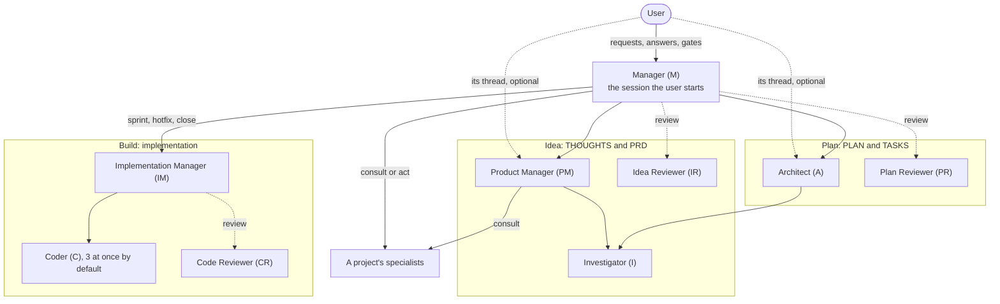
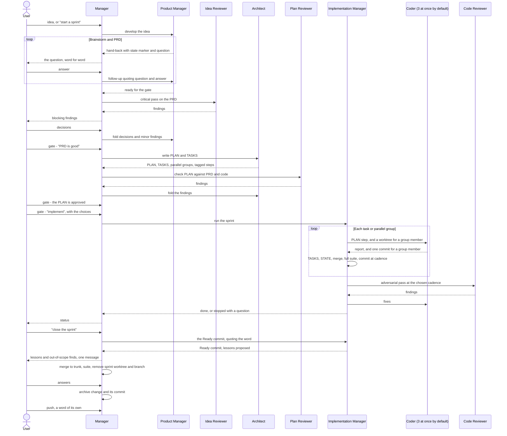

# Agent roles framework for the sprint and epic workflows

**Status:** Agreed and built: the framework, the build mechanics and the settings model are decided, and sprint 01 shipped them as the roles under [`roles/`](../roles/README.md) and the setup tool; the items under [Not yet exercised](#not-yet-exercised) remain to be tried in practice.
**Last updated:** 2026-10-20 — sprint 02: the Manager is hands-on on Deep/Medium with a can't-list, writes a close's deferred items, archive change and approved lessons; the one-hour rule for a waiting Implementation Manager; the reviewers run Deep/High, with the frontier tier by setting only; the five-minute rule, the step size and the reading rules. Before that, 2026-10-16 — the Manager runs a mechanical step itself, the Codex entry point adds `--no-daemon`, and the 5,000-token limit on a loaded role's skill applies on Claude Code only (decision of 2026-10-16: Codex documents no such cut, and there the size is reported). Before that, 2026-10-15: brought in line with what sprint 01 built: decision U (the Manager relays, gates pass where the user speaks, one word closes a sprint), the install model, and each provider statement with the version it was checked on.
**Applies to:** the skills [`prd-implementation`](../prd-implementation/SKILL.md) and [`epic-implementation`](../epic-implementation/SKILL.md) and the roles under [`roles/`](../roles/README.md); where this document and the role or skill text differ, that text stands. [`v1-to-v2.md`](v1-to-v2.md) says where each rule of the v1 files went.
**Provider versions:** every provider statement names the version it was checked on. At this update the four homes run Claude Code 2.1.296 and Codex CLI 0.160.0 on Windows (`doctor --only versions`, 2026-10-15) and Codex CLI 0.162.1 on WSL; Claude Code on WSL ran 2.1.300 in the last recorded run and prints 2.1.301 now; the shipped dictionaries were checked on Claude Code 2.1.296 and Codex CLI 0.162.1 on 2026-10-11. A statement checked on an older version was not checked again unless it says so.

## Why

Today one session carries a sprint through every stage, so every stage runs at one model and one effort level, and the session's context holds all of it. Switching model or effort between stages by hand is not workable.

The framework fixes that by giving each kind of work to its own agent:

- **A role is an agent with a pinned model and effort and its own context.** The session the user types in does not switch profile. A role the user chooses to load into that session is the one exception, described under [Loaded roles](#loaded-roles).
- **The session the user starts is the Manager**, where the project makes it the default or the user launches it as the Manager. It coordinates, relays and receives conclusions; the complexity stays in the agent that owns it, and so does the juggling between agents: the user talks to the Manager.
- **Sprint docs remain the durable state.** THOUGHTS, PRD, PLAN, TASKS and STATE are what one role hands to the next, and what survives a session ending.

## Roles

| Role | Owns | Dispatched by |
|---|---|---|
| **Manager (M)** | The session the user starts. Hands-on: it does what needs no separate judgement itself (the deferred items, a backlog line in the user's words, the sprint index, a close's archive change and commit, STATE while no Implementation Manager is at work, prose that is the user's words, a commit, a rebase, a lookup), routes the rest, holds the gates, and relays questions and conclusions. Authors no gated document, writes no code or tests, dispatches no Coder, reviews nothing it briefed or wrote, changes no state outside the repository; pushes, tags, merges to trunk, deploys or rewrites history only on the user's word. | — |
| **Product Manager (PM)** | The backlog, its one-time conversion and that of the deferred file; one idea from first thought to final PRD (THOUGHTS and PRD); an epic's THOUGHTS, charter, the seam of its roadmap when a sprint starts, and its close; a lesson outside a build. | M |
| **Investigator (I)** | An investigation another role needs; returns findings. Changes nothing and dispatches no agent. | PM or A |
| **Idea Reviewer (IR)** | Critical pass on THOUGHTS and PRD, or on an epic's THOUGHTS and charter. | M |
| **Architect (A)** | PLAN and TASKS, including which steps may run in parallel and which are `light` or `hard`; an epic's roadmap; the STATE fields a PLAN change moves; a lesson outside a build. | M |
| **Plan Reviewer (PR)** | PLAN checked against the PRD and the code, and every parallel claim in it. | M |
| **Implementation Manager (IM)** | A sprint's build or a hotfix: dispatch, TASKS, PLAN annotations, STATE, local commits and merges; the Ready commit of a close, and the deferred items and lessons it proposes for the Manager to write. Writes no code. | M |
| **Coder (C)** | One brief, implemented and self-verified. A second definition, the hard Coder (`coder-hard`), takes the steps tagged `hard`. | IM |
| **Code Reviewer (CR)** | Adversarial pass on the code: bugs, conformance to PLAN and PRD, clarity. | IM |
| **Specialists (OPS, DR, RD, …)** | Operations, data research, release and deploy, and other narrow work. A project's own agents; none is shipped. | M, or PM to consult |

- **A review is commissioned by whoever commissioned the work, never by the author under review.** The Manager dispatches the Idea and Plan Reviewers, once for each document before its gate moves anything unless the user waives it or asks for another, and the Implementation Manager dispatches the Code Reviewer. The author does not choose when it is reviewed or write the reviewer's brief.
- **The three reviewers are separate roles.** They check different things against different references and need different tools: the idea against the goal, the PLAN against the PRD and the code, the diff against the PLAN and PRD.
- **Helpers are engaged by the role that needs them.** The Product Manager and the Architect dispatch the Investigator; it dispatches nobody, and a question it has for a specialist comes back in its report.
- **Framework roles are project-agnostic** and live in this repository, one directory each under `roles/`: `ROLE.md`, `role.toml`, the sections they share in `_shared/`, and `bindings.toml`, which says which role follows which stage file. Setup generates each provider's definitions from that one source. An agent specific to one project lives in that project ([`roles/SPECIALISTS.md`](../roles/SPECIALISTS.md)).

## Diagrams

### Who dispatches whom

Solid arrows dispatch work. Dotted arrows are a review, or the user typing in a dispatched agent's thread: an option on Claude Code, for the Product Manager and the Architect alike, and impossible on Codex. On both providers the Manager relays a dispatched role's questions (see [Relaying and direct dialogue](#how-the-user-interacts)).

### One sprint, end to end

The brainstorm loop is drawn with the Manager relaying, as on both providers; on Claude Code the user may also answer in the agent's thread.

## How the user interacts

**Entry.** A session starts as the Manager where the project sets `roles.manager_default` or the user launches it so (below). On a session's first request, whatever it is, it runs the check command of the `prd-implementation` skill once: deferred items, format violations and the sprint workspaces. A flagged item goes to the user, to resolve, re-date or drop. Then it does what is its own and dispatches what needs a separate judgement. Size is never the criterion; a question that outgrows a few lookups goes to the Investigator:

| Request | Goes to |
|---|---|
| A lookup; a deferred item written, re-dated, resolved or dropped; a backlog line in the user's words; the sprint index; prose that is the user's words, an approved lesson or a lesson the user asks it to record; a commit of files M or a role wrote; a rebase on the user's word | M does it |
| An idea, the backlog beyond a line, a one-time conversion, a feature, a sprint or an epic, THOUGHTS, a PRD or a charter, an epic's close | PM |
| PLAN and TASKS, or an epic's roadmap, once the PRD or the charter has passed its gate | Architect |
| Implementing a sprint, a hotfix (code is a Coder's, a one-line fix included) | Implementation Manager |
| Operations, data research, a release | The project's specialist, with a brief marked `consult` or `act` |
| Work whose role or specialist is not installed | Nobody: M says which is missing and does not do it itself |

**Manager as a project default.** Whether sessions in a project start as the Manager is a per-project setting, `roles.manager_default`. A session running as the Manager does the small work itself and routes code, so the setting suits any project that runs sprints; elsewhere the Manager is launched explicitly (`claude --agent manager --effort <level>`, `codex --profile manager --no-daemon`, or `$manager` in a `codex` session to keep the shared app-server daemon and remote control).

**Relaying.** On both providers the Manager dispatches the Product Manager and the Architect and relays their questions: it prints a question from a hand-back to the user word for word, under the role's name, and sends the user's answer back by a follow-up that quotes question and answer, which resumes the agent with its history. It never asks the user to load a role. The user decided this on 2026-10-15 (decision U), after sample sprint B, where loading roles by hand on Codex and going back to the Manager for every gate had left the juggling to the user.

**Direct dialogue.** On Claude Code the user may also type to a dispatched agent: select its row in the agent panel while it runs, or within 30 seconds after its turn ends, from `/tasks`; after that only the Manager's follow-up resumes it (documentation and runs, 2.1.296). The Manager does not see what the user typed there; it receives only the hand-back. Codex does not allow this: the user can open a subagent's thread to watch it, but input there is refused (operator check, 0.160.0), so on Codex every brief says there is no dialogue.

**Hand-backs.** A dispatched role in dialogue ends every turn with a hand-back written for the Manager:

- **A state marker**: `in dialogue, no action`, `ready for the gate`, or `stopped, needs the Manager` when the role cannot go on without something only the Manager can arrange. On the first the Manager takes no action of its own: it only prints a question. Without the marker it wakes on each interim report and may act early.
- **The question, twice.** The role writes it in its thread first, in full, then repeats it under `Question:`, word for word with its options and recommendation, for the Manager to print: the user may never see the thread.
- **One line while in dialogue**, besides the question. Longer reports rebuild in the Manager the context the agent exists to keep out. At the other two markers, a few lines.
- **Verbatim quotes of what the Manager must track**: decisions the user made, changes of direction or scope, and requests outside the agent's lane. Quoted, not paraphrased.

A role loaded into the user's session writes no hand-back.

**Gates.** There are two kinds, decided by the user on 2026-10-05 after the first skeleton run, where approvals were repeatedly given to the PM and had to be said again (decision T), and refined on 2026-10-15 (decision U).

- **Action gates are said to the Manager.** Starting implementation, and any push, merge to trunk, tag or deploy, pass only on a message the user writes to the Manager while it is the active role. Words said to another role, and any quote of them, pass none.
- **A document gate can also be passed where the user talks to the owning role.** Approving a finished PRD, a finished PLAN with its TASKS or an epic charter counts when the user says it to the role that owns the document, the document was finished when they spoke, and it has not changed since. From a dispatched role, the quoted words count only if the Manager itself told the user they could talk to that agent in its thread and has sent the agent nothing since, and the role's `ready for the gate` hand-back quotes them exactly; the Manager says which words it takes as the approval, which gate they pass and what it starts. The rule is keyed on what the Manager did, because on Claude Code the user can type to any dispatched agent. On Codex no brief offers a thread, so no quote passes there. In a loaded session the words are in the session word for word: the role says the gate passed, it stands after the switch back, and a role loaded next in that session takes it as passed. With only a summary of the words, as after compaction or a resume, the Manager or the role asks.
- **The word comes after the thing it approves exists.** A word given in advance passes nothing, and the Manager asks again when the thing exists. An agent's report is never the trigger.
- **An opened gate stands.** A change before the gate passes voids the approval, and the role says so. Once it has passed, a change to the document's substance, the requirements of a PRD or the steps of a PLAN, is a new change for the user to approve, and the Architect checks the PLAN against a changed PRD. A status line, a "Last updated" line or a link is not substance.
- **No sprint or epic document records an approval**, a review, or what waits for one, with one exception: STATE, which says where the work stands, may name what waits for a gate ("P2.1 waits for the PLAN gate"). A gate passes by the user's word, not by a file.
- **One word, one gate**, with one exception: the word to close a sprint covers the whole close (see [The close](#the-close)).
- **The PLAN gate and the start of implementation are two gates.** Approving the PLAN with its TASKS is a document gate. Starting implementation is a separate action gate, with its own word to the Manager, which the user gives with the implementation choices.

### Loaded roles

The Manager, the Product Manager and the Architect can also be loaded into the user's own session, each as its own skill: `/product-manager` on Claude Code, `$product-manager` on Codex. Loading is the user's choice; no role asks for it.

- **One role is active at a time.** Loading a role suspends any other, and switching back is the user's message, such as "back to the Manager". Without this rule two instruction sets contradict each other: the Manager's says to author nothing and the PM's says to write the PRD.
- **The session does not take the role's profile.** A Codex skill has no model or effort setting, and a Claude Code skill cannot set the session's model beyond one turn (documentation, read 2026-10-04, on Codex CLI 0.160.0 and Claude Code 2.1.289). The role says which model and effort it is meant for, and the user switches with `/model`, and `/effort` on Claude Code.
- **The roles share one context.** That removes the need for hand-backs, and it means the Manager's context is no longer thin.
- **Everything else stays delegated.** The Investigator and the reviewers remain subagents, so the review stays independent.
- **A loaded role fits what survives compaction.** Claude Code keeps the first 5,000 tokens of an invoked skill after a compaction (documentation, read 2026-10-04 on 2.1.289), so a role that can be loaded gives a skill of at most 5,000 tokens on Claude Code, by setup's estimate of one token per three bytes; `validate` refuses one over it. The figure is in the Claude Code dictionary (`skills.compaction_tokens`). Codex documents no such cut and its dictionary has no figure, so there the size is reported and not limited (decision of 2026-10-16). Every role's text stays under 12,000 bytes, since a dispatched role shares its budget with the project's instruction files.

Before decision U, a role that needed the user ran loaded on Codex, and the first Codex runs (G0, G2) used that arrangement; their results are under [Gate results](#gate-results-sprint-01).

## Build: Implementation Manager and Coders

| | Coder (C) | Implementation Manager (IM) |
|---|---|---|
| **Does** | Implements one brief, runs its own targeted tests, reports, with lesson candidates | Picks the next task, briefs the Coder or the hard Coder, flips TASKS, annotates PLAN, keeps STATE, engages the Code Reviewer, sends findings to a fresh Coder |
| **Never** | Writes a sprint doc; works outside the working directory its brief names; pushes | Writes code; asks the user (it writes STATE and stops with the question in its report); pushes, merges to trunk or tags |
| **Git** | In a sequential run, in the sprint's workspace, no commit. As a member of a parallel group, exactly one commit, in its own worktree | Local commits at the cadence, the merges and worktrees of a parallel group, and the Ready commit of a close |

- **One Implementation Manager per phase** (2026-10-18). Measured on two sprints: an Implementation Manager that ran a whole build read its context again on every turn, which grew from 79K to 663K tokens over 263 calls on Claude Code (no compaction) and held 220K on average over 2,010 calls on Codex, where its coordination turns were 74% of its cost. The Manager now dispatches a fresh one for each phase of the user's target, and STATE carries the build between them. A simulation on the Claude run put the context read at about 35 to 40% of what it was with a restart every 40 to 80 calls. A compaction limit per role is the fallback, not built until a measurement shows it is needed.
- **A waiting Implementation Manager is followed up under an hour, replaced at an hour or more** (2026-10-20). When the Implementation Manager hands back with a question for the user, the Manager reads the clock then and again when the answer comes: under an hour, it follows up with the waiting agent; an hour or more, it dispatches a fresh one from STATE, the question and the answer quoted. The reason is the cache: a dispatched role with `cache = "long"` keeps its context cached for an hour, and past that a follow-up re-writes the whole of a build lead's context, which costs five to eight spawns (a spawn is 57K to 79K tokens of cache writes, as measured). Measured: 42 of 42 gaps under an hour were hot and 5 of 5 over an hour were cold, with re-writes of 190K to 615K tokens. The rule is in the Manager's "Prefer a follow-up"; the reason is here.
- **The implementer commits only as a member of a parallel group** (PRD decision R, 2026-10-04). Every other commit of the build is the build lead's, at the cadence the user chose, as in v1; the chosen cadence is the authorization. Outside the build: the Manager's commit of files a role wrote, below; the close's Ready commit and archive commit, under the word to close ([The close](#the-close)); and the Product Manager's and the Architect's commits of their own documents, when their brief asks or the user tells them to, the start of a sprint's one commit needing no ask.
- **A Coder may read a spec but never writes sprint state.** The Implementation Manager points it at the PLAN step by file and ID instead of paraphrasing the step into a brief. For a hotfix the spec is the Manager's message.
- **A Coder creates a branch only when its brief says the sprint has none yet**, and then the one the brief names.
- **Out-of-scope finds do not stop the build.** The Implementation Manager checks each against the PRD and the PLAN and lists it in its report as a spec gap, a later step's or a backlog item; the Manager puts them to the user, a spec gap for a PLAN amendment and a backlog item beside fixing it now, and the Product Manager adds the backlog items accepted.
- **The Manager is hands-on, and its limits are a list of what it cannot do** (2026-10-20, replacing "writes no file" and "a mechanical step is the Manager's own"). Measured on eight sessions: re-dating one deferred item through a dispatch cost about 1.2M tokens and would have cost about a third of that inline, and the Manager was 3% of cache reads and 5% of weighted cost. So the Manager does what is not on the list, in its own session, whatever the size. It cannot write a gated document (the Product Manager or the Architect; it relays the user's words and authors none); code, tests, configuration or anything the suite covers, a one-line fix included (a Coder, through the Implementation Manager, which commissions the review); or state outside the repository (a specialist, with a brief that says `act`). It dispatches no Coder, runs no build phase and reviews nothing it briefed or wrote. A push, tag, merge to trunk, deploy or history rewrite is a gate and not a role: the Manager runs it, on the user's word for each. A commit the user asks for of files a role wrote is the Manager's: it stages and commits each by name, never all (decision U, which amends R). Moving backlog documents out of their earlier place, the Manager runs steps 1 and 2 (the deletions and the `git mv` of each); the Product Manager then fixes the links, verifies the result and proposes the commit (steps 3 to 6), which the Manager makes on the user's word (the user's decision, 2026-10-16). Amended 2026-10-21: STATE is the Manager's too while no Implementation Manager is at work, as before a session restarts. What a restart would lose is in the Manager's conversation, a fresh Implementation Manager would know it only from the Manager's brief, and its spawn cost 57K to 79K tokens for one file of at most 70 lines.
- **A hotfix.** The user's request is its gate and, quoted, its spec. The Manager's brief names the branch, the current one unless the user said otherwise, asks for a commit only if the user did, and says whether the user waived the review. The Implementation Manager dispatches a Coder, then the Code Reviewer unless waived. No sprint document, no STATE, no lesson.

### Parallel Coders

- **Sequential is the default.** A group runs in parallel only when the PLAN marks it.
- **At most `roles.max_parallel_coders` Coders at once**, a setting whose default is three.
- **Tasks within a phase**, not whole phases.
- **Join before review.** The adversarial pass and the cadence commit wait for the whole group.

### Worktree lifecycle for a parallel group

1. **Clean base.** The sprint's workspace must hold nothing uncommitted beyond STATE: the Implementation Manager first commits work still waiting for a later cadence commit, as a commit of its own, then records the HEAD commit SHA. A "don't commit" cadence cannot be combined with parallel groups.
2. **Create.** For each Coder it runs `git worktree add` from that SHA, under the project's existing worktree root (the same root the sprint rule resolves), never inside the workspace. The directory name marks it as a Coder worktree, e.g. `<repo>-s88-p2.3`. The branch uses its own prefix, e.g. `group/s88-p2.3`; git does not allow a branch nested under the sprint branch's name.
3. **Work.** Each Coder works only in its worktree, runs only its targeted tests, makes one commit and reports.
4. **Join.** Before the first merge, the Implementation Manager verifies the sprint HEAD still equals the recorded SHA; if not, it stops and reports. It merges each Coder branch with a real merge, not a squash, then runs the full suite.
5. **Clean up.** It removes each merged worktree and branch without being asked.

When something goes wrong:

- **A Coder fails**, or reports its step unverified. The Implementation Manager waits for the rest of the group, merges the members that succeeded, then writes STATE and stops and reports. The failed member's worktree and branch stay.
- **A merge conflicts.** The PLAN's parallel claim was wrong. The Implementation Manager keeps what merged cleanly and re-dispatches the conflicting task sequentially on top; it does not resolve the conflict by hand.

### Cleanup rules

- **"Finished" means merged, and git verifies it.** Cleanup uses only `git worktree remove` without force and `git branch -d`. If either refuses, the work is not finished.
- **Never force automatically.** An unmerged worktree stays in place and is listed in the Implementation Manager's report with a one-line reason. Force-removing it is the user's call.
- **Sweep on start.** An Implementation Manager starting on a sprint checks for Coder worktrees left by an earlier run: merged ones are removed, unmerged ones reported.
- **The sprint itself is the Manager's.** Once the sprint branch is verifiably merged into trunk, the Manager removes its worktree and local branch without a separate request.
- **Remote branches.** Deleting a remote branch is a push. It rides on the word the user gives for the push that lands the merge.

### The close

- **One word to the Manager closes a sprint**: the Ready commit, the merge to the default branch, the full suite there, the non-forcing removal of the sprint's worktree and branch, the archive change and its commit. It stops only on trouble: a merge conflict, a failing suite, a removal that would need force. A push, a tag, removing unmerged work, closing as code-complete and an abandoned sprint's decisions each need their own word (decision U, 2026-10-15; sample sprint B's close had taken four rounds).
- **The Manager runs the commands**: the merge, switching to the default branch first for a sprint in place, the suite and the removal.
- **The Implementation Manager writes and commits**, on the Manager's brief quoting the word: closing as code-complete, and the Ready commit with the last STATE. It proposes the close's deferred items and lessons in its report and writes neither.
- **The archive change and its commit are the Manager's** (2026-10-20, replacing a follow-up to the Implementation Manager). On the user's decision the Manager writes the proposed deferred items in `DEFERRED.md` on the default branch, with their numbers, and the approved lessons in the archive change; the Implementation Manager then writes each step's PLAN annotation and TASKS flip before the Ready commit.
- **The answers wait only for the archive.** With the Ready-commit report the Manager puts the proposed lessons and the out-of-scope finds to the user in one message; the merge goes ahead, and only the archive change waits for the answers.

## State, deferred items and lessons

- **STATE is the fifth sprint doc**: workspace, branch and base commit, the resolved choices, who holds the work, the next action, half-done work and lesson candidates. The Implementation Manager keeps it at every step transition and before any stop; a new session picks the sprint up from it and checks it against git. When the Architect changes a sprint's PLAN or TASKS outside the build, until the Ready commit, it sets STATE's target, next action and "Uncommitted" to match. The time on its "Written" line is read from the clock. The archive change deletes it.
- **The PLAN header's status** reads `In progress` from the first draft until the close sets `Completed YYYY-MM-DD` or `Code-complete YYYY-MM-DD`, or an abandoned or superseded sprint gets `Abandoned YYYY-MM-DD — <why>` or `Superseded YYYY-MM-DD by sprint NN — <why>`; it holds no approval.
- **A step tagged `hard`** shows `**[hard]**` after its ID on its TASKS line, and the check command reports a tag that disagrees with the PLAN step.
- **Deferred items.** A sprint whose only open steps wait on time or an outside event closes as code-complete, each waiting step an item of `DEFERRED.md` with a trigger, a review-by date and, optionally, a named check. Work that waits outside a sprint is an item of `Sprint: none`, which leaves the file when it is resolved or dropped. The Manager runs the check command at a session's start; asked to check the deferred items, it also runs each named check itself, and names to the user, unrun, one that plainly would change something. The Manager writes an item and the outcome the user decided, and the `Audit` annotation of an archived PLAN that follows; the Implementation Manager only proposes a close's items, each with trigger and date (2026-10-20). A `DEFERRED.md` in the old free-form shape is converted once, on the user's word, by the Product Manager.
- **The check command also reports the sprint workspaces**: each `sprint/NN-slug` branch, where it is checked out, and the sprint's docs there, whose PLAN and TASKS it checks.
- **Lessons.** A Coder's report names lesson candidates and the Implementation Manager keeps them in STATE. It proposes lessons, those and its own, in the report of the brief that writes or deletes the last STATE, and writes none; a hotfix proposes none. The Manager puts each proposal to the user and writes a close's approved lessons in the archive change (2026-10-20), and one the user asks it to record. Outside a close the Product Manager or the Architect proposes one when its work is ready and writes it on the user's approval, quoted by the Manager or said to it loaded; a lesson proposed outside a close stays with its proposer. Lessons are written on the default branch, as the `project-memory` skill says: one line in the index in the project's `AGENTS.md`, one file under `memory.dir`.

## Model and effort

Tiers and effort levels are named by role so the framework maps onto any provider. The mapping from tier to model name lives in each provider's dictionary under `providers/`, which `init` proposes and the user confirms into the settings; a generated definition carries the resolved model.

| Tier | Use when |
|---|---|
| **Fast** | Fully specified work whose output a script or a glance can check |
| **Standard** | Well-specified work needing local judgment |
| **Deep** | Ambiguity, cross-file design, adversarial reasoning |
| **Frontier** | A miss propagates downstream and no later gate catches it |

| Effort | Meaning |
|---|---|
| **Low** | Transcription, no deliberation |
| **Medium** | Default; also right for interactive back-and-forth |
| **High** | Many constraints held at once |
| **Max** | Exhaustive; a missed finding is expensive |

Profile per role, as each `role.toml` states it. "High-stakes" means live money or production state, irreversible operations, external contracts, or concurrency; the setting `roles.high_stakes` marks it.

| Role | Tier | Effort | Cache |
|---|---|---|---|
| Manager | Deep | Medium | |
| Product Manager | Deep; Frontier when high-stakes | High | Long |
| Investigator | Standard | High | |
| Architect | Deep; Frontier when high-stakes | High | Long |
| Implementation Manager | Deep | Medium | Long |
| Coder | Standard | Medium | |
| Hard Coder (`coder-hard`), for a step tagged `hard` | Deep | High | |
| Idea and Plan Reviewers | Deep | High | Long |
| Code Reviewer | Deep | High | |
| Specialists | Set per agent | Set per agent | |

The Manager is thin, not weak (rewritten 2026-10-20). It does the small work itself, routes the rest and holds the gates, so it runs at Deep. A routing miss was observed on Standard in a 110K context; the Manager's volume is low (5% of weighted cost over eight sessions), so the tier is cheap.

**The frontier tier is used for a review when the user chooses it** (2026-10-20), through the setting `[roles.<id>] tier = "frontier"` in the user's or the project's settings, followed by `render`. No brief carries a model, and both providers' dispatch notes forbid passing one. The reason is the quota: the frontier quota is exhausted before the normal limits.

**Three rules keep an agent's context from costing more than the work** (2026-10-20), each in the text of the roles it binds:

- **No subagent tool call runs over five minutes.** A command that may is split, or started so that it survives the turn and waited for with bounded waits under five minutes ("Wait on a long job" under Commands in `providers/*/actions.md`, which the Coder's and the Code Reviewer's text point to; `prd-implementation/references/claude-code.md` holds it for the implementer too). A dispatched agent's cache lasts five minutes unless its role has the long cache, and a longer call re-writes its whole context: twelve Coder re-writes followed tool calls of six to thirteen minutes in sprint 87. A one-hour cache on every Coder would have cost more than those re-writes (`providers/claude-code/actions.md`, "Prompt cache").
- **A step is what a fresh Coder finishes in about forty responses** (the Architect's text). A Coder re-reads its whole context every turn, and three long steps were a fifth of sprint 87.
- **Read a file by the range the work needs**, never a whole file over a few hundred lines and never the same range twice; a reviewer starts from the diff (the Coder's and the reviewers' text). Every file read is re-read on every later turn, and the Coders were about 69% of sprint 87's weighted cost.

**The long cache** (`cache = "long"`) is for a role that waits between its turns, on the user or on agents it dispatched, or thinks for minutes between two requests. On Claude Code setup writes it into the role's definition as `experimental.cacheTtl: 1h`, the one-hour prompt cache, where a dispatched role otherwise has five minutes (documentation, read 2026-10-12 on 2.1.296). Codex has no such key, and nothing is written there.

Reviewers have no edit tools and cannot spawn agents. Claude Code enforces this in the definition: the Idea and Plan Reviewers have neither a writing tool nor a shell, and the Code Reviewer has a shell, through which only its instructions keep it from writing. On Codex all of it is an instruction (see [Provider support](#provider-support)).
### What each provider offers

These are the inputs of the dictionaries in `providers/`.

**Claude Code** (documentation, read 2026-10-11 on 2.1.296). A definition names a model by alias, `haiku`, `sonnet`, `opus` or `fable`, or by full model ID, or inherits the session's. Effort is one of `low`, `medium`, `high`, `xhigh`, `max`; which levels apply depends on the model. The shipped mapping is `haiku`, `sonnet`, `opus` and `fable` for the four tiers; `haiku` resolves to a model with effort levels from 2.1.293. No command lists models without starting a session.

**Codex** (probe: the installed client's model catalog, Codex CLI 0.160.0, 2026-10-02).

| Model | Catalog description | Effort values | Default effort | In the spawn tool's list | Agent tools |
|---|---|---|---|---|---|
| `gpt-6.1-sol` | Latest workhorse model | `low`, `medium`, `high`, `xhigh`, `max`, `ultra` | `low` | Yes | Current |
| `gpt-6-astra` | Frontier model for the most demanding work | `low`, `medium`, `high`, `xhigh`, `max`, `ultra` | `medium` | Yes | Current |
| `gpt-6-sol` | Previous generation workhorse | `low`, `medium`, `high`, `xhigh`, `max`, `ultra` | `medium` | Yes | Current |
| `gpt-6-luna` | Fast and affordable model | `low`, `medium`, `high`, `xhigh`, `max` | `medium` | Yes | Current |
| `gpt-5.6-sol` | Older generation workhorse | `low`, `medium`, `high`, `xhigh`, `max`, `ultra` | `low` | Yes | Current |
| `gpt-5.6-terra` | Older balanced model | `low`, `medium`, `high`, `xhigh`, `max`, `ultra` | `medium` | No | Current |
| `gpt-5.6-luna` | Older fast model | `low`, `medium`, `high`, `xhigh`, `max` | `medium` | No | Older |
| `gpt-5.5` | Legacy coding model | `low`, `medium`, `high`, `xhigh` | `medium` | No | None listed |

- **The catalog on 0.162.1** (`codex debug models`, 2026-10-11) lists the same entries with the same effort values and defaults, except that `gpt-5.5` is now marked hidden. The spawn tool's list and the agent tools were not checked again.
- **The spawn tool offers five of the eight** on 0.160.0. It lists only the first five as values for a per-spawn request. `gpt-5.6-luna` was run as a session's model; the other two were not tried. Whether a definition can pin one of those three was not probed.
- **The catalog holds two more entries marked hidden,** `gpt-reserve` and `codex-auto-review`. They are not offered for selection and are not candidates for a role.
- **"Agent tools" is the tool generation the catalog assigns to the model.** Roles were selectable on both generations. The tool names differ, as listed under [Provider support](#provider-support).

The shipped Codex mapping uses three models for four tiers: `gpt-6-luna` for fast, `gpt-6.1-sol` for standard and deep, which there differ only in effort, and `gpt-6-astra` for frontier. A settings file can map `gpt-6-sol` to either middle tier.

## Installation

- **One shared clone** is the only installed source. On a machine with WSL it is on a Windows drive, read as `<drive>:\<clone>` from Windows and as `/mnt/<drive>/<clone>` from WSL, and `render` refuses a clone both sides cannot read. It is install-only and changes only by `git pull`, run with Windows git (decision J).
- **Four homes link to it**: Claude Code and Codex, on Windows and on WSL. A Claude Code home is `CLAUDE_CONFIG_DIR`, else `~/.claude`, which on Windows is `%USERPROFILE%\.claude`. A Codex home is `CODEX_HOME`, else `~/.codex`, on Windows `%USERPROFILE%\.codex`, and Codex's user skills are in `~/.agents/skills` (documentation, read 2026-10-04, with Codex CLI 0.160.0 installed). On Windows they are in `%USERPROFILE%\.agents\skills`, which no Codex page names and the 0.160.0 source does; G7 showed Codex CLI 0.160.0 on Windows reading them there.
- **Links, not copies.** A skill and the Claude-only rule are linked into each home: a symlink on Linux, a directory junction on Windows. So a pull changes every skill on both sides at once; generated files change at the next `render`.
- **One run per side.** A run handles the homes of the side it runs on and skips a place whose real path is on the other side. Where two homes share a directory, a generated file is written once.
- **Generated, not linked**: each role's definition for each provider, the loaded-role skills, the Codex Manager's profile file and a project's files. A Codex role file is always a regular file, because the 0.160.0 source refuses a symlinked one at spawn (read in the source, not run).

## Further decisions

Each item is agreed, with its reason.

- **Specialists are consulted by the role that has the question, and act only through the Manager.** The Manager or the Product Manager asks a specialist directly for advice or a read-only inspection, because the asker has the context to pose the question and judge the answer. Anything that changes state outside the repository is an `act` brief, which only the Manager writes, on the user's word for that action.
- **The process and the roles stay independent, joined by one binding table.** The process rules name no agent. The roles are defined by responsibility: requirements, plan, build, review. `roles/bindings.toml` maps each stage file to a role and names the part of it that role follows, and binds the roles that write lessons to the `project-memory` skill. Each role loads only its stages, in place of loading both process skills whole.
- **Parallel work is a positive claim.** The PLAN keeps one ordering relation, `Depends on`, for any reason one step must follow another. A group runs in parallel only when the Architect marks it and the Plan Reviewer has checked the claim; unmarked means serial. A missed mark then costs speed, not correctness.
- **A specialist engagement is a brief with a mode.** The brief states the question, the context, what is known or ruled out, the limits and the return format, and is marked `consult` or `act`. The report gives the answer, the evidence, the confidence, what was not checked and a suggested next step.
- **One build lead for sprints and hotfixes: the Implementation Manager.** It takes a sprint or a hotfix, engaging a Coder and the Code Reviewer; under the sprint process it also keeps the sprint's state. A hotfix is reviewed by default, and the user can waive it. A bare "Manager" always means the top-level one.
- **The PLAN tags the exceptions.** An unmarked step gets a fresh Coder. A step tagged `light` may share one Coder with the light steps next to it. A step tagged `hard` (concurrency, schema or contract change, migration, money path) gets the hard Coder, a definition of its own pinned higher, because Codex ignores a raise requested at spawn for a definition that pins its model. A shared Coder is used only in a sequential run within a phase, for about five steps at most, and is retired on any failure or review finding.
- **Settings are layered files, rendered into each provider's files.** Defaults ship with the framework; a user-level file (`~/.agents/workflow.toml`), a project file (`.agents/workflow.toml`) and a git-ignored project-local file (`.agents/workflow.local.toml`) override them in that order. Whether the project file is committed is the user's choice. Roles name a tier; only the provider section maps tiers to models, with an explicit per-role model as an escape hatch.
- **Choices of an install are settings, not options to repeat.** Whether the roles are installed at all (`roles.enabled`; false is the process alone, which a project can also choose for itself) and whether a clone only one side of a Windows and WSL machine reads is accepted (`setup.allow_unshared_clone`, read from the user-level file alone) are decided once, with `init` or in the file; `render --no-roles` and `--allow-unshared-clone` remain for a single run.
- **Setup is re-runnable.** `init` writes the settings file from the installed tools and their models. `render` generates each tool's native files. `doctor` checks drift and that both tools discover everything. `show` prints each effective value and its layer. `uninstall` removes only what setup created. It validates before writing, never edits a user-owned file outside a marked block or a listed key, and offers a dry run and a backup. Generated files are marked and git-ignored by default. What Codex appends after setup's part of the Manager's profile file, such as the answer to "trust this project?", is carried on every render and is not a hand edit (seen on Codex CLI 0.162.1).
- **Where sprint docs live is a setting of the sprint process.** A project can keep them outside its own repository, for example in a private sibling repository.
- **The Manager does what is not on its can't-list and dispatches the rest by kind of work, never by size.** A question that outgrows a few lookups goes to the Investigator.
- **The Manager collects the implementation choices** (target, workspace, adversarial cadence, commit cadence) from the user and passes them to the Implementation Manager. The implementer is always a Coder, so that choice is not asked.
- **Epic stages.** The PM owns the charter, the seam of the roadmap when a sprint starts, and the epic's close; the Architect owns the roadmap's decomposition.
- **No guard for stray Coders yet.** The brief gives an absolute worktree path; a hook is added only if a Coder strays.
- **The outcome, and nothing beyond it.** Measured on a project's sprint 92: ten days and most of its tokens went into proving and recording a runner that never ran a job, with a 1,858-line PLAN, a verification phase that built its own controller, and a document step through three review rounds in one day. Every role but the Manager and the Investigator now includes `_shared/outcome.md`, and the Manager carries the outcome in its own text: nothing is built to prove, record or guard the work unless the user asks; scope grows only by the user's word, named as a scope increase with its cost; cutting is always on offer; removing a requirement shrinks the plan. The Idea Reviewer tests each requirement against the user's words, the Plan Reviewer checks the shortest path, a step that only writes a document is neither `hard` nor, unasked, a step, and the process files no longer demand provider-derived evidence before readiness. Amended 2026-10-21: in two sprints after it, a find outside the step that found it was put to the user as a backlog item without a check against the PRD or the PLAN, and every gap was labelled a scope increase. Of 21 finds routed out, at least seven were ones the outcome or an existing step needed: most came back only when the user asked for them, and three are still deferred. A find the outcome or a requirement needs, and no step covers, is now a spec gap, put to the user for a PLAN amendment in this sprint; only the rest is a scope increase or a backlog item, and each of those is put beside fixing it now, with its cost.
- **Sprint 02's decisions (2026-10-20): a hands-on Manager, and agents that cost what they do.** Measured on sprint 87 and eight Manager sessions: the roles' own overhead is about a tenth of a sprint, and the rest is agent size, waiting and tier. Decided: the Manager does what is not on its can't-list, in its session, on Deep/Medium; the Manager writes a close's deferred items and archive change; a waiting Implementation Manager is followed up under an hour and replaced after; the three reviewers run Deep/High, with the frontier tier only by the user's setting; no tool call of a dispatched agent runs over five minutes; a step is about forty Coder responses; files are read by range; and a subagent's cache lifetime is set by `cache = "long"` for the roles that wait, not for the Coders and the Code Reviewer. The sources are the roles under `roles/`, [`providers/claude-code/actions.md`](../providers/claude-code/actions.md) ("Prompt cache") and the process skills' `conventions.md`.

## Not yet exercised

- **Decision U's rules in a live run.** Written after sample sprint B closed: a document gate passed in a loaded role and taken as passed by the role loaded next, the one-word close with the archive as a follow-up to the Ready commit's Implementation Manager, and a commit the Manager makes of files a role wrote. The relay itself was shown on both providers (see [Gate results](#gate-results-sprint-01)).
- **Loaded roles on Codex.** G2 showed a loaded role's instructions holding for six turns and across a resume on 0.160.0, decision T's run showed an approval said to the loaded PM passing its gate after the switch back on 0.162.1, and sample sprint B loaded the PM once on 0.162.1. Still open: a longer dialogue, and what survives compaction.
- **Direct dialogue over a long conversation.** On Claude Code it ran for 17 PM hand-backs in the skeleton run; a longer one, with compaction, has not been exercised, nor a follow-up to an agent that is still mid-turn.
- **A parallel group and a hard step on Codex.** Both sample sprints built them on Claude Code; on Codex the hard Coder was shown only when dispatched once (0.162.1).
- **Other providers.** Only Claude Code and Codex have been checked.

## Provider support

### Gate results, sprint 01

Results of the sprint's gates and acceptance runs. The skeleton runs (G0, G2, G10) were in a throwaway project with the skeleton roles (Manager, Product Manager, Coder and hard Coder) installed by hand; the later runs used the roles as setup generates them.

- **G0 on Claude Code 2.1.289, 2026-10-05: passed.** A session started with `claude --agent manager` showed `@manager`. The Manager wrote no file. Every Product Manager turn ended with a hand-back carrying a state marker, and the Manager took no tool action on "in dialogue, no action", though it wrote a short reply to each of the 14 such hand-backs; its role text now asks for none. The run was under the gate rule before decision T, where every gate was said to the Manager: two hand-backs quoting the user's approval of the PRD did not move it, and it dispatched a Coder only on the user's own word. Each Coder's brief named the PRD file and a requirement id, and each made exactly one commit holding only its own files. The Coder created the branch its brief named, against its role text at the time, which said "no new branch". The session record shows `product-manager` on Opus at high effort, `coder` on Sonnet at medium and `coder-hard` on Opus at high, as their definitions pin.
- **What the first attempt showed.** The Product Manager put its question only in the hand-back, which ends its run, so the user had nothing to answer. The role text then said that the user reads the thread and never the hand-back; since sample sprint A the question goes in the thread first and is repeated in the hand-back for the Manager to print. A turn the user types in a finished subagent's thread resumes it, and its hand-back reaches the Manager; the documentation did not say so.
- **What the run changed.** The user gave the PRD approval to the Product Manager twice before saying it to the Manager. Document gates were relaxed as a result (decision T); see [How the user interacts](#how-the-user-interacts).
- **G5 on Claude Code 2.1.289, 2026-10-05: settled.** A subagent's role is `agentType` in `subagents/agent-<id>.meta.json` beside its transcript. The main thread's role is `agentSetting` on the transcript's `agent-setting` entries. Effort is `effort` on each assistant entry, equal to `perTurnEffort` wherever both exist. None of this is a published format. `tools/session-profile` reads it.
- **G0 on Codex CLI 0.160.0, 2026-10-05: passed every criterion that was run; the two that test decision T were not run.** This run predates decision U: the Manager then told the user to load the Product Manager instead of dispatching it, which it no longer does. The session ran as the Manager from the project's `.codex/config.toml`, on `gpt-6.1-sol` at medium effort. Every file change in the main thread happened while the Product Manager was loaded; as the Manager the session ran only look commands, and it refused to create a branch even when the user told it to. The dispatched Product Manager's record shows `agent_role` `product_manager` at high effort, and it returned a hand-back. The Coders' records show `coder` at medium and `coder_hard` at high. All three were spawned with `fork_turns` set to `none`, and none of their records holds a turn of the parent's conversation. Each Coder made exactly one commit. No Coder was started before the user's own word.
- **What the Codex run showed.** With the work on the default branch, nobody could create the sprint branch: the Coder's text forbade a new branch and the Manager's forbids any command that changes the project. The Coder now creates the branch its brief names when the sprint has none. Git commits were requested outside the sandbox from the start and approved by the automatic approvals reviewer, not by the user. A shell command the user runs with `!` is recorded in the session but starts no turn on Codex, where on Claude Code 2.1.289 it does.
- **G2 on Codex CLI 0.160.0, 2026-10-05: passed at six turns and after a resume; the eight-turn criterion was not run.** With the Product Manager loaded, a request to edit code was refused after six turns, again on the first turn after a resume, and again in a later test after the role was loaded, the session quit and resumed without reloading it. The first two refusals came two turns short of the eight the gate asks for.
- **G10 on Codex CLI 0.160.0, 2026-10-05: a definition's read-only sandbox is ignored in an interactive session.** A role whose definition sets `sandbox_mode = "read-only"` was spawned from a parent in the workspace-write sandbox and told to create a file once. The file was created, with exit code 0. The child's session record shows its role and the sandbox policy `workspace-write`, the parent's. This matches the non-interactive probes. On Codex a reviewer's "no edits" is an instruction and not an enforced property.
- **G1 on Codex CLI 0.160.0, 2026-10-05: passed.** Scope: run on Linux, with a synthetic probe skill and a control, building the prompt only, so an explicit `$name` invocation was not exercised. A probe skill whose `SKILL.md` frontmatter carries `compatibility`, `license` and `disable-model-invocation` beside `name` and `description`, with an `agents/openai.yaml`, was put in `.agents/skills` of a scratch home next to a control skill holding only `name` and `description`. `codex debug prompt-input`, run offline with `HOME` and `CODEX_HOME` in the scratch home, listed both skills in the prompt it built, exited 0 and wrote nothing to stderr; no "skipped loading" or "ignoring invalid" line appeared. The result was the same with the probe as a real directory and as a symlink to a directory outside the home. Codex does not act on `disable-model-invocation`: the probe stayed in the list the model sees. With `policy.allow_implicit_invocation: false` added to `agents/openai.yaml`, the probe left that list, the control stayed, and there was still no warning. The documentation says of this setting that the skill is not invoked implicitly and that explicit invocation still works; it does not describe the list. A discovery check that reads this list therefore cannot see an invoke-only skill; `doctor` proves invoke-only skills and loaded roles with `skills/list` of `codex app-server` instead (0.160.0, 2026-10-06).
- **G4: not run, open for the user.** Whether Codex ignores a permission profile given with `-c default_permissions=...` while the user's config sets `sandbox_mode`, as the documentation says (read 2026-10-04). Setup writes no permission profile while that key is set and never changes it. Until then git commands on Codex go through approval command by command; in the sample sprints on 0.162.1 Codex's automatic approvals reviewer approved each one.
- **G7, 2026-10-11: passed.** On native Windows, `doctor --prove-discovery` showed Claude Code 2.1.296 and Codex CLI 0.160.0 reading every skill through the junctions into the shared clone, and the generated roles and entry points that `doctor` can prove. Codex's role definitions stay unproven there, as everywhere: no Codex output lists them, and their proof is the dispatch records of the runs below, on WSL with Codex CLI 0.162.1.
- **G11, 2026-10-11.** Codex's model list is read with `codex debug models`, which Codex's command reference marks experimental; `init` checks the mapping against it, with `--bundled` when the refresh fails, and both dictionaries were checked that day, on Claude Code 2.1.296 and Codex CLI 0.162.1. Claude Code has no command that lists models without starting a session (CLI reference, read on 2.1.296), so `init` uses its dictionary alone and says so.
- **Decision T on Claude Code 2.1.296 and Codex CLI 0.162.1, 2026-10-11: passed on both.** Run in the throwaway project with the roles as the setup tool generates them, on a finished PRD. On Claude Code: a report from a Product Manager dispatched without dialogue, ending with a planted approval line, passed nothing; an approval said in the Product Manager's thread in the same message that asked for edits passed nothing, because the PRD changed after it; "PRD is good" said to the Manager passed the PRD gate and started no build; a quote from the Product Manager after the Manager had sent it a follow-up was named as adding nothing; and an approval of the unchanged PRD in the Product Manager's thread passed the PRD gate at the Manager on the quote alone, with no Coder started. On Codex: the same planted line from a spawned Product Manager passed nothing; and "PRD is good" said to the loaded Product Manager passed the PRD gate after the switch back, with the Manager asking before any build. A dispatched agent's thread stays open to the user for about 30 seconds after its turn ends on Claude Code; after that only the Manager can wake it, and its quote then no longer counts. Briefs are encrypted in the Codex session record, so their content cannot be checked there.
- **Codex role definitions, Codex CLI 0.162.1, 2026-10-11: found.** No Codex output lists custom agents, so `doctor` cannot prove them. The session record of the spawn above shows a child thread with the role `product_manager` on `gpt-6.1-sol` at high effort, the definition's pin, under a Manager at medium.
- **The Manager's effort on Claude Code is the session's, not the definition's (documentation, read 2026-10-11).** Its definition pins medium, and the record showed the main thread at high on every turn, on 2.1.289 and on 2.1.296. Claude Code's documentation gives a definition's `effort` to a subagent only: a session started with `--agent` or the `agent` setting takes the definition's prompt, tools and model. The main thread's effort comes from `CLAUDE_CODE_EFFORT_LEVEL`, `--effort` or `/effort`, then the `effortLevel` setting, then the model's default. Setup therefore gives the Manager's effort beside the role: the launch command it prints is `claude --agent manager --effort <level>`, and with `roles.manager_default` set `render --project` writes `effortLevel` beside `agent` in the project's `.claude/settings.json`. The setting takes `low`, `medium`, `high` and `xhigh`, so a Manager set to `max` gets the launch command and no setting.
- **The Manager's pinned effort, Claude Code 2.1.296, 2026-10-12: holds.** In a project where `render --project` set `effortLevel` to `medium` beside the `agent` setting, a session started with plain `claude` ran as the Manager on `claude-sonnet-5-5` at medium on every turn of its record. That `--effort` at launch sets it is read from the documentation and not shown by a record.
- **Every role dispatched once, Claude Code 2.1.296 and Codex CLI 0.162.1, 2026-10-12: all nine found on both, each at its definition's model and effort.** An ordinary session in an empty project dispatched each role and asked it to name itself, open its first bound stage file, create a file and dispatch an agent. The session records show, on Claude Code: Product Manager and Architect on `claude-opus-5-5` at high, Implementation Manager on it at medium, hard Coder on it at high, Investigator on `claude-sonnet-5-5` at high, Coder on it at medium, the three reviewers on `claude-fable-5-1` at max. On Codex: the three reviewers on `gpt-6-astra` at max, the other six on `gpt-6.1-sol` at the same efforts as on Claude Code. This is the proof of the nine Codex role definitions that `doctor` cannot give.
- **What that run showed about the roles.** Every bound role opened its stage file from the installed skill's directory, `~/.claude/skills/` or `~/.agents/skills/`; on Claude Code the Idea and Plan Reviewers, which have no shell, did it with the file-reading tool. The Investigator and the Code Reviewer answered "no bindings", as designed. Only the Coder and the hard Coder created the file. On Claude Code the reviewers, the Investigator and the Coders have no dispatch tool and the reviewers and the Investigator no writing tool; on Codex the same roles declined on their role text alone, which is all that holds them there. The Product Manager, the Architect and the Implementation Manager declined to create a file outside the ones their roles name. On Claude Code the Implementation Manager dispatched a Coder, two layers below the main session, which ran as `coder` at its pin; on Codex it declined a dispatch that carried no brief.
- **A question asked in a dispatched role's thread, Claude Code 2.1.296, 2026-10-12: it did not reach a user who looked away.** In the first session of sample sprint A the Product Manager asked in its thread and handed back one line; the Manager did nothing, as its text then said. Claude Code removes a finished subagent's row at once and lists it in `/tasks` for 30 seconds more, with no setting for it and no way for the user to reopen the thread (documentation). The hand-back now repeats the question, and the Manager prints it and relays an answer given to it by a follow-up, which resumes the agent with its history (documentation).
- **A dispatched role's prompt cache, Claude Code 2.1.296, 2026-10-12.** On a subscription the main conversation's cache lasts an hour and a subagent's five minutes (documentation; the session record shows both). In that record the Product Manager, resumed after 4 minutes, read 63,654 tokens from the cache; resumed after 8.5 minutes, it wrote 69,467 afresh and read none. The Product Manager, the Architect and the Implementation Manager now name the long cache; the same record shows the Plan Reviewer, in one run, write its whole 111,133-token context again after more than five minutes of thinking, so the Idea Reviewer and the Plan Reviewer name it too.
- **Sample sprint A, Claude Code 2.1.296 to 2.1.299 and Codex CLI 0.162.1, 2026-10-12 to 2026-10-14.** Designed on Claude Code. Phase 1 built on Claude Code, with the step tagged `hard` on the hard Coder and a parallel group of two. Shown on Claude Code 2.1.299: three Product Manager questions answered in the main thread through the Manager's relay, and the one-hour cache writes of the Product Manager, the Architect, the Plan Reviewer and the Implementation Manager, with no cold reload. Phase 2 and the close on Codex: the Manager picked the sprint up from its docs and STATE alone; the Implementation Manager, a Coder and the Code Reviewer ran at their pins; nine git commands of the build were approved by Codex's automatic approvals reviewer, and so were the Manager's merge and branch removal at the close. It closed as code-complete, with deferred item D1 and a named check. Found and fixed: Codex agents called `wait_agent` at its 10-second minimum, the Manager 33 times in seven minutes; Codex wrote the project's trust answer into setup's profile file, which `render` then took for a hand edit; the PLAN's status was never set after its gate; STATE's time was estimated.
- **Sample sprint B, Codex CLI 0.162.1 and Claude Code 2.1.300, 2026-10-14 to 2026-10-15.** Designed on Codex with the Product Manager, the Idea Reviewer, the Architect and the Plan Reviewer dispatched and the Manager relaying their questions; a second phase was added with the Product Manager loaded once, and the Architect dispatched the Investigator. Built and closed on Claude Code, with the hard Coder on the step tagged `hard`, the Code Reviewer, and the one-hour cache of the Architect and the Implementation Manager. While it was active D1's trigger was made to fire: the Manager ran the named check in its own shell, found it fired before its review-by date, and D1 was resolved on the default branch as a backlog item. What it showed led to decision U: roles loaded by hand on Codex, "back to the Manager" for every gate, approval prose in the PRD that voided an approval when it was reworded, an Implementation Manager spawned only to commit, and a close of four rounds.
- **Memory acceptance, Codex CLI 0.162.1 and Claude Code 2.1.300, 2026-10-15.** A lesson index filled to its 50 lines was whole in `codex debug prompt-input` and quoted by a new Claude Code session through the project's `CLAUDE.md` import; a lesson written on Codex was quoted on Claude Code. The Investigator ran on Claude Code under the Product Manager, and the Manager relayed the Product Manager's question in the main thread, after decision U.

What the framework needs from a provider. Each cell gives the verdict and the kind of evidence, checked on the version in its column's header unless the cell names a later one. A probe is a test that was run; documentation means the provider's own documentation, not run.

| Requirement | Claude Code 2.1.287 (2026-10-01) | Codex CLI 0.160.0 (2026-10-02) |
|---|---|---|
| **Role definitions.** User-level and project-level definitions with their own instructions; a project definition overrides a user one of the same name. | Supported (documentation); all nine roles dispatched from user-level definitions on 2.1.296 (probe) | Supported (probe); all nine on 0.162.1 |
| **Pinned profile.** A definition pins model and effort, and a spawned agent runs with them. | Supported (documentation; probe on 2.1.296). The pin is a default for the dispatch: a model the dispatch names, and from 2.1.292 an effort, beats it | Supported with a difference (probe): the pin holds and beats a per-spawn request; an unpinned definition runs with the parent's model and effort |
| **Restricted roles.** A definition makes a role read-only and bars it from spawning. | Supported (documentation; probe on 2.1.296) | Not supported (probe; G10 in an interactive session) |
| **Nesting.** An agent three layers below the main session. | Supported (documentation; two layers probed, on 2.1.296) | Supported with a difference (probe) |
| **Concurrency.** One agent runs three children at once and collects all three results. | Supported (documentation; two at once in sample sprint A, 2.1.299) | Supported with a difference (probe) |
| **Session as coordinator.** The main session starts as a designated role, per launch and as a project default. | Supported (documentation; probe on 2.1.289 per launch and on 2.1.296 as a project default) | Supported with a difference (probe) |
| **Direct dialogue.** The user messages a subagent directly, and its parent receives the report. | Supported (documentation; probe on 2.1.289) | Not supported (operator check) |
| **Reuse.** A finished agent takes a follow-up task with its context intact, also after the session is resumed. | Supported (documentation; a follow-up shown in the relay on 2.1.299) | Supported (probe) |
| **Provenance.** A subagent's report is distinguishable from user input. | Supported (probe) | Supported (probe) |
| **Instruction loading.** Subagents load the user-level and project instruction files; a definition can opt out of them or substitute its own. | Supported (probe and documentation) | Supported with a difference (probe): both files load, and a definition can add instructions but cannot opt out or substitute |
| **Git worktrees.** Worktree add outside the workspace root, commit inside it, merge, then the non-forcing remove and branch delete. | Supported (probe), subject to the session's permission rules | Supported with a difference (probe) |
| **Models and effort.** The names and levels a definition can use. | Supported (documentation, 2.1.296): listed under [What each provider offers](#what-each-provider-offers) | Unverified (probe) for the full set. The catalog's eight models and their effort values are listed under [What each provider offers](#what-each-provider-offers); one model was pinned in a definition and ran as pinned, five are offered by the spawn tool, and pinning the other three in a definition was not tested |

### How each provider does it

The Claude Code column is from documentation read on 2.1.287 (2026-10-01), and the Codex column from probes and an operator check on Codex CLI 0.160.0 (2026-10-02), unless a cell names another version. In the Codex column the file locations and the 32 KiB cap are from documentation.

| | Claude Code | Codex |
|---|---|---|
| **Role file** | Markdown with frontmatter in `~/.claude/agents/` or `.claude/agents/` | TOML in `~/.codex/agents/` or `.codex/agents/`; project files load only in a trusted project. Setup writes a regular file, never a link: the 0.160.0 source refuses a symlinked one at spawn (read, not run) |
| **Selecting a role** | Agent type on the dispatch call | `agent_type` on the spawn call |
| **Override on one dispatch** | Model and, from 2.1.292, effort; each beats the definition's, and `CLAUDE_CODE_EFFORT_LEVEL` beats both efforts. The effort parameter is for a subagent that is not a fork (documentation, read 2026-10-11 on 2.1.296; not run). Before 2.1.292, model only | Model and effort. Honoured when the definition leaves them unset; a definition that pins them beats both |
| **What an unpinned definition runs with** | The session's model and effort, unless the dispatch names a model or, from 2.1.292, an effort | The parent's model and effort, unless the spawn names them |
| **Fresh context for the child** | The default | Only when the spawn sets `fork_turns` to `none`; the default copies the parent's conversation |
| **Limit on agents** | Depth: three layers below the main session | Count of open agents: four including the main session were open when the next was refused, with default settings; no depth limit seen through five layers. See [the limit](#differences-on-codex-and-what-to-do-about-each) |
| **Session as a role** | `--agent <name>` or the `agent` setting, reusing the role's definition file for its prompt, tools and model. Its effort is not the session's: that is given with `--effort` or the `effortLevel` setting, which takes no `max` (documentation, read 2026-10-11 on 2.1.296) | A profile file, `<name>.config.toml` in the Codex home, chosen with `--profile <name>`; since 0.134.0 a `[profiles.<name>]` table in `config.toml` is not read (documentation, read 2026-10-11). Or model, effort and instructions in a trusted project's `.codex/config.toml`, which wins over the profile. A profile session always runs embedded, off the shared app-server daemon that `codex remote-control` manages: `codex agents` does not list it and it has no remote control; `--no-daemon` states that and silences the warning (`codex --help`, 0.160.0 and 0.163.0). A role loaded with `$<name>` in a plain `codex` session keeps the daemon |
| **Follow-up to a finished agent** | Message it by name or ID; after a restart the same session must be resumed first | Follow-up task addressed by task path, such as `/root/lead/c1`; it still answers after a resume |
| **Waiting for a dispatched agent** | Its result arrives as a notification; nothing polls (2.1.289) | `wait_agent`, which any agent's report ends; the action notes give `timeout_ms` 3600000, the maximum, since a short timeout only polls, and a wait ended by another agent's report is made again silently (0.162.1 source) |
| **Restricting a role** | Tool allow and deny lists in the definition | None found: a child runs under the parent session's sandbox and keeps the agent tools |
| **Instruction files in subagents** | User and project files load. A definition can opt out, and its own prompt replaces the default system prompt | User-level and project `AGENTS.md` both load. The definition's instructions are added as a separate developer message. No opt-out or substitution worked. 32 KiB combined cap by default |
| **User input to a subagent** | Open its thread from the agent panel and type, while it runs or for 30 seconds after its turn ends (2.1.296) | Disabled. `/subagents` opens a child's thread for watching only |
| **Where a role that needs the user runs** | Dispatched; the Manager relays its questions, and the user may also type in its thread | Dispatched; the Manager relays its questions (0.162.1, 2026-10-14). Loading it into the main session is the user's option |
| **Asking the user** | A subagent has no question dialog; it asks in plain text in its own thread and repeats the question in its hand-back | The action notes say a dispatched agent cannot ask the user; it hands back `stopped, needs the Manager` with its questions |
| **How a child's result reaches the parent** | As a report marked as subagent output, carrying no authority from the user | As a typed agent notification naming the sender's task path, separate from user input |
| **Git writes** | Governed by the session's permission rules | Refused by the default sandbox; allowed by a permission profile, or command by command through approval |

### Differences on Codex, and what to do about each

Observed on Codex CLI 0.160.0 unless the item names another version.

- **The user cannot type to a subagent.** `/subagents` lists a session's child agents and opens one for watching, but input there is refused with a notice that the agent is controlled by its parent. The child receives nothing. *Consequence:* the direct dialogue Claude Code allows with a dispatched PM or Architect does not exist on Codex. *Workaround:* the Manager relays the agent's questions and the user's answers (decision U); the user may load the role into the main session instead, as under [Loaded roles](#loaded-roles).
- **A pinned role cannot be raised for one spawn.** The spawn call accepts a model and an effort, but a definition that pins them wins, and the request is ignored without an error. *Consequence:* the Implementation Manager cannot raise a pinned Coder for a hard step. *Workaround, chosen:* a second Coder definition pinned higher, `coder-hard`. The other route, an unpinned Coder with model and effort passed on every spawn, also works, as the agents' session logs showed.
- **A definition cannot make a role read-only or bar it from spawning.** A child ran under the parent session's sandbox whatever its definition said, in both directions, and kept every agent tool; G10 showed the same in an interactive session. *Consequence:* on Codex "reviewers have no edit tools and cannot spawn" is an instruction, not an enforced property. *Workaround:* state it in the reviewer's instructions; the definitions still request the read-only sandbox, at no cost. Where enforcement matters, run the review as its own read-only session or use a reviewer on the other provider. Within one session there is none.
- **The limit is the number of open agents, not depth.** With default settings the fourth agent below the main session was refused, so four were open counting it; with the limit raised, five layers ran (probes, 0.160.0). The documentation (read 2026-10-04) leaves the default to the client and counts the configured limit, `agents.max_concurrent_threads_per_session`, over spawned agents without the main session, so the observed four is not a documented default. *Consequence:* Manager, Implementation Manager and three Coders need five, and a reviewer or helper needs more. *Workaround:* set the key to 8 or more; `render --apply-codex-settings` writes 8 where the user's file sets none. A finished agent holds no slot.
- **A child inherits the parent's conversation unless told otherwise.** *Consequence:* a role would start with its dispatcher's context instead of its own. *Workaround:* every dispatching role spawns with `fork_turns` set to `none`.
- **There is no "run the session as this agent".** *Consequence:* the Manager needs a profile file or project config of its own; the definition file used for subagents cannot be reused for the main session. Where both a profile and the project config set a key, the project config wins. *Workaround:* setup produces both from the Manager's one source. Codex writes into the profile file what the user does in a session started with it, such as the answer to "trust this project?" (0.162.1); setup owns only its own part at the head of the file and carries the rest.
- **A definition adds instructions but cannot remove or replace any.** A child's session log held the user-level `AGENTS.md`, the project `AGENTS.md` and the role's own instructions together. Setting the project-instruction size limit to zero in the definition did not drop the project file, and pointing the definition at a replacement base-instructions file had no effect. *Consequence:* every agent carries the user and project instructions on top of its role's, and they must fit the size cap. *Workaround:* keep both `AGENTS.md` files short and load process text by stage.
- **The default sandbox refuses git.** Inside a writable workspace `.git` stays read-only and a sibling directory is not writable, so `git add`, `git commit` and `git worktree add` all fail. *Consequence:* a Coder's commit and the Implementation Manager's worktree and merge commands do not run unattended. *Workaround:* a permission profile that makes the repository's `.git` and the worktree root writable; under one, an agent ran the whole worktree lifecycle with no approval. Profiles do not combine with `sandbox_mode` (documentation; G4 not run). Codex 0.163.0 refuses to load a config that defines a profile and sets no `default_permissions` while `sandbox_mode` is unset (its config validation, 2026-10-18), so `render --apply-codex-settings` writes the profile only where `default_permissions` is set after the run: by `--default-codex-permissions`, which selects it, or by the user's own file; otherwise it prints the profile as text, and `doctor` reports an earlier block written without one as an error. The alternative is approval command by command. In an interactive session the first command was attempted in the sandbox, did not succeed, and was retried through the normal approval request; the later commands were submitted directly as requests to run outside the sandbox. An automatic approvals reviewer approved each request, and the whole lifecycle passed; in the sample sprints on 0.162.1 it approved every git command, the Manager's close commands among them. A non-interactive session did not ask for approval and simply failed.
- **All agents in a session share one working directory.** *Consequence and workaround:* the one already chosen for Coder worktrees: the Implementation Manager hands each Coder an absolute path.
- **A short wait only polls.** `wait_agent` returns at its timeout with nothing, and each call reads the whole context again: in sample sprint A on 0.162.1 the Manager called it 33 times in seven minutes at the 10-second minimum. *Workaround:* the action notes give `timeout_ms` 3600000, the maximum (in the 0.162.1 source a timeout over it is refused); any agent's report ends the wait, Codex's own approval-review agents included, so a wait that ends with nothing for the Manager is made again without a message. On 0.163.0, sample sessions still showed one "Waiting for agents" line per call, and one Manager polled at 60 seconds despite the note; the note now says "never less". In a later run on 0.163.0 models still asked for 60 and 300 seconds, and each wake-up of the Manager read about 220K tokens again. Codex enforces a floor, so `render --apply-codex-settings` writes `[features.multi_agent_v2]` with `min_wait_timeout_ms = 300000` and `default_wait_timeout_ms = 3600000` where the user's file defines nothing at that path; 0.163.0 accepts the keys, refuses a config unless min <= default <= max, and raises a shorter request to the floor ("Requested timeout ... was clamped to the minimum"). Not shown: that the floor applies while the feature's own switch, which the table leaves as it was, is off. Not waiting at all is no option: open Codex issues report that a finished agent does not reliably wake an idle parent.
- **Tool names differ between model generations.** Current models send a follow-up task; older ones send input and resume a closed agent. *Consequence:* role instructions describe the action and do not name a tool. *Workaround:* none needed beyond that.

Two smaller observations on Codex:

- **Start sessions at the project root.** Project roles were listed when the session started in the directory holding `.codex/agents/`. Started in a subdirectory with its own `.codex/`, none were listed.
- **Finished agents do not hold a slot.** With the default limit, further agents could be spawned after earlier ones finished; the oldest finished agent then left the list of live agents.

### Not checked on Codex

- Whether a definition can pin one of the three models the spawn tool does not list.
- Whether a dispatched agent has a tool of its own to ask the user a question: the action notes say it cannot, and no record of a probe was found; and whether a hook can tell which agent made a call.
- G4: whether a permission profile given on the command line is ignored while the user's config sets `sandbox_mode`.
