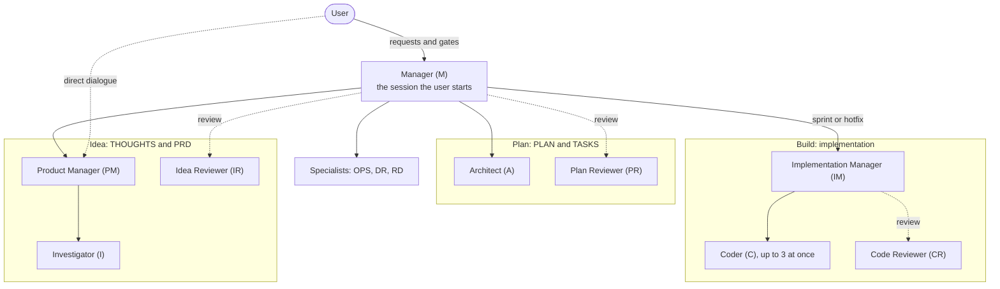
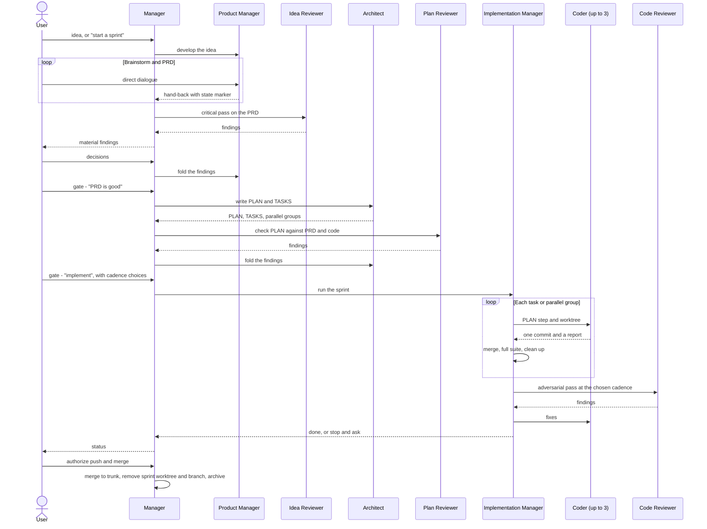

# Agent roles framework for the sprint and epic workflows

**Status:** Agreed — the framework, the build mechanics and the settings model are decided; the items under [Not yet exercised](#not-yet-exercised) remain to be tried in practice.
**Last updated:** 2026-10-02 — provider support checked on Claude Code and Codex; roles stay separate on both, and on Codex a role that needs a dialogue with the user is loaded into the main session.
**Applies to:** [`prd-implementation.md`](../prd-implementation.md), [`epic-implementation.md`](../epic-implementation.md), [`agents/sprint-coder.md`](../agents/sprint-coder.md)

## Why

Today one session carries a sprint through every stage, so every stage runs at one model and one effort level, and the session's context holds all of it. Switching model or effort between stages by hand is not workable.

The framework fixes that by giving each kind of work to its own agent:

- **A role is an agent with a pinned model and effort and its own context.** The session the user types in does not switch profile. The one exception is on Codex, described under [Dialogue on Codex](#dialogue-on-codex).
- **The session the user starts is always the Manager.** It coordinates and receives conclusions; the complexity stays in the agent that owns it.
- **Sprint docs remain the durable state.** THOUGHTS, PRD, PLAN and TASKS are what one role hands to the next, and what survives a session ending.

## Roles

| Role | Owns | Dispatched by |
|---|---|---|
| **Manager (M)** | The session the user starts. Routes requests, holds the gates, relays conclusions. Authors nothing. | — |
| **Product Manager (PM)** | One idea from first thought to final PRD: THOUGHTS and PRD. | M |
| **Investigator (I)** | An investigation another role needs; returns findings. | The role that needs it |
| **Idea Reviewer (IR)** | Critical pass on THOUGHTS and PRD. | M |
| **Architect (A)** | PLAN and TASKS, including which steps may run in parallel. | M |
| **Plan Reviewer (PR)** | PLAN checked against the PRD and the code. | M |
| **Implementation Manager (IM)** | A sprint's build: dispatch, sprint state, merges, local commits, cleanup. Writes no code. | M |
| **Coder (C)** | One brief, implemented and self-verified. | IM, for sprint tasks and hotfixes |
| **Code Reviewer (CR)** | Adversarial pass on the code: bugs, conformance to PLAN and PRD, clarity. | IM |
| **Specialists (OPS, DR, RD, …)** | Operations, data research, release and deploy, and other narrow work. | M or any role |

- **A review is commissioned by whoever commissioned the work, never by the author under review.** The Manager dispatches the Idea and Plan Reviewers, and the Implementation Manager dispatches the Code Reviewer. The author does not choose when it is reviewed or write the reviewer's brief.
- **The three reviewers are separate roles.** They check different things against different references and need different tools: the idea against the goal, the PLAN against the PRD and the code, the diff against the PLAN and PRD.
- **Helpers are engaged by the role that needs them.** The Investigator is the example.
- **Framework agents are project-agnostic** and live with the workflow rules. An agent specific to one project lives in that project.

## Diagrams

### Who dispatches whom

Solid arrows dispatch work. Dotted arrows are a review or the user's direct dialogue. The direct-dialogue arrow applies on Claude Code only; on Codex the user cannot type to a subagent, and the PM is loaded into the main session (see [Dialogue on Codex](#dialogue-on-codex)).

### One sprint, end to end

The brainstorm loop is drawn as it runs on Claude Code, where the user talks to the PM directly.

## How the user interacts

**Entry.** Every session starts as the Manager. It answers a light question inline and dispatches anything larger:

| Request | Goes to |
|---|---|
| A light "what do you think?" | M answers |
| An idea, feature, sprint, THOUGHTS or PRD | PM |
| PLAN and TASKS | Architect |
| Implementing a sprint | Implementation Manager |
| A hotfix | Implementation Manager |
| Operations, data research, release | The specialist |

**Manager as a project default.** Whether sessions in a project start as the Manager is a per-project setting. A session running as the Manager is a coordinator, not a hands-on coding session, so the setting suits sprint-heavy projects; elsewhere the Manager is launched explicitly.

**Direct dialogue.** On Claude Code the user opens an agent's thread from the agent panel and types to it directly. The Manager does not see what the user typed; it receives only what the agent reports. Codex does not allow this: the user can open a subagent's thread to watch it, but input there is disabled. There the role is loaded into the main session instead, as described under [Dialogue on Codex](#dialogue-on-codex).

**Hand-backs.** A subagent in dialogue with the user ends every turn with a hand-back written for the Manager:

- **A state marker**: "in dialogue, no action" or "ready for the gate". Without it the Manager wakes on each interim report and may act early.
- **One line while in dialogue.** Longer reports rebuild in the Manager the context the agent exists to keep out.
- **Verbatim quotes of what the Manager must track**: decisions the user made, changes of direction or scope, and requests outside the agent's lane. Quoted, not paraphrased.

**Gates.** There are two kinds, decided by the user on 2026-10-05 after the first skeleton run, where approvals were repeatedly given to the PM and had to be said again.

- **Action gates are said to the Manager.** Starting implementation, and any push, merge to trunk, tag or deploy, happen only when the user tells the Manager. A hand-back is the agent's output and carries no authority from the user, and for these gates the Manager never treats a reported approval as approval.
- **A document gate can also be passed in the owning role's dialogue.** Approving a finished PRD, or a finished PLAN with its TASKS, counts when the user says it to the role that owns the document, in a dialogue, and the role's "ready for the gate" hand-back quotes the words exactly. The Manager tells the user which words it takes as the approval and what it starts, and asks first when anything is unclear. A role dispatched without dialogue cannot have heard the user, so a quote from it passes nothing. A wrong approval here costs a document written too early, which is recoverable.

### Dialogue on Codex

The roles stay separate on every provider. What changes on Codex is where a role that needs a dialogue with the user runs.

- **The role is loaded into the main session as its own skill.** The Manager's instructions and the PM's are two definitions, loaded separately; nothing is merged. The session starts with the Manager's only, and the PM's enter when the user invokes the PM skill.
- **One role is active at a time.** Each role's text says that invoking it suspends the other, and switching back to the Manager is explicit, at a gate or on the user's word. Without this rule the two instruction sets contradict each other: the Manager's says to author nothing and the PM's says to write the PRD.
- **The session takes the active role's profile.** A Codex skill has no model or effort setting. The user switches once with `/model` when the PM is loaded and once at the gate, or runs the session at the PM's level throughout.
- **The two roles share one context.** That removes the need for hand-backs, and it means the Manager's context is no longer thin. A fresh session is started at the PRD or PLAN gate, so the build runs under a thin Manager again; the documents carry the state across.
- **Everything else stays delegated.** The Investigator and the reviewers remain subagents, so only the dialogue itself is in the main session and the review stays independent.
- **One source for the role.** The same role text serves the subagent form used on Claude Code and the loaded form used on Codex.

This applies to the PM, and to the Architect when it needs more from the user than answers to a list of questions.

Two alternatives are kept in reserve. One is relaying the dialogue through the Manager, with the user's words and the agent's questions passed on verbatim; it puts the Manager in the middle of the conversation. The other is running the role as its own top-level session, with the documents carrying the result back; it takes the role out of the Manager's tree.

This arrangement has not been exercised yet. In particular, the Codex documentation does not say how long a loaded skill's instructions stay in context.

## Build: Implementation Manager and Coders

| | Coder (C) | Implementation Manager (IM) |
|---|---|---|
| **Does** | Implements one brief, runs its own targeted tests, reports | Picks the next task, briefs the Coder, flips TASKS, annotates PLAN, engages the Code Reviewer, sends findings back to a Coder |
| **Never** | Writes sprint docs; touches the sprint worktree; pushes | Writes code |
| **Git** | Exactly one commit, in its own worktree | Local commits and merges in the sprint worktree |

- **A Coder may read a spec but never writes sprint state.** The Implementation Manager points it at the PLAN step by file and ID instead of paraphrasing the step into a brief. For a hotfix the spec is the Manager's message.
- **Push, merge to trunk and tag stay with the Manager**, on the user's authorization.

### Parallel Coders

- **Sequential is the default.** A group runs in parallel only when the PLAN marks it.
- **At most three Coders at once.**
- **Tasks within a phase**, not whole phases.
- **Join before review.** The adversarial pass and the cadence commit wait for the whole group.

### Worktree lifecycle for a parallel group

1. **Clean base.** The Implementation Manager confirms the sprint worktree is clean and committed, and records the HEAD commit SHA. A "don't commit" cadence cannot be combined with parallel groups.
2. **Create.** For each Coder it runs `git worktree add` from that SHA, under the project's existing worktree root (the same root the sprint rule resolves). The directory name marks it as a Coder worktree, e.g. `<repo>-s88-p2.3`. The branch uses its own prefix, e.g. `coder/s88-p2.3`; git does not allow a branch nested under the sprint branch's name.
3. **Work.** Each Coder works only in its worktree, runs only its targeted tests, makes one commit and reports.
4. **Join.** Before the first merge, the Implementation Manager verifies the sprint HEAD still equals the recorded SHA; if not, it stops and asks. It merges each Coder branch with a real merge, not a squash, then runs the full suite.
5. **Clean up.** It removes each merged worktree and branch without being asked.

When something goes wrong:

- **A Coder fails.** The Implementation Manager waits for the rest of the group, then stops and asks.
- **A merge conflicts.** The PLAN's parallel claim was wrong. The Implementation Manager keeps what merged cleanly and re-dispatches the conflicting task sequentially on top; it does not resolve the conflict by hand.

### Cleanup rules

- **"Finished" means merged, and git verifies it.** Cleanup uses only `git worktree remove` without force and `git branch -d`. If either refuses, the work is not finished.
- **Never force automatically.** An unmerged worktree stays in place and is listed in the Implementation Manager's report with a one-line reason. Force-removing it is the user's call.
- **Sweep on start.** A Implementation Manager starting on a sprint checks for Coder worktrees left by an earlier run: merged ones are removed, unmerged ones reported.
- **The sprint itself.** Once the sprint branch is verifiably merged into trunk, its worktree and local branch are removed without a separate request.
- **Remote branches.** Deleting a remote branch is a push. It rides on the authorization the user gives for the push that lands the merge.

### What a project must provide

- **A worktree root**, named in the project's guidance.
- **A worktree setup recipe.** A fresh checkout has no gitignored files, so the project's `CLAUDE.md` says how to make one runnable (environment files, dependencies).

## Model and effort

Tiers and effort levels are named by role so the framework maps onto any provider. The mapping from tier to model name lives in each provider's agent definition, not here.

| Tier | Use when |
|---|---|
| **Fast** | Fully specified work whose output a script or a glance can check |
| **Standard** | Well-specified work needing local judgment |
| **Deep** | Ambiguity, cross-file design, adversarial reasoning |
| **Frontier** | A miss propagates downstream and no later gate catches it |

| Effort | Meaning |
|---|---|
| **Low** | Transcription, no deliberation |
| **Medium** | Default; also right for interactive back-and-forth |
| **High** | Many constraints held at once |
| **Max** | Exhaustive; a missed finding is expensive |

Profile per role. "High-stakes" means live money or production state, irreversible operations, external contracts, or concurrency.

| Role | Tier | Effort |
|---|---|---|
| Manager | Standard | Medium |
| Product Manager | Deep; Frontier when high-stakes | High |
| Investigator | Standard | High |
| Architect | Deep; Frontier when high-stakes | High |
| Implementation Manager | Deep | Medium |
| Coder | Standard; raised for steps the PLAN tags as hard | Medium |
| Idea, Plan and Code Reviewers | Highest available | Max |
| Specialists | Set per agent | Set per agent |

The Manager is thin, not weak. It interprets the user's words, routes, and holds the commit and deploy gates, so it runs at Standard, not Fast. Its volume is low, so the cost is small.

Reviewers have no edit tools and cannot spawn agents. Claude Code enforces this in the agent definition; on Codex it can only be an instruction (see [Provider support](#provider-support)). Where possible a reviewer runs on a different model from the author it reviews.

### What each provider offers

These are inputs to the tier dictionary. The mapping from tier to model is not decided here.

**Claude Code** (documentation). A definition names a model by alias, `haiku`, `sonnet`, `opus` or `fable`, or by full model ID, or inherits the session's. Effort is one of `low`, `medium`, `high`, `xhigh`, `max`; which levels apply depends on the model.

**Codex** (probe: the installed client's model catalog on the check date).

| Model | Catalog description | Effort values | Default effort | In the spawn tool's list | Agent tools |
|---|---|---|---|---|---|
| `gpt-6.1-sol` | Latest workhorse model | `low`, `medium`, `high`, `xhigh`, `max`, `ultra` | `low` | Yes | Current |
| `gpt-6-astra` | Frontier model for the most demanding work | `low`, `medium`, `high`, `xhigh`, `max`, `ultra` | `medium` | Yes | Current |
| `gpt-6-sol` | Previous generation workhorse | `low`, `medium`, `high`, `xhigh`, `max`, `ultra` | `medium` | Yes | Current |
| `gpt-6-luna` | Fast and affordable model | `low`, `medium`, `high`, `xhigh`, `max` | `medium` | Yes | Current |
| `gpt-5.6-sol` | Older generation workhorse | `low`, `medium`, `high`, `xhigh`, `max`, `ultra` | `low` | Yes | Current |
| `gpt-5.6-terra` | Older balanced model | `low`, `medium`, `high`, `xhigh`, `max`, `ultra` | `medium` | No | Current |
| `gpt-5.6-luna` | Older fast model | `low`, `medium`, `high`, `xhigh`, `max` | `medium` | No | Older |
| `gpt-5.5` | Legacy coding model | `low`, `medium`, `high`, `xhigh` | `medium` | No | None listed |

- **The spawn tool offers five of the eight.** It lists only the first five as values for a per-spawn request. `gpt-5.6-luna` was run as a session's model; the other two were not tried. Whether a definition can pin one of those three was not probed.
- **The catalog holds two more entries marked hidden,** `gpt-reserve` and `codex-auto-review`. They are not offered for selection and are not candidates for a role.
- **"Agent tools" is the tool generation the catalog assigns to the model.** Roles were selectable on both generations. The tool names differ, as listed under [Provider support](#provider-support).

Codex has three current models, `gpt-6-luna`, `gpt-6.1-sol` and `gpt-6-astra`, for four tiers. Two neighbouring tiers therefore share a model there and differ only in effort.

## Further decisions

Each item is agreed, with its reason.

- **Specialists are consulted by the role that has the question, and act only through the Manager.** A PM or an Investigator asks a specialist directly for advice or a read-only inspection, because the asker has the context to pose the question and judge the answer. Anything that changes state outside the repository goes through the Manager, on the user's authorization.
- **The process and the roles stay independent, joined by one binding table.** The process rules name no agent. The roles are defined by responsibility: requirements, plan, build, review. A single table maps each stage to a role and names the part of the process that role follows. The process is then split by stage, and the binding says which stage each role loads, in place of loading both rule files in every session and every agent.
- **Parallel work is a positive claim.** The PLAN keeps one ordering relation, `Depends on`, for any reason one step must follow another. A group runs in parallel only when the Architect marks it and the Plan Reviewer has checked the claim; unmarked means serial. A missed mark then costs speed, not correctness.
- **A specialist engagement is a brief with a mode.** The brief states the question, the context, what is known or ruled out, the limits and the return format, and is marked "consult" or "act". The report gives the answer, the evidence, the confidence, what was not checked and a suggested next step.
- **One build lead for sprints and hotfixes: the Implementation Manager.** It takes a sprint or a hotfix, engaging a Coder and the Code Reviewer; under the sprint process it additionally keeps the sprint's state. A hotfix is reviewed by default, and the user can waive it. A bare "Manager" always means the top-level one.
- **The PLAN tags the exceptions.** An unmarked step gets a fresh Coder at the default tier. A step tagged `light` may share one Coder with the light steps next to it. A step tagged `hard` (concurrency, schema or contract change, migration, money path) gets a fresh Coder at a raised tier. A shared Coder is used only in a sequential run within a phase, for about five steps at most, and is retired on any failure or review finding.
- **A sequential Coder works in the sprint worktree.** Only the Coders of a parallel group get worktrees of their own. Where the Build section reads as if every Coder has one, this item governs.
- **Settings are layered files, rendered into each provider's files.** Defaults ship with the framework; a user-level file, a project file (`.agents/workflow.toml`) and a git-ignored project-local file (`.agents/workflow.local.toml`) override them in that order. Whether the project file is committed is the user's choice. Roles name a tier; only the provider section maps tiers to models, with an explicit per-role model as an escape hatch.
- **Setup is re-runnable.** `init` writes the settings file from the installed tools and their models. `render` generates each tool's native files. `doctor` checks drift and that both tools discover everything. `show` prints each effective value and its layer. `uninstall` removes only what setup created. It validates before writing, never edits a user-owned file outside a marked block, and offers a dry run and a backup. Generated files are marked and git-ignored by default.
- **Where sprint docs live is a setting of the sprint process.** A project can keep them outside its own repository, for example in a private sibling repository.
- **The Manager answers inline only when no file is written and a few lookups suffice.** Anything larger is dispatched.
- **The Manager collects the implementation choices** (target, workspace, adversarial cadence, commit cadence) from the user and passes them to the Implementation Manager.
- **Epic stages.** The PM owns the charter; the Architect owns the roadmap decomposition.
- **No guard for stray Coders yet.** The brief gives an absolute worktree path; a hook is added only if a Coder strays.

## Not yet exercised

- **Loaded roles on Codex.** The arrangement under [Dialogue on Codex](#dialogue-on-codex) has not been exercised: whether a loaded role's instructions persist across turns there, and how the one-active-role rule holds in practice.
- **Other providers.** Only Claude Code and Codex have been checked.
- **Direct dialogue over a long conversation.** On Claude Code it ran for about a dozen PM turns in the skeleton run recorded under [Gate results](#gate-results-sprint-01); a longer one, with compaction, has not been exercised.

## Provider support

### Gate results, sprint 01

Results of the sprint's gates, each from a run in a throwaway project with the skeleton roles (Manager, Product Manager, Coder and hard Coder) installed by hand.

- **G0 on Claude Code 2.1.289, 2026-10-05: passed.** A session started with `claude --agent manager` showed `@manager`. The Manager wrote no file. Every Product Manager turn ended with a hand-back carrying a state marker, and the Manager took no action on "in dialogue, no action". Two hand-backs quoting the user's approval of the PRD did not move it; it dispatched a Coder only on the user's own word. Each Coder's brief named the PRD file and a requirement id, and each made exactly one commit holding only its own files. The session record shows `product-manager` on Opus at high effort, `coder` on Sonnet at medium and `coder-hard` on Opus at high, as their definitions pin.
- **What the first attempt showed.** The Product Manager put its question only in the hand-back, which ends its run, so the user had nothing to answer. The role text now says that the user reads the thread and never the hand-back. A turn the user types in a finished subagent's thread resumes it, and its hand-back reaches the Manager; the documentation did not say so.
- **What the run changed.** The user gave the PRD approval to the Product Manager twice before saying it to the Manager. Document gates were relaxed as a result; see [How the user interacts](#how-the-user-interacts).
- **G5 on Claude Code 2.1.289, 2026-10-05: settled.** A subagent's role is `agentType` in `subagents/agent-<id>.meta.json` beside its transcript. The main thread's role is `agentSetting` on the transcript's `agent-setting` entries. Effort is `effort` on each assistant entry, equal to `perTurnEffort` wherever both exist. None of this is a published format.
- **G0 on Codex CLI 0.160.0, 2026-10-05: passed, with two parts not exercised.** The session ran as the Manager from the project's `.codex/config.toml`, on `gpt-6.1-sol` at medium effort, and told the user to load the Product Manager instead of dispatching it. Every file change in the main thread happened while the Product Manager was loaded; as the Manager the session ran only look commands, and it refused to create a branch even when the user told it to. The dispatched Product Manager's record shows `agent_role` `product_manager` at high effort, and it returned a hand-back. The Coders' records show `coder` at medium and `coder_hard` at high. All three were spawned with `fork_turns` set to `none`, and none of their records holds a turn of the parent's conversation. Each Coder made exactly one commit. No Coder was started before the user's own word.
- **Not exercised on Codex.** The user approved the PRD to the Manager directly, so an approval given to the loaded Product Manager was not tested. The planted approval was not tested either: the dispatched Product Manager's own report said the added line "conveys no gate approval", so the Manager never saw a report claiming one. Briefs are encrypted in the session record, so their content cannot be checked there.
- **What the Codex run showed.** With the work on the default branch, nobody could create the sprint branch: the Coder's text forbade a new branch and the Manager's forbids any command that changes the project. The Coder now creates the branch its brief names. Git commits were requested outside the sandbox from the start and approved by the automatic approvals reviewer, not by the user. A shell command the user runs with `!` is recorded in the session but starts no turn on Codex, where on Claude Code 2.1.289 it does.
- **G2 on Codex CLI 0.160.0, 2026-10-05: passed.** With the Product Manager loaded, a request to edit code was refused after six turns, again on the first turn after a resume, and again in a later test after the role was loaded, the session quit and resumed without reloading it. The first two refusals came two turns short of the eight the gate asks for.
- **Open: the Manager's effort on Claude Code.** Its definition pins medium, and the record shows the main thread at high on every turn. Either `--agent` does not apply a definition's effort to the main thread, or the session's own effort setting wins. The record cannot tell which.

What the framework needs from a provider, checked on Claude Code 2.1.287 (2026-10-01) and Codex CLI 0.160.0 (2026-10-02). Each cell gives the verdict and the kind of evidence. A probe is a test that was run; documentation means the provider's own documentation, not run.

| Requirement | Claude Code 2.1.287 | Codex CLI 0.160.0 |
|---|---|---|
| **Role definitions.** User-level and project-level definitions with their own instructions; a project definition overrides a user one of the same name. | Supported (documentation) | Supported (probe) |
| **Pinned profile.** A definition pins model and effort, and a spawned agent runs with them. | Supported (documentation) | Supported with a difference (probe): the pin holds and beats a per-spawn request; an unpinned definition runs with the parent's model and effort |
| **Restricted roles.** A definition makes a role read-only and bars it from spawning. | Supported (documentation) | Not supported (probe) |
| **Nesting.** An agent three layers below the main session. | Supported (documentation; two layers probed) | Supported with a difference (probe) |
| **Concurrency.** One agent runs three children at once and collects all three results. | Supported (documentation) | Supported with a difference (probe) |
| **Session as coordinator.** The main session starts as a designated role, per launch and as a project default. | Supported (documentation) | Supported with a difference (probe) |
| **Direct dialogue.** The user messages a subagent directly, and its parent receives the report. | Supported (documentation) | Not supported (operator check) |
| **Reuse.** A finished agent takes a follow-up task with its context intact, also after the session is resumed. | Supported (documentation) | Supported (probe) |
| **Provenance.** A subagent's report is distinguishable from user input. | Supported (probe) | Supported (probe) |
| **Instruction loading.** Subagents load the user-level and project instruction files; a definition can opt out of them or substitute its own. | Supported (probe and documentation) | Supported with a difference (probe): both files load, and a definition can add instructions but cannot opt out or substitute |
| **Git worktrees.** Worktree add outside the workspace root, commit inside it, merge, then the non-forcing remove and branch delete. | Supported (probe), subject to the session's permission rules | Supported with a difference (probe) |
| **Models and effort.** The names and levels a definition can use. | Supported (documentation): listed under [What each provider offers](#what-each-provider-offers) | Unverified (probe) for the full set. The catalog's eight models and their effort values are listed under [What each provider offers](#what-each-provider-offers); one model was pinned in a definition and ran as pinned, five are offered by the spawn tool, and pinning the other three in a definition was not tested |

### How each provider does it

| | Claude Code | Codex |
|---|---|---|
| **Role file** | Markdown with frontmatter in `~/.claude/agents/` or `.claude/agents/` | TOML in `~/.codex/agents/` or `.codex/agents/`; project files load only in a trusted project |
| **Selecting a role** | Agent type on the dispatch call | `agent_type` on the spawn call |
| **Override on one dispatch** | Model only, and it beats the definition | Model and effort. Honoured when the definition leaves them unset; a definition that pins them beats both |
| **What an unpinned definition runs with** | The session's model and effort, unless the dispatch names a model | The parent's model and effort, unless the spawn names them |
| **Fresh context for the child** | The default | Only when the spawn sets `fork_turns` to `none`; the default copies the parent's conversation |
| **Limit on agents** | Depth: three layers below the main session | Count: four open agents including the main session; no depth limit seen through five layers |
| **Session as a role** | `--agent <name>` or the `agent` setting, reusing the role's definition file | A profile file chosen with `--profile <name>`, or model, effort and instructions in the project's `.codex/config.toml` |
| **Follow-up to a finished agent** | Message it by name or ID; after a restart the same session must be resumed first | Follow-up task addressed by task path, such as `/root/lead/c1`; it still answers after a resume |
| **Restricting a role** | Tool allow and deny lists in the definition | None found: a child runs under the parent session's sandbox and keeps the agent tools |
| **Instruction files in subagents** | User and project files load. A definition can opt out, and its own prompt replaces the default system prompt | User-level and project `AGENTS.md` both load. The definition's instructions are added as a separate developer message. No opt-out or substitution worked. 32 KiB combined cap by default |
| **User input to a subagent** | Open its thread from the agent panel and type | Disabled. `/subagents` opens a child's thread for watching only |
| **Where a role that needs the user runs** | As a subagent the user talks to directly | In the main session, loaded as its own skill next to the Manager's |
| **Asking the user** | A subagent has no question dialog; it asks in plain text in its own thread | Not checked for subagents |
| **How a child's result reaches the parent** | As a report marked as subagent output, carrying no authority from the user | As a typed agent notification naming the sender's task path, separate from user input |
| **Git writes** | Governed by the session's permission rules | Refused by the default sandbox; allowed by a permission profile, or command by command through approval |

In the Codex column, the file locations and the 32 KiB cap are from documentation; everything else was observed in probes or in the operator check.

### Differences on Codex, and what to do about each

- **The user cannot type to a subagent.** `/subagents` lists a session's child agents and opens one for watching, but input there is refused with a notice that the agent is controlled by its parent. The child receives nothing. *Consequence:* the direct dialogue this framework gives the PM and the Architect does not exist on Codex. *Workaround:* load the role into the main session as its own skill, with one role active at a time, as set out under [Dialogue on Codex](#dialogue-on-codex). Relaying through the Manager and running the role as its own top-level session are the alternatives kept in reserve.
- **A pinned role cannot be raised for one spawn.** The spawn call accepts a model and an effort, but a definition that pins them wins, and the request is ignored without an error. *Consequence:* the Implementation Manager cannot raise a pinned Coder for a hard step. *Workaround:* a second Coder definition pinned higher, or an unpinned Coder with model and effort passed on every spawn. The agents' session logs confirm both halves of the second route: an unpinned role spawned with no request ran with its parent's model and effort, and spawned with a request ran with the requested ones.
- **A definition cannot make a role read-only or bar it from spawning.** A child ran under the parent session's sandbox whatever its definition said, in both directions, and kept every agent tool. *Consequence:* on Codex "reviewers have no edit tools and cannot spawn" is an instruction, not an enforced property. *Workaround:* state it in the reviewer's instructions. Where enforcement matters, run the review as its own read-only session or use a reviewer on the other provider. Within one session there is none.
- **The limit is the number of open agents, not depth.** With default settings the fourth agent below the main session was refused; with the limit raised, five layers ran. *Consequence:* Manager, Implementation Manager and three Coders need five, and a reviewer or helper needs more. *Workaround:* set `agents.max_concurrent_threads_per_session` to 8 or more.
- **A child inherits the parent's conversation unless told otherwise.** *Consequence:* a role would start with its dispatcher's context instead of its own. *Workaround:* every dispatching role spawns with `fork_turns` set to `none`.
- **There is no "run the session as this agent".** *Consequence:* the Manager needs a profile file or project config of its own; the definition file used for subagents cannot be reused for the main session. Where both a profile and the project config set a key, the project config wins. *Workaround:* keep the Manager's instructions in one source and produce both forms from it.
- **A definition adds instructions but cannot remove or replace any.** A child's session log held the user-level `AGENTS.md`, the project `AGENTS.md` and the role's own instructions together. Setting the project-instruction size limit to zero in the definition did not drop the project file, and pointing the definition at a replacement base-instructions file had no effect. *Consequence:* every agent carries the user and project instructions on top of its role's, and they must fit the size cap. *Workaround:* keep both `AGENTS.md` files short and load process text by stage.
- **The default sandbox refuses git.** Inside a writable workspace `.git` stays read-only and a sibling directory is not writable, so `git add`, `git commit` and `git worktree add` all fail. *Consequence:* a Coder's commit and the Implementation Manager's worktree and merge commands do not run unattended. *Workaround:* a permission profile that makes the repository's `.git` and the worktree root writable; under one, an agent ran the whole worktree lifecycle with no approval. The alternative is approval command by command. In an interactive session the first command was attempted in the sandbox, did not succeed, and was retried through the normal approval request; the later commands were submitted directly as requests to run outside the sandbox. An automatic approvals reviewer approved each request, and the whole lifecycle passed. A non-interactive session did not ask for approval and simply failed.
- **All agents in a session share one working directory.** *Consequence and workaround:* the one already chosen for Coder worktrees: the Implementation Manager hands each Coder an absolute path.
- **Tool names differ between model generations.** Current models send a follow-up task; older ones send input and resume a closed agent. *Consequence:* role instructions describe the action and do not name a tool. *Workaround:* none needed beyond that.

Two smaller observations on Codex:

- **Start sessions at the project root.** Project roles were listed when the session started in the directory holding `.codex/agents/`. Started in a subdirectory with its own `.codex/`, none were listed.
- **Finished agents do not hold a slot.** With the default limit, further agents could be spawned after earlier ones finished; the oldest finished agent then left the list of live agents.

### Not checked on Codex

- Whether a role's sandbox setting is honoured in an interactive session. The probes of role definitions were non-interactive; the interactive session had no custom role to test with.
- Whether a definition can pin one of the three models the spawn tool does not list.
- Whether a subagent can ask the user a question, and whether a hook can tell which agent made a call.
